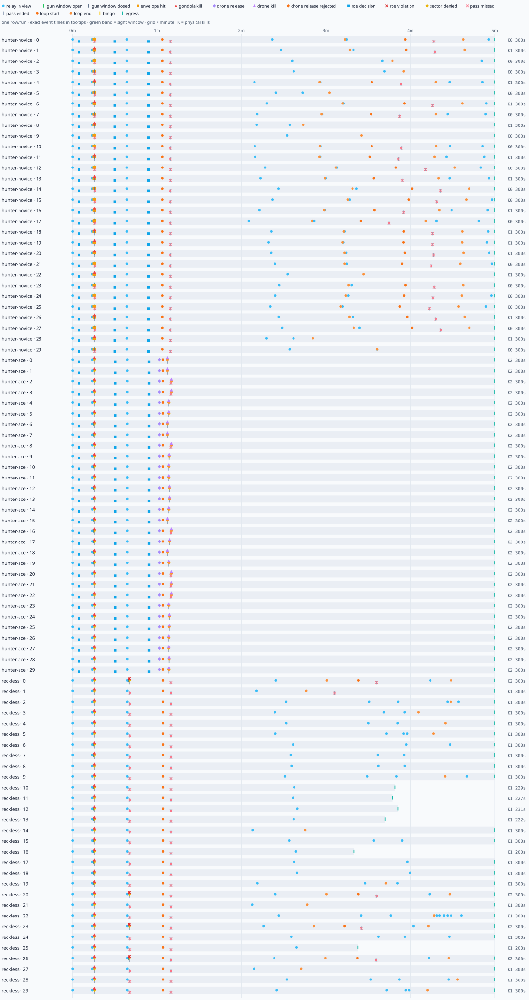

# Playtest Lab — beat 15

Generated 2026-10-16 · 90 runs · seed 0 · 26544.3s simulated · 170.3× wall speed

## Headline metrics vs targets

| pilot | first sight window mean (samples/missing) | ≤20s | longest gap (raw / loop-excluded) | ≤30s | hunt mean (ended/censored) | 4–6min | passes/physical kill | envelope-only | ROE decisions | physical/safe kills |
|---|---:|---:|---:|---:|---:|---:|---:|---:|---:|---:|---:|
| hunter-ace | 15.0s (10/20 miss) | 33% | 300.0s / 232.6s | no | 300.0s (30/0) | 100% | 1.00 | 0% | 90 | 60/60 |
| hunter-novice | 15.4s (30/0 miss) | 100% | 284.6s / 136.1s | no | 300.0s (30/0) | 100% | 6.31 | 21% | 90 | 13/13 |
| reckless | 19.1s (12/18 miss) | 33% | 300.0s / 137.6s | no | 283.8s (30/0) | 80% | 2.79 | 0% | 0 | 34/30 |

Gun window = instantaneous ballistic sight cue at ≤900 m, with a live selected gondola and an authorized loaded gun. This conservative cue is distinct from proximity, the dwell-qualified HUD cue and actual dispersed rounds hitting the gondola box.

## Fun verdict

Top three evidence-backed problems:

1. Sight-window drought: 90 of 90 runs exceeded 30s after excluding deliberate loops; raw worst gap was 300.0s. Compare the cue/proximity cross-check before attributing this entirely to mission pacing.
2. Zero-kill/failure runs: 17 completed hunts recorded no physical gondola/drone kill; inspect pass geometry and controller failure before assigning blame to mission pacing.

These are controller-observed experience proxies, not measured human feelings. Drought includes leading/trailing hunt edges; deliberate miss-and-loop intervals are reported separately when present. Drone releases and kills are counted only from the mission's public release and source-tagged gun engagement ledger.

### Outcome spread

| pilot | ≥1 denied / runs | all relays denied / runs | physical kills: runs | hunt end reasons |
|---|---:|---:|---|---|
| hunter-ace | 30/30 | 0/30 | 2: 30 | deadline: 30 |
| hunter-novice | 13/30 | 0/30 | 0: 17, 1: 13 | deadline: 30 |
| reckless | 30/30 | 0/30 | 1: 26, 2: 4 | deadline: 24, aircraft-lost: 6 |

### Flags

- gun-window drought >30s excluding deliberate loops: hunter-novice seed 0 (48.4s; raw 284.6s)
- gun-window drought >30s excluding deliberate loops: hunter-novice seed 1 (48.5s; raw 284.6s)
- no envelope-only teaching moment: hunter-novice seed 1
- gun-window drought >30s excluding deliberate loops: hunter-novice seed 2 (72.8s; raw 284.6s)
- gun-window drought >30s excluding deliberate loops: hunter-novice seed 3 (64.8s; raw 284.6s)
- gun-window drought >30s excluding deliberate loops: hunter-novice seed 4 (48.5s; raw 284.6s)
- no envelope-only teaching moment: hunter-novice seed 4
- gun-window drought >30s excluding deliberate loops: hunter-novice seed 5 (117.6s; raw 284.6s)
- gun-window drought >30s excluding deliberate loops: hunter-novice seed 6 (48.5s; raw 284.6s)
- no envelope-only teaching moment: hunter-novice seed 6
- gun-window drought >30s excluding deliberate loops: hunter-novice seed 7 (48.4s; raw 284.6s)
- gun-window drought >30s excluding deliberate loops: hunter-novice seed 8 (136.1s; raw 284.6s)
- no envelope-only teaching moment: hunter-novice seed 8
- gun-window drought >30s excluding deliberate loops: hunter-novice seed 9 (94.7s; raw 284.6s)
- gun-window drought >30s excluding deliberate loops: hunter-novice seed 10 (48.4s; raw 284.6s)
- gun-window drought >30s excluding deliberate loops: hunter-novice seed 11 (48.5s; raw 284.6s)
- no envelope-only teaching moment: hunter-novice seed 11
- gun-window drought >30s excluding deliberate loops: hunter-novice seed 12 (48.5s; raw 284.6s)
- gun-window drought >30s excluding deliberate loops: hunter-novice seed 13 (48.5s; raw 284.6s)
- no envelope-only teaching moment: hunter-novice seed 13
- gun-window drought >30s excluding deliberate loops: hunter-novice seed 14 (48.4s; raw 284.6s)
- gun-window drought >30s excluding deliberate loops: hunter-novice seed 15 (48.5s; raw 284.6s)
- gun-window drought >30s excluding deliberate loops: hunter-novice seed 16 (48.5s; raw 284.6s)
- no envelope-only teaching moment: hunter-novice seed 16
- gun-window drought >30s excluding deliberate loops: hunter-novice seed 17 (49.1s; raw 284.6s)
- gun-window drought >30s excluding deliberate loops: hunter-novice seed 18 (48.5s; raw 284.6s)
- no envelope-only teaching moment: hunter-novice seed 18
- gun-window drought >30s excluding deliberate loops: hunter-novice seed 19 (48.5s; raw 284.6s)
- no envelope-only teaching moment: hunter-novice seed 19
- gun-window drought >30s excluding deliberate loops: hunter-novice seed 20 (48.5s; raw 284.6s)
- no envelope-only teaching moment: hunter-novice seed 20
- gun-window drought >30s excluding deliberate loops: hunter-novice seed 21 (48.5s; raw 284.6s)
- gun-window drought >30s excluding deliberate loops: hunter-novice seed 22 (93.3s; raw 284.6s)
- no envelope-only teaching moment: hunter-novice seed 22
- gun-window drought >30s excluding deliberate loops: hunter-novice seed 23 (48.5s; raw 284.6s)
- gun-window drought >30s excluding deliberate loops: hunter-novice seed 24 (48.4s; raw 284.6s)
- gun-window drought >30s excluding deliberate loops: hunter-novice seed 25 (48.5s; raw 284.6s)
- gun-window drought >30s excluding deliberate loops: hunter-novice seed 26 (48.5s; raw 284.6s)
- no envelope-only teaching moment: hunter-novice seed 26
- gun-window drought >30s excluding deliberate loops: hunter-novice seed 27 (48.5s; raw 284.6s)
- gun-window drought >30s excluding deliberate loops: hunter-novice seed 28 (129.3s; raw 284.6s)
- no envelope-only teaching moment: hunter-novice seed 28
- gun-window drought >30s excluding deliberate loops: hunter-novice seed 29 (83.5s; raw 284.6s)
- first gun window >20s/missing: hunter-ace seed 0 (missing)
- gun-window drought >30s excluding deliberate loops: hunter-ace seed 0 (232.6s; raw 300.0s)
- no envelope-only teaching moment: hunter-ace seed 0
- first gun window >20s/missing: hunter-ace seed 1 (missing)
- gun-window drought >30s excluding deliberate loops: hunter-ace seed 1 (232.6s; raw 300.0s)
- no envelope-only teaching moment: hunter-ace seed 1
- first gun window >20s/missing: hunter-ace seed 2 (missing)
- gun-window drought >30s excluding deliberate loops: hunter-ace seed 2 (229.9s; raw 300.0s)
- no envelope-only teaching moment: hunter-ace seed 2
- first gun window >20s/missing: hunter-ace seed 3 (missing)
- gun-window drought >30s excluding deliberate loops: hunter-ace seed 3 (229.9s; raw 300.0s)
- no envelope-only teaching moment: hunter-ace seed 3
- first gun window >20s/missing: hunter-ace seed 4 (missing)
- gun-window drought >30s excluding deliberate loops: hunter-ace seed 4 (231.7s; raw 300.0s)
- no envelope-only teaching moment: hunter-ace seed 4
- first gun window >20s/missing: hunter-ace seed 5 (missing)
- gun-window drought >30s excluding deliberate loops: hunter-ace seed 5 (231.7s; raw 300.0s)
- no envelope-only teaching moment: hunter-ace seed 5
- gun-window drought >30s excluding deliberate loops: hunter-ace seed 6 (232.6s; raw 285.0s)
- no envelope-only teaching moment: hunter-ace seed 6
- gun-window drought >30s excluding deliberate loops: hunter-ace seed 7 (232.6s; raw 285.0s)
- no envelope-only teaching moment: hunter-ace seed 7
- first gun window >20s/missing: hunter-ace seed 8 (missing)
- gun-window drought >30s excluding deliberate loops: hunter-ace seed 8 (229.9s; raw 300.0s)
- no envelope-only teaching moment: hunter-ace seed 8
- first gun window >20s/missing: hunter-ace seed 9 (missing)
- gun-window drought >30s excluding deliberate loops: hunter-ace seed 9 (231.4s; raw 300.0s)
- no envelope-only teaching moment: hunter-ace seed 9
- gun-window drought >30s excluding deliberate loops: hunter-ace seed 10 (231.7s; raw 285.0s)
- no envelope-only teaching moment: hunter-ace seed 10
- first gun window >20s/missing: hunter-ace seed 11 (missing)
- gun-window drought >30s excluding deliberate loops: hunter-ace seed 11 (231.7s; raw 300.0s)
- no envelope-only teaching moment: hunter-ace seed 11
- gun-window drought >30s excluding deliberate loops: hunter-ace seed 12 (231.2s; raw 285.0s)
- no envelope-only teaching moment: hunter-ace seed 12
- gun-window drought >30s excluding deliberate loops: hunter-ace seed 13 (231.1s; raw 285.0s)
- no envelope-only teaching moment: hunter-ace seed 13
- first gun window >20s/missing: hunter-ace seed 14 (missing)
- gun-window drought >30s excluding deliberate loops: hunter-ace seed 14 (231.7s; raw 300.0s)
- no envelope-only teaching moment: hunter-ace seed 14
- gun-window drought >30s excluding deliberate loops: hunter-ace seed 15 (232.6s; raw 285.0s)
- no envelope-only teaching moment: hunter-ace seed 15
- gun-window drought >30s excluding deliberate loops: hunter-ace seed 16 (229.9s; raw 285.0s)
- no envelope-only teaching moment: hunter-ace seed 16
- gun-window drought >30s excluding deliberate loops: hunter-ace seed 17 (231.1s; raw 285.0s)
- no envelope-only teaching moment: hunter-ace seed 17
- gun-window drought >30s excluding deliberate loops: hunter-ace seed 18 (232.6s; raw 285.0s)
- no envelope-only teaching moment: hunter-ace seed 18
- gun-window drought >30s excluding deliberate loops: hunter-ace seed 19 (231.7s; raw 285.0s)
- no envelope-only teaching moment: hunter-ace seed 19
- first gun window >20s/missing: hunter-ace seed 20 (missing)
- gun-window drought >30s excluding deliberate loops: hunter-ace seed 20 (229.9s; raw 300.0s)
- no envelope-only teaching moment: hunter-ace seed 20
- first gun window >20s/missing: hunter-ace seed 21 (missing)
- gun-window drought >30s excluding deliberate loops: hunter-ace seed 21 (229.9s; raw 300.0s)
- no envelope-only teaching moment: hunter-ace seed 21
- first gun window >20s/missing: hunter-ace seed 22 (missing)
- gun-window drought >30s excluding deliberate loops: hunter-ace seed 22 (229.9s; raw 300.0s)
- no envelope-only teaching moment: hunter-ace seed 22
- first gun window >20s/missing: hunter-ace seed 23 (missing)
- gun-window drought >30s excluding deliberate loops: hunter-ace seed 23 (231.7s; raw 300.0s)
- no envelope-only teaching moment: hunter-ace seed 23
- first gun window >20s/missing: hunter-ace seed 24 (missing)
- gun-window drought >30s excluding deliberate loops: hunter-ace seed 24 (231.3s; raw 300.0s)
- no envelope-only teaching moment: hunter-ace seed 24
- first gun window >20s/missing: hunter-ace seed 25 (missing)
- gun-window drought >30s excluding deliberate loops: hunter-ace seed 25 (231.4s; raw 300.0s)
- no envelope-only teaching moment: hunter-ace seed 25
- first gun window >20s/missing: hunter-ace seed 26 (missing)
- gun-window drought >30s excluding deliberate loops: hunter-ace seed 26 (231.7s; raw 300.0s)
- no envelope-only teaching moment: hunter-ace seed 26
- first gun window >20s/missing: hunter-ace seed 27 (missing)
- gun-window drought >30s excluding deliberate loops: hunter-ace seed 27 (231.7s; raw 300.0s)
- no envelope-only teaching moment: hunter-ace seed 27
- first gun window >20s/missing: hunter-ace seed 28 (missing)
- gun-window drought >30s excluding deliberate loops: hunter-ace seed 28 (231.5s; raw 300.0s)
- no envelope-only teaching moment: hunter-ace seed 28
- first gun window >20s/missing: hunter-ace seed 29 (missing)
- gun-window drought >30s excluding deliberate loops: hunter-ace seed 29 (231.6s; raw 300.0s)
- no envelope-only teaching moment: hunter-ace seed 29
- first gun window >20s/missing: reckless seed 0 (39.9s)
- gun-window drought >30s excluding deliberate loops: reckless seed 0 (39.9s; raw 260.1s)
- no envelope-only teaching moment: reckless seed 0
- first gun window >20s/missing: reckless seed 1 (missing)
- gun-window drought >30s excluding deliberate loops: reckless seed 1 (134.1s; raw 300.0s)
- no envelope-only teaching moment: reckless seed 1
- first gun window >20s/missing: reckless seed 2 (missing)
- gun-window drought >30s excluding deliberate loops: reckless seed 2 (64.3s; raw 300.0s)
- no envelope-only teaching moment: reckless seed 2
- first gun window >20s/missing: reckless seed 3 (missing)
- gun-window drought >30s excluding deliberate loops: reckless seed 3 (64.3s; raw 300.0s)
- no envelope-only teaching moment: reckless seed 3
- first gun window >20s/missing: reckless seed 4 (missing)
- gun-window drought >30s excluding deliberate loops: reckless seed 4 (64.3s; raw 300.0s)
- no envelope-only teaching moment: reckless seed 4
- first gun window >20s/missing: reckless seed 5 (missing)
- gun-window drought >30s excluding deliberate loops: reckless seed 5 (64.3s; raw 300.0s)
- no envelope-only teaching moment: reckless seed 5
- gun-window drought >30s excluding deliberate loops: reckless seed 6 (49.3s; raw 285.0s)
- no envelope-only teaching moment: reckless seed 6
- gun-window drought >30s excluding deliberate loops: reckless seed 7 (49.3s; raw 285.0s)
- no envelope-only teaching moment: reckless seed 7
- first gun window >20s/missing: reckless seed 8 (missing)
- gun-window drought >30s excluding deliberate loops: reckless seed 8 (64.3s; raw 300.0s)
- no envelope-only teaching moment: reckless seed 8
- first gun window >20s/missing: reckless seed 9 (missing)
- gun-window drought >30s excluding deliberate loops: reckless seed 9 (64.3s; raw 300.0s)
- no envelope-only teaching moment: reckless seed 9
- gun-window drought >30s excluding deliberate loops: reckless seed 10 (49.3s; raw 214.1s)
- hunt outside 4–6min: reckless seed 10 (229.2s)
- no envelope-only teaching moment: reckless seed 10
- first gun window >20s/missing: reckless seed 11 (missing)
- gun-window drought >30s excluding deliberate loops: reckless seed 11 (64.3s; raw 227.5s)
- hunt outside 4–6min: reckless seed 11 (227.5s)
- no envelope-only teaching moment: reckless seed 11
- gun-window drought >30s excluding deliberate loops: reckless seed 12 (49.3s; raw 216.2s)
- hunt outside 4–6min: reckless seed 12 (231.2s)
- no envelope-only teaching moment: reckless seed 12
- gun-window drought >30s excluding deliberate loops: reckless seed 13 (49.3s; raw 207.0s)
- hunt outside 4–6min: reckless seed 13 (222.0s)
- no envelope-only teaching moment: reckless seed 13
- first gun window >20s/missing: reckless seed 14 (missing)
- gun-window drought >30s excluding deliberate loops: reckless seed 14 (134.8s; raw 300.0s)
- no envelope-only teaching moment: reckless seed 14
- gun-window drought >30s excluding deliberate loops: reckless seed 15 (49.3s; raw 285.0s)
- no envelope-only teaching moment: reckless seed 15
- gun-window drought >30s excluding deliberate loops: reckless seed 16 (49.3s; raw 185.0s)
- hunt outside 4–6min: reckless seed 16 (200.1s)
- no envelope-only teaching moment: reckless seed 16
- gun-window drought >30s excluding deliberate loops: reckless seed 17 (49.3s; raw 285.0s)
- no envelope-only teaching moment: reckless seed 17
- gun-window drought >30s excluding deliberate loops: reckless seed 18 (49.3s; raw 285.0s)
- no envelope-only teaching moment: reckless seed 18
- gun-window drought >30s excluding deliberate loops: reckless seed 19 (77.5s; raw 285.0s)
- no envelope-only teaching moment: reckless seed 19
- first gun window >20s/missing: reckless seed 20 (missing)
- gun-window drought >30s excluding deliberate loops: reckless seed 20 (64.3s; raw 300.0s)
- no envelope-only teaching moment: reckless seed 20
- first gun window >20s/missing: reckless seed 21 (missing)
- gun-window drought >30s excluding deliberate loops: reckless seed 21 (133.4s; raw 300.0s)
- no envelope-only teaching moment: reckless seed 21
- first gun window >20s/missing: reckless seed 22 (missing)
- gun-window drought >30s excluding deliberate loops: reckless seed 22 (64.3s; raw 300.0s)
- no envelope-only teaching moment: reckless seed 22
- first gun window >20s/missing: reckless seed 23 (missing)
- gun-window drought >30s excluding deliberate loops: reckless seed 23 (64.3s; raw 300.0s)
- no envelope-only teaching moment: reckless seed 23
- first gun window >20s/missing: reckless seed 24 (missing)
- gun-window drought >30s excluding deliberate loops: reckless seed 24 (64.3s; raw 300.0s)
- no envelope-only teaching moment: reckless seed 24
- first gun window >20s/missing: reckless seed 25 (missing)
- gun-window drought >30s excluding deliberate loops: reckless seed 25 (64.3s; raw 202.8s)
- hunt outside 4–6min: reckless seed 25 (202.8s)
- no envelope-only teaching moment: reckless seed 25
- first gun window >20s/missing: reckless seed 26 (39.9s)
- gun-window drought >30s excluding deliberate loops: reckless seed 26 (39.9s; raw 260.1s)
- no envelope-only teaching moment: reckless seed 26
- first gun window >20s/missing: reckless seed 27 (missing)
- gun-window drought >30s excluding deliberate loops: reckless seed 27 (137.6s; raw 300.0s)
- no envelope-only teaching moment: reckless seed 27
- first gun window >20s/missing: reckless seed 28 (missing)
- gun-window drought >30s excluding deliberate loops: reckless seed 28 (64.3s; raw 300.0s)
- no envelope-only teaching moment: reckless seed 28
- first gun window >20s/missing: reckless seed 29 (missing)
- gun-window drought >30s excluding deliberate loops: reckless seed 29 (64.3s; raw 300.0s)
- no envelope-only teaching moment: reckless seed 29

### Proximity, cue and hit cross-check

| pilot | first ≤900 m mean / missing | instantaneous cue seconds | qualified HUD cue seconds | physical kills |
|---|---:|---:|---:|---:|
| hunter-ace | 15.0s / 0 | 0.292 | 0.000 | 60 |
| hunter-novice | 14.9s / 0 | 0.658 | 0.000 | 13 |
| reckless | 15.0s / 0 | 0.350 | 0.000 | 34 |

### Opportunities/events by minute

| pilot | minute | sight-window s | relay | opens/closes | envelope | kills | ROE decisions | ROE violations | denied/missed |
|---|---:|---:|---:|---:|---:|---:|---:|---:|---:|
| hunter-ace | 0 | 0.292 | 90 | 10/10 | 0 | 30 | 90 | 0 | 30/0 |
| hunter-novice | 0 | 0.658 | 90 | 30/30 | 1648 | 13 | 90 | 0 | 13/17 |
| reckless | 0 | 0.350 | 90 | 12/12 | 0 | 34 | 0 | 4 | 34/26 |
| hunter-ace | 1 | 0.000 | 0 | 0/0 | 0 | 30 | 0 | 0 | 30/7 |
| hunter-novice | 1 | 0.000 | 0 | 0/0 | 0 | 0 | 0 | 0 | 0/30 |
| reckless | 1 | 0.000 | 0 | 0/0 | 0 | 0 | 0 | 0 | 0/30 |
| hunter-ace | 2 | 0.000 | 0 | 0/0 | 0 | 0 | 0 | 0 | 0/0 |
| hunter-novice | 2 | 0.000 | 40 | 0/0 | 0 | 0 | 0 | 0 | 0/0 |
| reckless | 2 | 0.000 | 30 | 0/0 | 0 | 0 | 0 | 0 | 0/0 |
| hunter-ace | 3 | 0.000 | 0 | 0/0 | 0 | 0 | 0 | 0 | 0/0 |
| hunter-novice | 3 | 0.000 | 18 | 0/0 | 0 | 0 | 0 | 0 | 0/7 |
| reckless | 3 | 0.000 | 31 | 0/0 | 0 | 0 | 0 | 0 | 0/5 |
| hunter-ace | 4 | 0.000 | 0 | 0/0 | 0 | 0 | 0 | 0 | 0/0 |
| hunter-novice | 4 | 0.000 | 25 | 0/0 | 0 | 0 | 0 | 0 | 0/15 |
| reckless | 4 | 0.000 | 16 | 0/0 | 0 | 0 | 0 | 0 | 0/0 |
| hunter-ace | 5 | 0.000 | 0 | 0/0 | 0 | 0 | 0 | 0 | 0/0 |
| hunter-novice | 5 | 0.000 | 0 | 0/0 | 0 | 0 | 0 | 0 | 0/0 |
| reckless | 5 | 0.000 | 0 | 0/0 | 0 | 0 | 0 | 0 | 0/0 |

### Per-run Pathfinder metrics

| pilot | seed | first window | longest gap | hunt s | censored | passes | envelope-only | physical/safe kills | drone attempts/releases/rejected | ROE decisions/violations |
|---|---:|---:|---:|---:|---|---:|---:|---:|---:|---:|
| hunter-novice | 0 | 15.4 | 284.6 | 300.0 | no | 3 | 1 | 0/0 | 0/0/0 | 3/0 |
| hunter-novice | 1 | 15.3 | 284.6 | 300.0 | no | 3 | 0 | 1/1 | 0/0/0 | 3/0 |
| hunter-novice | 2 | 15.4 | 284.6 | 300.0 | no | 2 | 1 | 0/0 | 0/0/0 | 3/0 |
| hunter-novice | 3 | 15.4 | 284.6 | 300.0 | no | 2 | 1 | 0/0 | 0/0/0 | 3/0 |
| hunter-novice | 4 | 15.4 | 284.6 | 300.0 | no | 3 | 0 | 1/1 | 0/0/0 | 3/0 |
| hunter-novice | 5 | 15.4 | 284.6 | 300.0 | no | 2 | 1 | 0/0 | 0/0/0 | 3/0 |
| hunter-novice | 6 | 15.4 | 284.6 | 300.0 | no | 3 | 0 | 1/1 | 0/0/0 | 3/0 |
| hunter-novice | 7 | 15.4 | 284.6 | 300.0 | no | 3 | 1 | 0/0 | 0/0/0 | 3/0 |
| hunter-novice | 8 | 15.4 | 284.6 | 300.0 | no | 2 | 0 | 1/1 | 0/0/0 | 3/0 |
| hunter-novice | 9 | 15.4 | 284.6 | 300.0 | no | 2 | 1 | 0/0 | 0/0/0 | 3/0 |
| hunter-novice | 10 | 15.4 | 284.6 | 300.0 | no | 3 | 1 | 0/0 | 0/0/0 | 3/0 |
| hunter-novice | 11 | 15.4 | 284.6 | 300.0 | no | 3 | 0 | 1/1 | 0/0/0 | 3/0 |
| hunter-novice | 12 | 15.4 | 284.6 | 300.0 | no | 3 | 1 | 0/0 | 0/0/0 | 3/0 |
| hunter-novice | 13 | 15.4 | 284.6 | 300.0 | no | 3 | 0 | 1/1 | 0/0/0 | 3/0 |
| hunter-novice | 14 | 15.4 | 284.6 | 300.0 | no | 3 | 1 | 0/0 | 0/0/0 | 3/0 |
| hunter-novice | 15 | 15.4 | 284.6 | 300.0 | no | 3 | 1 | 0/0 | 0/0/0 | 3/0 |
| hunter-novice | 16 | 15.3 | 284.6 | 300.0 | no | 3 | 0 | 1/1 | 0/0/0 | 3/0 |
| hunter-novice | 17 | 15.4 | 284.6 | 300.0 | no | 3 | 1 | 0/0 | 0/0/0 | 3/0 |
| hunter-novice | 18 | 15.4 | 284.6 | 300.0 | no | 3 | 0 | 1/1 | 0/0/0 | 3/0 |
| hunter-novice | 19 | 15.4 | 284.6 | 300.0 | no | 3 | 0 | 1/1 | 0/0/0 | 3/0 |
| hunter-novice | 20 | 15.3 | 284.6 | 300.0 | no | 3 | 0 | 1/1 | 0/0/0 | 3/0 |
| hunter-novice | 21 | 15.4 | 284.6 | 300.0 | no | 3 | 1 | 0/0 | 0/0/0 | 3/0 |
| hunter-novice | 22 | 15.4 | 284.6 | 300.0 | no | 2 | 0 | 1/1 | 0/0/0 | 3/0 |
| hunter-novice | 23 | 15.4 | 284.6 | 300.0 | no | 3 | 1 | 0/0 | 0/0/0 | 3/0 |
| hunter-novice | 24 | 15.4 | 284.6 | 300.0 | no | 3 | 1 | 0/0 | 0/0/0 | 3/0 |
| hunter-novice | 25 | 15.4 | 284.6 | 300.0 | no | 3 | 1 | 0/0 | 0/0/0 | 3/0 |
| hunter-novice | 26 | 15.4 | 284.6 | 300.0 | no | 3 | 0 | 1/1 | 0/0/0 | 3/0 |
| hunter-novice | 27 | 15.4 | 284.6 | 300.0 | no | 3 | 1 | 0/0 | 0/0/0 | 3/0 |
| hunter-novice | 28 | 15.4 | 284.6 | 300.0 | no | 2 | 0 | 1/1 | 0/0/0 | 3/0 |
| hunter-novice | 29 | 15.4 | 284.6 | 300.0 | no | 2 | 1 | 0/0 | 0/0/0 | 3/0 |
| hunter-ace | 0 | — | 300.0 | 300.0 | no | 2 | 0 | 2/2 | 1/1/0 | 3/0 |
| hunter-ace | 1 | — | 300.0 | 300.0 | no | 2 | 0 | 2/2 | 1/1/0 | 3/0 |
| hunter-ace | 2 | — | 300.0 | 300.0 | no | 2 | 0 | 2/2 | 1/1/0 | 3/0 |
| hunter-ace | 3 | — | 300.0 | 300.0 | no | 2 | 0 | 2/2 | 1/1/0 | 3/0 |
| hunter-ace | 4 | — | 300.0 | 300.0 | no | 2 | 0 | 2/2 | 1/1/0 | 3/0 |
| hunter-ace | 5 | — | 300.0 | 300.0 | no | 2 | 0 | 2/2 | 1/1/0 | 3/0 |
| hunter-ace | 6 | 15.0 | 285.0 | 300.0 | no | 2 | 0 | 2/2 | 1/1/0 | 3/0 |
| hunter-ace | 7 | 15.0 | 285.0 | 300.0 | no | 2 | 0 | 2/2 | 1/1/0 | 3/0 |
| hunter-ace | 8 | — | 300.0 | 300.0 | no | 2 | 0 | 2/2 | 1/1/0 | 3/0 |
| hunter-ace | 9 | — | 300.0 | 300.0 | no | 2 | 0 | 2/2 | 1/1/0 | 3/0 |
| hunter-ace | 10 | 15.0 | 285.0 | 300.0 | no | 2 | 0 | 2/2 | 1/1/0 | 3/0 |
| hunter-ace | 11 | — | 300.0 | 300.0 | no | 2 | 0 | 2/2 | 1/1/0 | 3/0 |
| hunter-ace | 12 | 15.0 | 285.0 | 300.0 | no | 2 | 0 | 2/2 | 1/1/0 | 3/0 |
| hunter-ace | 13 | 15.0 | 285.0 | 300.0 | no | 2 | 0 | 2/2 | 1/1/0 | 3/0 |
| hunter-ace | 14 | — | 300.0 | 300.0 | no | 2 | 0 | 2/2 | 1/1/0 | 3/0 |
| hunter-ace | 15 | 15.0 | 285.0 | 300.0 | no | 2 | 0 | 2/2 | 1/1/0 | 3/0 |
| hunter-ace | 16 | 15.0 | 285.0 | 300.0 | no | 2 | 0 | 2/2 | 1/1/0 | 3/0 |
| hunter-ace | 17 | 15.0 | 285.0 | 300.0 | no | 2 | 0 | 2/2 | 1/1/0 | 3/0 |
| hunter-ace | 18 | 15.0 | 285.0 | 300.0 | no | 2 | 0 | 2/2 | 1/1/0 | 3/0 |
| hunter-ace | 19 | 15.0 | 285.0 | 300.0 | no | 2 | 0 | 2/2 | 1/1/0 | 3/0 |
| hunter-ace | 20 | — | 300.0 | 300.0 | no | 2 | 0 | 2/2 | 1/1/0 | 3/0 |
| hunter-ace | 21 | — | 300.0 | 300.0 | no | 2 | 0 | 2/2 | 1/1/0 | 3/0 |
| hunter-ace | 22 | — | 300.0 | 300.0 | no | 2 | 0 | 2/2 | 1/1/0 | 3/0 |
| hunter-ace | 23 | — | 300.0 | 300.0 | no | 2 | 0 | 2/2 | 1/1/0 | 3/0 |
| hunter-ace | 24 | — | 300.0 | 300.0 | no | 2 | 0 | 2/2 | 1/1/0 | 3/0 |
| hunter-ace | 25 | — | 300.0 | 300.0 | no | 2 | 0 | 2/2 | 1/1/0 | 3/0 |
| hunter-ace | 26 | — | 300.0 | 300.0 | no | 2 | 0 | 2/2 | 1/1/0 | 3/0 |
| hunter-ace | 27 | — | 300.0 | 300.0 | no | 2 | 0 | 2/2 | 1/1/0 | 3/0 |
| hunter-ace | 28 | — | 300.0 | 300.0 | no | 2 | 0 | 2/2 | 1/1/0 | 3/0 |
| hunter-ace | 29 | — | 300.0 | 300.0 | no | 2 | 0 | 2/2 | 1/1/0 | 3/0 |
| reckless | 0 | 39.9 | 260.1 | 300.0 | no | 4 | 0 | 2/1 | 0/0/0 | 0/1 |
| reckless | 1 | — | 300.0 | 300.0 | no | 4 | 0 | 1/1 | 0/0/0 | 0/0 |
| reckless | 2 | — | 300.0 | 300.0 | no | 3 | 0 | 1/1 | 0/0/0 | 0/0 |
| reckless | 3 | — | 300.0 | 300.0 | no | 3 | 0 | 1/1 | 0/0/0 | 0/0 |
| reckless | 4 | — | 300.0 | 300.0 | no | 3 | 0 | 1/1 | 0/0/0 | 0/0 |
| reckless | 5 | — | 300.0 | 300.0 | no | 3 | 0 | 1/1 | 0/0/0 | 0/0 |
| reckless | 6 | 15.0 | 285.0 | 300.0 | no | 3 | 0 | 1/1 | 0/0/0 | 0/0 |
| reckless | 7 | 15.0 | 285.0 | 300.0 | no | 3 | 0 | 1/1 | 0/0/0 | 0/0 |
| reckless | 8 | — | 300.0 | 300.0 | no | 3 | 0 | 1/1 | 0/0/0 | 0/0 |
| reckless | 9 | — | 300.0 | 300.0 | no | 3 | 0 | 1/1 | 0/0/0 | 0/0 |
| reckless | 10 | 15.0 | 214.1 | 229.2 | no | 3 | 0 | 1/1 | 0/0/0 | 0/0 |
| reckless | 11 | — | 227.5 | 227.5 | no | 3 | 0 | 1/1 | 0/0/0 | 0/0 |
| reckless | 12 | 15.0 | 216.2 | 231.2 | no | 3 | 0 | 1/1 | 0/0/0 | 0/0 |
| reckless | 13 | 15.0 | 207.0 | 222.0 | no | 3 | 0 | 1/1 | 0/0/0 | 0/0 |
| reckless | 14 | — | 300.0 | 300.0 | no | 3 | 0 | 1/1 | 0/0/0 | 0/0 |
| reckless | 15 | 15.0 | 285.0 | 300.0 | no | 3 | 0 | 1/1 | 0/0/0 | 0/0 |
| reckless | 16 | 15.0 | 185.0 | 200.1 | no | 3 | 0 | 1/1 | 0/0/0 | 0/0 |
| reckless | 17 | 15.0 | 285.0 | 300.0 | no | 3 | 0 | 1/1 | 0/0/0 | 0/0 |
| reckless | 18 | 15.0 | 285.0 | 300.0 | no | 3 | 0 | 1/1 | 0/0/0 | 0/0 |
| reckless | 19 | 15.0 | 285.0 | 300.0 | no | 3 | 0 | 1/1 | 0/0/0 | 0/0 |
| reckless | 20 | — | 300.0 | 300.0 | no | 4 | 0 | 2/1 | 0/0/0 | 0/1 |
| reckless | 21 | — | 300.0 | 300.0 | no | 3 | 0 | 1/1 | 0/0/0 | 0/0 |
| reckless | 22 | — | 300.0 | 300.0 | no | 3 | 0 | 1/1 | 0/0/0 | 0/0 |
| reckless | 23 | — | 300.0 | 300.0 | no | 4 | 0 | 2/1 | 0/0/0 | 0/1 |
| reckless | 24 | — | 300.0 | 300.0 | no | 3 | 0 | 1/1 | 0/0/0 | 0/0 |
| reckless | 25 | — | 202.8 | 202.8 | no | 3 | 0 | 1/1 | 0/0/0 | 0/0 |
| reckless | 26 | 39.9 | 260.1 | 300.0 | no | 4 | 0 | 2/1 | 0/0/0 | 0/1 |
| reckless | 27 | — | 300.0 | 300.0 | no | 3 | 0 | 1/1 | 0/0/0 | 0/0 |
| reckless | 28 | — | 300.0 | 300.0 | no | 3 | 0 | 1/1 | 0/0/0 | 0/0 |
| reckless | 29 | — | 300.0 | 300.0 | no | 3 | 0 | 1/1 | 0/0/0 | 0/0 |

The SVG has one row per run; hover an event marker for its exact tick-derived time, kind, target and count.

## At a glance

| pilot | runs | complete | censored | win rate | mean length | spread | flags |
|---|---:|---:|---:|---:|---:|---:|---:|
| hunter-ace | 30 | 30 | 0 | 100% | 300.0s | 0.0s | 30 |
| hunter-novice | 30 | 30 | 0 | 43% | 300.0s | 0.0s | 30 |
| reckless | 30 | 30 | 0 | 67% | 284.8s | 94.7s | 30 |

Flag counts: **90 generic; 209 Pathfinder**

## Reproduction

- Command: `tools/playtest-lab/run '--beat' '15' '--seeds' '30' '--max-seconds' '360' '--out' 'analysis/playtest/2026-10-16-beat15-v2'`
- Source commit: `df8fc8808824d100f7150e59f06032df8e5717d0`
- Clone SHA-256: `a1ac519084ac414a873933838e4cd00dc816ed9c92fcd4a2b962fad56ba039ef`
- Wall time: 155.838781s
- Configured max seconds: 360

## Notes

- Experience proxies, not a claim to measure human feelings. 120 Hz production simulation; per-second bins preserve tick events and exact phase/dead-air durations. No renderer or wall-clock pacing.
- Fresh director per sortie; no progression imported. Seeds deterministically vary reaction latency, aim bias, and opening hands-off time; mission geometry/damage/AI rules stay authored. Paired seeds use the same perturbation draws for each pilot.
- Clone is the committed owner-pilot-clone policy (canonical features and reference-case validation), held at its training cadence of 20 Hz. Novice adapts BanditPressureReport's pursuit pilot. Ace adapts FirstMergeOpeningAcceptanceTests.HudPilot with delayed body-frame cue observations and bounded analog controls. Shared recovery and terrain escape use the existing scripted command seam; this is not a human usability study.
- Threat: live bandit within 2500 m and nose within 35 degrees, or firing; includes wingmen. Gun target: selected live target with authorized ballistic solution. Dead air: no threat, no gun opportunity, no player shot, decision, spectacle or near miss. Initial begin is not counted as a decision.
- Shot near miss: unique hostile gun round's swept separation within 25 m outside its hit radius; counted only on passage, not repeated ticks. Ground near miss: entry below 100 m AGL with 25 m hysteresis, excluding configured recovery/contact. Explosions are labelled destruction/impact proxies from session events, not renderer effects.
- Generic-beat RTB choice: combat complete, bingo, empty gun, or 600s combat budget, through TryRequestReturnToBase. Recovery/navigation is a shared scripted pilot, with a conventional straight-in join, not learned owner behaviour or an overhead-pattern model. A 360s limit is censored, never a win or fabricated landing.
- Tension heuristic: 0.35 proximity + 0.15 positive closure (within threat range) + 0.25 threat + 0.15 damage-risk under threat + 0.10 low-clearance risk; clamped 0..1, near shots at least 0.85 and hits at least 0.95. Engagement means exclude RTB and terminal wreck descent. Phase percentages include wreck/debrief time.
- Default native terrain is the session's authored/default surface, without the browser's streamed terrain atlas. Ground-clearance results describe that substrate. CASEVAC uses semantic navigation for all profiles; fixed-wing clone/gun/G metrics do not apply. Generic pilots attempt every built-in beat; specialist mission failures and timeouts remain visible.
- PATHFINDERS: paired seed also seeds FirstLight relay drift; spawn geometry, weather layers, weapons and damage remain authored. Hunter policies use public analog pitch/roll/yaw/throttle, target-slot selection, trigger/override, drone release and RTB; only the shared recovery controller retains the existing scripted seam.
- Pathfinders Phase 1 ends when all relays are denied/escaped or the hunt deadline passes, then transitions to debrief; recovery is a later phase. Emergency maxSeconds still censors any active hunt or lifecycle.
- Gun window: selected live gondola, authorized loaded gun, instantaneous ballistic sight solution (conservative cue; dispersion/box contacts can kill outside it), range <=900 m. The HUD-qualified GunSolution adds dwell and is not used to erase brief physical opportunities. Drought includes leading and trailing edge gaps in the hunt. A 900 m proximity-only QA check is not this metric.
- Pass: selected live relay enters 6000 m, finishes on kill, selection change, outward exit beyond 6500 m or hunt completion/egress/loss. Complete passes only; open passes at censor are separate. Envelope-only means physical envelope impacts but no gondola kill in that pass. Miss means no kill, including envelope-only. Ratios use all physical gondola/drone kills; safe kills are separate.
- Relay in view is a headless proxy: live relay within 30 km and 60 degrees of body nose. ROE decisions are new per-target footprint classifications, not servo ticks. Novice first encounters aim at the envelope centroid before learning the gondola; ace skips populated/unknown footprints, retries hard geometry, and chooses drones when appropriate; reckless aims/fires without consulting ROE.
- DRONE ACTION: Pathfinder ace uses the public release route at a selected relay. Accepted releases and source-tagged drone gun kills are read from the mission ledger; rejected attempts remain separate and no hit is injected.
- Envelope-only >50% is a provisional dominance flag; zero marks an absent teaching moment. This is an exploratory controller study, not a human fun verdict or a fully calibrated expert benchmark.

## Pilot metrics

| pilot | kills | hits given/taken | near misses | decisions/min | first action | dead air (total/max) | outcome distribution | entropy | paired e1→e2 | rising | mean Δ |
|---|---:|---:|---:|---:|---:|---:|---|---:|---:|---:|---:|
| hunter-ace | 60 | 30/0 | 0 | 1.80 | 4.7s (0 missing) | 8993.5s / 232.6s | win:30, loss:0, crash:0, recovered:0, draw:0 | -0.00 | 0 | — | — |
| hunter-novice | 13 | 1661/0 | 0 | 2.04 | 4.7s (0 missing) | 8968.7s / 171.3s | win:13, loss:0, crash:0, recovered:0, draw:17 | 0.43 | 0 | — | — |
| reckless | 34 | 34/0 | 8 | 1.05 | 15.0s (0 missing) | 8522.2s / 235.7s | win:20, loss:0, crash:6, recovered:0, draw:4 | 0.53 | 0 | — | — |

## Flags

- dead air >20s: hunter-novice seed 0 (129.7s)
- dead air >20s: hunter-novice seed 1 (133.0s)
- dead air >20s: hunter-novice seed 2 (163.4s)
- dead air >20s: hunter-novice seed 3 (171.3s)
- dead air >20s: hunter-novice seed 4 (111.7s)
- dead air >20s: hunter-novice seed 5 (118.5s)
- dead air >20s: hunter-novice seed 6 (128.0s)
- dead air >20s: hunter-novice seed 7 (113.1s)
- dead air >20s: hunter-novice seed 8 (136.1s)
- dead air >20s: hunter-novice seed 9 (141.4s)
- dead air >20s: hunter-novice seed 10 (111.9s)
- dead air >20s: hunter-novice seed 11 (111.6s)
- dead air >20s: hunter-novice seed 12 (123.3s)
- dead air >20s: hunter-novice seed 13 (115.5s)
- dead air >20s: hunter-novice seed 14 (135.0s)
- dead air >20s: hunter-novice seed 15 (131.6s)
- dead air >20s: hunter-novice seed 16 (114.9s)
- dead air >20s: hunter-novice seed 17 (106.4s)
- dead air >20s: hunter-novice seed 18 (128.8s)
- dead air >20s: hunter-novice seed 19 (127.9s)
- dead air >20s: hunter-novice seed 20 (129.3s)
- dead air >20s: hunter-novice seed 21 (129.3s)
- dead air >20s: hunter-novice seed 22 (142.8s)
- dead air >20s: hunter-novice seed 23 (132.1s)
- dead air >20s: hunter-novice seed 24 (130.2s)
- dead air >20s: hunter-novice seed 25 (126.6s)
- dead air >20s: hunter-novice seed 26 (132.7s)
- dead air >20s: hunter-novice seed 27 (135.8s)
- dead air >20s: hunter-novice seed 28 (129.3s)
- dead air >20s: hunter-novice seed 29 (152.6s)
- dead air >20s: hunter-ace seed 0 (232.6s)
- dead air >20s: hunter-ace seed 1 (232.6s)
- dead air >20s: hunter-ace seed 2 (229.9s)
- dead air >20s: hunter-ace seed 3 (229.9s)
- dead air >20s: hunter-ace seed 4 (231.7s)
- dead air >20s: hunter-ace seed 5 (231.7s)
- dead air >20s: hunter-ace seed 6 (232.6s)
- dead air >20s: hunter-ace seed 7 (232.6s)
- dead air >20s: hunter-ace seed 8 (229.9s)
- dead air >20s: hunter-ace seed 9 (231.4s)
- dead air >20s: hunter-ace seed 10 (231.7s)
- dead air >20s: hunter-ace seed 11 (231.7s)
- dead air >20s: hunter-ace seed 12 (231.2s)
- dead air >20s: hunter-ace seed 13 (231.1s)
- dead air >20s: hunter-ace seed 14 (231.7s)
- dead air >20s: hunter-ace seed 15 (232.6s)
- dead air >20s: hunter-ace seed 16 (229.9s)
- dead air >20s: hunter-ace seed 17 (231.1s)
- dead air >20s: hunter-ace seed 18 (232.6s)
- dead air >20s: hunter-ace seed 19 (231.7s)
- dead air >20s: hunter-ace seed 20 (229.9s)
- dead air >20s: hunter-ace seed 21 (229.9s)
- dead air >20s: hunter-ace seed 22 (229.9s)
- dead air >20s: hunter-ace seed 23 (231.7s)
- dead air >20s: hunter-ace seed 24 (231.3s)
- dead air >20s: hunter-ace seed 25 (231.4s)
- dead air >20s: hunter-ace seed 26 (231.7s)
- dead air >20s: hunter-ace seed 27 (231.7s)
- dead air >20s: hunter-ace seed 28 (231.5s)
- dead air >20s: hunter-ace seed 29 (231.6s)
- dead air >20s: reckless seed 0 (116.3s)
- dead air >20s: reckless seed 1 (113.7s)
- dead air >20s: reckless seed 2 (204.4s)
- dead air >20s: reckless seed 3 (181.4s)
- dead air >20s: reckless seed 4 (200.5s)
- dead air >20s: reckless seed 5 (192.2s)
- dead air >20s: reckless seed 6 (159.5s)
- dead air >20s: reckless seed 7 (235.7s)
- dead air >20s: reckless seed 8 (235.7s)
- dead air >20s: reckless seed 9 (200.2s)
- dead air >20s: reckless seed 10 (158.5s)
- dead air >20s: reckless seed 11 (158.0s)
- dead air >20s: reckless seed 12 (159.7s)
- dead air >20s: reckless seed 13 (153.9s)
- dead air >20s: reckless seed 14 (134.8s)
- dead air >20s: reckless seed 15 (235.7s)
- dead air >20s: reckless seed 16 (133.8s)
- dead air >20s: reckless seed 17 (159.1s)
- dead air >20s: reckless seed 18 (235.7s)
- dead air >20s: reckless seed 19 (158.2s)
- dead air >20s: reckless seed 20 (116.0s)
- dead air >20s: reckless seed 21 (133.4s)
- dead air >20s: reckless seed 22 (192.6s)
- dead air >20s: reckless seed 23 (107.1s)
- dead air >20s: reckless seed 24 (235.7s)
- dead air >20s: reckless seed 25 (136.5s)
- dead air >20s: reckless seed 26 (115.3s)
- dead air >20s: reckless seed 27 (137.6s)
- dead air >20s: reckless seed 28 (209.2s)
- dead air >20s: reckless seed 29 (187.7s)

## Phase share

| pilot | setup | transit | merge | fight | defensive | RTB | approach | landing | dead | finished |
|---|---:|---:|---:|---:|---:|---:|---:|---:|---:|---:|
| hunter-ace | 0.0% | 0.0% | 0.0% | 100.0% | 0.0% | 0.0% | 0.0% | 0.0% | 0.0% | 0.0% |
| hunter-novice | 0.0% | 0.0% | 0.0% | 100.0% | 0.0% | 0.0% | 0.0% | 0.0% | 0.0% | 0.0% |
| reckless | 0.0% | 0.0% | 0.0% | 99.6% | 0.0% | 0.0% | 0.0% | 0.0% | 0.4% | 0.0% |

## Runs by pilot

### hunter-ace

| seed | outcome | length | first action | dead air | longest dead air | decisions/min | e1/e2 tension | kills | rounds fired | hits given/taken | shot/ground near misses |
|---:|---|---:|---:|---:|---:|---:|---:|---:|---:|---:|---:|
| 0 | win | 300.0s | 4.7s | 299.8s | 232.6s | 1.80 | — | 2 | 20 | 1/0 | 0/0 |
| 1 | win | 300.0s | 4.7s | 299.8s | 232.6s | 1.80 | — | 2 | 18 | 1/0 | 0/0 |
| 2 | win | 300.0s | 4.7s | 299.8s | 229.9s | 1.80 | — | 2 | 16 | 1/0 | 0/0 |
| 3 | win | 300.0s | 4.7s | 299.8s | 229.9s | 1.80 | — | 2 | 16 | 1/0 | 0/0 |
| 4 | win | 300.0s | 4.7s | 299.8s | 231.7s | 1.80 | — | 2 | 17 | 1/0 | 0/0 |
| 5 | win | 300.0s | 4.7s | 299.8s | 231.7s | 1.80 | — | 2 | 17 | 1/0 | 0/0 |
| 6 | win | 300.0s | 4.7s | 299.8s | 232.6s | 1.80 | — | 2 | 17 | 1/0 | 0/0 |
| 7 | win | 300.0s | 4.7s | 299.8s | 232.6s | 1.80 | — | 2 | 17 | 1/0 | 0/0 |
| 8 | win | 300.0s | 4.7s | 299.8s | 229.9s | 1.80 | — | 2 | 17 | 1/0 | 0/0 |
| 9 | win | 300.0s | 4.7s | 299.8s | 231.4s | 1.80 | — | 2 | 16 | 1/0 | 0/0 |
| 10 | win | 300.0s | 4.7s | 299.8s | 231.7s | 1.80 | — | 2 | 17 | 1/0 | 0/0 |
| 11 | win | 300.0s | 4.7s | 299.8s | 231.7s | 1.80 | — | 2 | 17 | 1/0 | 0/0 |
| 12 | win | 300.0s | 4.7s | 299.8s | 231.2s | 1.80 | — | 2 | 17 | 1/0 | 0/0 |
| 13 | win | 300.0s | 4.7s | 299.8s | 231.1s | 1.80 | — | 2 | 17 | 1/0 | 0/0 |
| 14 | win | 300.0s | 4.7s | 299.8s | 231.7s | 1.80 | — | 2 | 17 | 1/0 | 0/0 |
| 15 | win | 300.0s | 4.7s | 299.8s | 232.6s | 1.80 | — | 2 | 17 | 1/0 | 0/0 |
| 16 | win | 300.0s | 4.7s | 299.8s | 229.9s | 1.80 | — | 2 | 17 | 1/0 | 0/0 |
| 17 | win | 300.0s | 4.7s | 299.8s | 231.1s | 1.80 | — | 2 | 17 | 1/0 | 0/0 |
| 18 | win | 300.0s | 4.7s | 299.8s | 232.6s | 1.80 | — | 2 | 17 | 1/0 | 0/0 |
| 19 | win | 300.0s | 4.7s | 299.8s | 231.7s | 1.80 | — | 2 | 17 | 1/0 | 0/0 |
| 20 | win | 300.0s | 4.7s | 299.8s | 229.9s | 1.80 | — | 2 | 17 | 1/0 | 0/0 |
| 21 | win | 300.0s | 4.7s | 299.8s | 229.9s | 1.80 | — | 2 | 17 | 1/0 | 0/0 |
| 22 | win | 300.0s | 4.7s | 299.8s | 229.9s | 1.80 | — | 2 | 16 | 1/0 | 0/0 |
| 23 | win | 300.0s | 4.7s | 299.8s | 231.7s | 1.80 | — | 2 | 16 | 1/0 | 0/0 |
| 24 | win | 300.0s | 4.7s | 299.8s | 231.3s | 1.80 | — | 2 | 17 | 1/0 | 0/0 |
| 25 | win | 300.0s | 4.7s | 299.8s | 231.4s | 1.80 | — | 2 | 17 | 1/0 | 0/0 |
| 26 | win | 300.0s | 4.7s | 299.8s | 231.7s | 1.80 | — | 2 | 16 | 1/0 | 0/0 |
| 27 | win | 300.0s | 4.7s | 299.8s | 231.7s | 1.80 | — | 2 | 17 | 1/0 | 0/0 |
| 28 | win | 300.0s | 4.7s | 299.8s | 231.5s | 1.80 | — | 2 | 16 | 1/0 | 0/0 |
| 29 | win | 300.0s | 4.7s | 299.8s | 231.6s | 1.80 | — | 2 | 16 | 1/0 | 0/0 |

### hunter-novice

| seed | outcome | length | first action | dead air | longest dead air | decisions/min | e1/e2 tension | kills | rounds fired | hits given/taken | shot/ground near misses |
|---:|---|---:|---:|---:|---:|---:|---:|---:|---:|---:|---:|
| 0 | draw | 300.0s | 4.7s | 298.8s | 129.7s | 2.20 | — | 0 | 114 | 60/0 | 0/0 |
| 1 | win | 300.0s | 4.7s | 298.5s | 133.0s | 2.20 | — | 1 | 163 | 48/0 | 0/0 |
| 2 | draw | 300.0s | 4.7s | 299.2s | 163.4s | 1.60 | — | 0 | 63 | 58/0 | 0/0 |
| 3 | draw | 300.0s | 4.7s | 299.2s | 171.3s | 1.60 | — | 0 | 66 | 60/0 | 0/0 |
| 4 | win | 300.0s | 4.7s | 299.2s | 111.7s | 2.20 | — | 1 | 84 | 46/0 | 0/0 |
| 5 | draw | 300.0s | 4.7s | 299.2s | 118.5s | 1.60 | — | 0 | 69 | 59/0 | 0/0 |
| 6 | win | 300.0s | 4.7s | 299.1s | 128.0s | 2.20 | — | 1 | 88 | 54/0 | 0/0 |
| 7 | draw | 300.0s | 4.7s | 299.2s | 113.1s | 2.20 | — | 0 | 65 | 61/0 | 0/0 |
| 8 | win | 300.0s | 4.7s | 299.2s | 136.1s | 1.60 | — | 1 | 81 | 55/0 | 0/0 |
| 9 | draw | 300.0s | 4.7s | 299.2s | 141.4s | 1.60 | — | 0 | 68 | 60/0 | 0/0 |
| 10 | draw | 300.0s | 4.7s | 299.2s | 111.9s | 2.20 | — | 0 | 62 | 61/0 | 0/0 |
| 11 | win | 300.0s | 4.7s | 299.2s | 111.6s | 2.20 | — | 1 | 86 | 54/0 | 0/0 |
| 12 | draw | 300.0s | 4.7s | 299.2s | 123.3s | 2.20 | — | 0 | 71 | 54/0 | 0/0 |
| 13 | win | 300.0s | 4.7s | 299.2s | 115.5s | 2.20 | — | 1 | 80 | 57/0 | 0/0 |
| 14 | draw | 300.0s | 4.7s | 298.5s | 135.0s | 2.20 | — | 0 | 140 | 62/0 | 0/0 |
| 15 | draw | 300.0s | 4.7s | 298.8s | 131.6s | 2.20 | — | 0 | 115 | 58/0 | 0/0 |
| 16 | win | 300.0s | 4.7s | 299.2s | 114.9s | 2.20 | — | 1 | 84 | 49/0 | 0/0 |
| 17 | draw | 300.0s | 4.7s | 299.2s | 106.4s | 2.20 | — | 0 | 68 | 57/0 | 0/0 |
| 18 | win | 300.0s | 4.7s | 298.7s | 128.8s | 2.20 | — | 1 | 146 | 50/0 | 0/0 |
| 19 | win | 300.0s | 4.7s | 299.0s | 127.9s | 2.20 | — | 1 | 105 | 52/0 | 0/0 |
| 20 | win | 300.0s | 4.7s | 298.7s | 129.3s | 2.20 | — | 1 | 146 | 48/0 | 0/0 |
| 21 | draw | 300.0s | 4.7s | 298.6s | 129.3s | 2.20 | — | 0 | 139 | 55/0 | 0/0 |
| 22 | win | 300.0s | 4.7s | 299.2s | 142.8s | 1.60 | — | 1 | 80 | 55/0 | 0/0 |
| 23 | draw | 300.0s | 4.7s | 298.5s | 132.1s | 2.20 | — | 0 | 150 | 56/0 | 0/0 |
| 24 | draw | 300.0s | 4.7s | 298.5s | 130.2s | 2.20 | — | 0 | 138 | 59/0 | 0/0 |
| 25 | draw | 300.0s | 4.7s | 298.9s | 126.6s | 2.20 | — | 0 | 107 | 54/0 | 0/0 |
| 26 | win | 300.0s | 4.7s | 298.5s | 132.7s | 2.20 | — | 1 | 158 | 56/0 | 0/0 |
| 27 | draw | 300.0s | 4.7s | 298.5s | 135.8s | 2.20 | — | 0 | 153 | 55/0 | 0/0 |
| 28 | win | 300.0s | 4.7s | 299.2s | 129.3s | 1.60 | — | 1 | 83 | 51/0 | 0/0 |
| 29 | draw | 300.0s | 4.7s | 299.2s | 152.6s | 1.60 | — | 0 | 71 | 57/0 | 0/0 |

### reckless

| seed | outcome | length | first action | dead air | longest dead air | decisions/min | e1/e2 tension | kills | rounds fired | hits given/taken | shot/ground near misses |
|---:|---|---:|---:|---:|---:|---:|---:|---:|---:|---:|---:|
| 0 | draw | 300.0s | 15.0s | 298.8s | 116.3s | 1.60 | — | 2 | 140 | 2/0 | 0/0 |
| 1 | win | 300.0s | 15.0s | 299.1s | 113.7s | 1.20 | — | 1 | 102 | 1/0 | 0/0 |
| 2 | win | 300.0s | 15.0s | 299.6s | 204.4s | 1.00 | — | 1 | 43 | 1/0 | 0/0 |
| 3 | win | 300.0s | 15.0s | 299.6s | 181.4s | 1.00 | — | 1 | 43 | 1/0 | 0/0 |
| 4 | win | 300.0s | 15.0s | 299.6s | 200.5s | 1.00 | — | 1 | 43 | 1/0 | 0/0 |
| 5 | win | 300.0s | 15.0s | 299.6s | 192.2s | 1.00 | — | 1 | 43 | 1/0 | 0/0 |
| 6 | win | 300.0s | 15.0s | 299.3s | 159.5s | 0.80 | — | 1 | 83 | 1/0 | 0/1 |
| 7 | win | 300.0s | 15.0s | 299.6s | 235.7s | 0.80 | — | 1 | 43 | 1/0 | 0/0 |
| 8 | win | 300.0s | 15.0s | 299.6s | 235.7s | 0.80 | — | 1 | 43 | 1/0 | 0/0 |
| 9 | win | 300.0s | 15.0s | 299.6s | 200.2s | 1.00 | — | 1 | 43 | 1/0 | 0/0 |
| 10 | crash | 234.2s | 15.0s | 233.4s | 158.5s | 1.02 | — | 1 | 91 | 1/0 | 0/1 |
| 11 | crash | 232.6s | 15.0s | 231.9s | 158.0s | 1.03 | — | 1 | 79 | 1/0 | 0/1 |
| 12 | crash | 236.3s | 15.0s | 235.5s | 159.7s | 1.02 | — | 1 | 96 | 1/0 | 0/1 |
| 13 | crash | 227.1s | 15.0s | 226.4s | 153.9s | 1.06 | — | 1 | 84 | 1/0 | 0/1 |
| 14 | win | 300.0s | 15.0s | 299.1s | 134.8s | 1.00 | — | 1 | 102 | 1/0 | 0/0 |
| 15 | win | 300.0s | 15.0s | 299.1s | 235.7s | 0.80 | — | 1 | 100 | 1/0 | 0/0 |
| 16 | crash | 205.3s | 15.0s | 204.4s | 133.8s | 1.17 | — | 1 | 97 | 1/0 | 0/1 |
| 17 | win | 300.0s | 15.0s | 299.2s | 159.1s | 0.80 | — | 1 | 89 | 1/0 | 0/1 |
| 18 | win | 300.0s | 15.0s | 299.2s | 235.7s | 0.80 | — | 1 | 97 | 1/0 | 0/0 |
| 19 | win | 300.0s | 15.0s | 299.1s | 158.2s | 1.00 | — | 1 | 101 | 1/0 | 0/0 |
| 20 | draw | 300.0s | 15.0s | 298.8s | 116.0s | 1.60 | — | 2 | 140 | 2/0 | 0/0 |
| 21 | win | 300.0s | 15.0s | 299.1s | 133.4s | 1.00 | — | 1 | 101 | 1/0 | 0/0 |
| 22 | win | 300.0s | 15.0s | 299.6s | 192.6s | 1.00 | — | 1 | 43 | 1/0 | 0/0 |
| 23 | draw | 300.0s | 15.0s | 299.2s | 107.1s | 1.60 | — | 2 | 84 | 2/0 | 0/0 |
| 24 | win | 300.0s | 15.0s | 299.2s | 235.7s | 0.80 | — | 1 | 99 | 1/0 | 0/0 |
| 25 | crash | 208.0s | 15.0s | 207.2s | 136.5s | 1.15 | — | 1 | 97 | 1/0 | 0/1 |
| 26 | draw | 300.0s | 15.0s | 298.8s | 115.3s | 1.60 | — | 2 | 136 | 2/0 | 0/0 |
| 27 | win | 300.0s | 15.0s | 299.1s | 137.6s | 1.00 | — | 1 | 102 | 1/0 | 0/0 |
| 28 | win | 300.0s | 15.0s | 299.6s | 209.2s | 1.00 | — | 1 | 43 | 1/0 | 0/0 |
| 29 | win | 300.0s | 15.0s | 299.6s | 187.7s | 1.00 | — | 1 | 43 | 1/0 | 0/0 |

## Timeline strip

[Full hunt timeline](timeline.svg)

The strip uses one row per run; Pathfinder event markers, gun-window bands, minute grid, and exact tooltip times are defined in the SVG legend.
