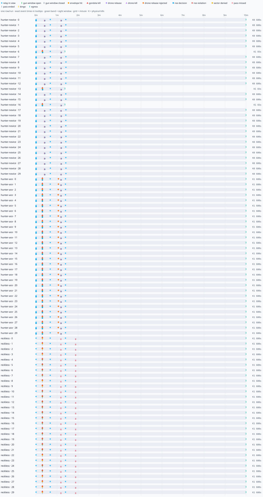

# Playtest Lab — beat 15

Generated 2026-10-16 · 90 runs · seed 0 · 324000.0s simulated · 476.9× wall speed

## Headline metrics vs targets

| pilot | first sight window mean (samples/missing) | ≤20s | longest gap | ≤30s | hunt mean (ended/censored) | 4–6min | passes/physical kill | envelope-only | ROE decisions | physical/safe kills |
|---|---:|---:|---:|---:|---:|---:|---:|---:|---:|---:|
| hunter-ace | 17.8s (18/12 miss) | 60% | 600.0s | no | 600.0s (30/0) | 0% | 2.00 | 0% | 90 | 30/30 |
| hunter-novice | — (0/30 miss) | 0% | 600.0s | no | 548.3s (30/0) | 0% | 20.00 | 0% | 90 | 3/3 |
| reckless | 17.8s (18/12 miss) | 60% | 600.0s | no | 600.0s (30/0) | 0% | 3.00 | 0% | 0 | 30/30 |

Gun window = instantaneous ballistic sight cue at ≤900 m, with a live selected gondola and an authorized loaded gun. This conservative cue is distinct from proximity, the dwell-qualified HUD cue and actual dispersed rounds hitting the gondola box.

## Fun verdict

Top three evidence-backed problems:

1. Sight-window drought: 90 of 90 runs exceeded 30s, with a worst gap of 600.0s. 87/90 hunts reached the controller combat budget. Compare the cue/proximity cross-check before attributing this entirely to mission pacing.
2. Wrong-shot teaching is absent: 0 envelope-only passes across 210 completed passes in 90 runs. These controllers mostly miss or hit a gondola; the experiment has not demonstrated the intended envelope-puncture lesson.
3. Blocked drone choices: 30 policy attempts produced 0 releases (30 capability rejections). The current Phase 1 controller/API has not made a drone action available; resolve that before treating hard geometry as a design problem.

These are controller-observed experience proxies, not measured human feelings. Drought includes leading/trailing hunt edges. Phase 1 exposes no drone-release API; blocked choices are not failed release calls.

**Full-sortie limitation:** 90/90 runs are censored at 3600s; completed sortie length and recovered win rate remain unknown. The inherited recovery controller has not established a completed Pathfinders recovery. Hunt duration ends separately at actual egress/loss; combat-budget egress is not mission completion.

### Outcome spread

| pilot | ≥1 denied / runs | all relays denied / runs | physical kills: runs | hunt end reasons |
|---|---:|---:|---|---|
| hunter-ace | 30/30 | 0/30 | 1: 30 | RTB:combat-budget: 30 |
| hunter-novice | 3/30 | 0/30 | 0: 27, 1: 3 | RTB:combat-budget: 27, RTB:route-exhausted: 3 |
| reckless | 30/30 | 0/30 | 1: 30 | RTB:combat-budget: 30 |

### Flags

- first gun window >20s/missing: hunter-novice seed 0 (missing)
- gun-window drought >30s: hunter-novice seed 0 (600.0s)
- hunt outside 4–6min: hunter-novice seed 0 (600.0s)
- no envelope-only teaching moment: hunter-novice seed 0
- first gun window >20s/missing: hunter-novice seed 1 (missing)
- gun-window drought >30s: hunter-novice seed 1 (600.0s)
- hunt outside 4–6min: hunter-novice seed 1 (600.0s)
- no envelope-only teaching moment: hunter-novice seed 1
- first gun window >20s/missing: hunter-novice seed 2 (missing)
- gun-window drought >30s: hunter-novice seed 2 (600.0s)
- hunt outside 4–6min: hunter-novice seed 2 (600.0s)
- no envelope-only teaching moment: hunter-novice seed 2
- first gun window >20s/missing: hunter-novice seed 3 (missing)
- gun-window drought >30s: hunter-novice seed 3 (600.0s)
- hunt outside 4–6min: hunter-novice seed 3 (600.0s)
- no envelope-only teaching moment: hunter-novice seed 3
- first gun window >20s/missing: hunter-novice seed 4 (missing)
- gun-window drought >30s: hunter-novice seed 4 (600.0s)
- hunt outside 4–6min: hunter-novice seed 4 (600.0s)
- no envelope-only teaching moment: hunter-novice seed 4
- first gun window >20s/missing: hunter-novice seed 5 (missing)
- gun-window drought >30s: hunter-novice seed 5 (600.0s)
- hunt outside 4–6min: hunter-novice seed 5 (600.0s)
- no envelope-only teaching moment: hunter-novice seed 5
- first gun window >20s/missing: hunter-novice seed 6 (missing)
- gun-window drought >30s: hunter-novice seed 6 (82.6s)
- hunt outside 4–6min: hunter-novice seed 6 (82.6s)
- no envelope-only teaching moment: hunter-novice seed 6
- first gun window >20s/missing: hunter-novice seed 7 (missing)
- gun-window drought >30s: hunter-novice seed 7 (600.0s)
- hunt outside 4–6min: hunter-novice seed 7 (600.0s)
- no envelope-only teaching moment: hunter-novice seed 7
- first gun window >20s/missing: hunter-novice seed 8 (missing)
- gun-window drought >30s: hunter-novice seed 8 (600.0s)
- hunt outside 4–6min: hunter-novice seed 8 (600.0s)
- no envelope-only teaching moment: hunter-novice seed 8
- first gun window >20s/missing: hunter-novice seed 9 (missing)
- gun-window drought >30s: hunter-novice seed 9 (600.0s)
- hunt outside 4–6min: hunter-novice seed 9 (600.0s)
- no envelope-only teaching moment: hunter-novice seed 9
- first gun window >20s/missing: hunter-novice seed 10 (missing)
- gun-window drought >30s: hunter-novice seed 10 (600.0s)
- hunt outside 4–6min: hunter-novice seed 10 (600.0s)
- no envelope-only teaching moment: hunter-novice seed 10
- first gun window >20s/missing: hunter-novice seed 11 (missing)
- gun-window drought >30s: hunter-novice seed 11 (600.0s)
- hunt outside 4–6min: hunter-novice seed 11 (600.0s)
- no envelope-only teaching moment: hunter-novice seed 11
- first gun window >20s/missing: hunter-novice seed 12 (missing)
- gun-window drought >30s: hunter-novice seed 12 (600.0s)
- hunt outside 4–6min: hunter-novice seed 12 (600.0s)
- no envelope-only teaching moment: hunter-novice seed 12
- first gun window >20s/missing: hunter-novice seed 13 (missing)
- gun-window drought >30s: hunter-novice seed 13 (82.6s)
- hunt outside 4–6min: hunter-novice seed 13 (82.6s)
- no envelope-only teaching moment: hunter-novice seed 13
- first gun window >20s/missing: hunter-novice seed 14 (missing)
- gun-window drought >30s: hunter-novice seed 14 (600.0s)
- hunt outside 4–6min: hunter-novice seed 14 (600.0s)
- no envelope-only teaching moment: hunter-novice seed 14
- first gun window >20s/missing: hunter-novice seed 15 (missing)
- gun-window drought >30s: hunter-novice seed 15 (600.0s)
- hunt outside 4–6min: hunter-novice seed 15 (600.0s)
- no envelope-only teaching moment: hunter-novice seed 15
- first gun window >20s/missing: hunter-novice seed 16 (missing)
- gun-window drought >30s: hunter-novice seed 16 (82.6s)
- hunt outside 4–6min: hunter-novice seed 16 (82.6s)
- no envelope-only teaching moment: hunter-novice seed 16
- first gun window >20s/missing: hunter-novice seed 17 (missing)
- gun-window drought >30s: hunter-novice seed 17 (600.0s)
- hunt outside 4–6min: hunter-novice seed 17 (600.0s)
- no envelope-only teaching moment: hunter-novice seed 17
- first gun window >20s/missing: hunter-novice seed 18 (missing)
- gun-window drought >30s: hunter-novice seed 18 (600.0s)
- hunt outside 4–6min: hunter-novice seed 18 (600.0s)
- no envelope-only teaching moment: hunter-novice seed 18
- first gun window >20s/missing: hunter-novice seed 19 (missing)
- gun-window drought >30s: hunter-novice seed 19 (600.0s)
- hunt outside 4–6min: hunter-novice seed 19 (600.0s)
- no envelope-only teaching moment: hunter-novice seed 19
- first gun window >20s/missing: hunter-novice seed 20 (missing)
- gun-window drought >30s: hunter-novice seed 20 (600.0s)
- hunt outside 4–6min: hunter-novice seed 20 (600.0s)
- no envelope-only teaching moment: hunter-novice seed 20
- first gun window >20s/missing: hunter-novice seed 21 (missing)
- gun-window drought >30s: hunter-novice seed 21 (600.0s)
- hunt outside 4–6min: hunter-novice seed 21 (600.0s)
- no envelope-only teaching moment: hunter-novice seed 21
- first gun window >20s/missing: hunter-novice seed 22 (missing)
- gun-window drought >30s: hunter-novice seed 22 (600.0s)
- hunt outside 4–6min: hunter-novice seed 22 (600.0s)
- no envelope-only teaching moment: hunter-novice seed 22
- first gun window >20s/missing: hunter-novice seed 23 (missing)
- gun-window drought >30s: hunter-novice seed 23 (600.0s)
- hunt outside 4–6min: hunter-novice seed 23 (600.0s)
- no envelope-only teaching moment: hunter-novice seed 23
- first gun window >20s/missing: hunter-novice seed 24 (missing)
- gun-window drought >30s: hunter-novice seed 24 (600.0s)
- hunt outside 4–6min: hunter-novice seed 24 (600.0s)
- no envelope-only teaching moment: hunter-novice seed 24
- first gun window >20s/missing: hunter-novice seed 25 (missing)
- gun-window drought >30s: hunter-novice seed 25 (600.0s)
- hunt outside 4–6min: hunter-novice seed 25 (600.0s)
- no envelope-only teaching moment: hunter-novice seed 25
- first gun window >20s/missing: hunter-novice seed 26 (missing)
- gun-window drought >30s: hunter-novice seed 26 (600.0s)
- hunt outside 4–6min: hunter-novice seed 26 (600.0s)
- no envelope-only teaching moment: hunter-novice seed 26
- first gun window >20s/missing: hunter-novice seed 27 (missing)
- gun-window drought >30s: hunter-novice seed 27 (600.0s)
- hunt outside 4–6min: hunter-novice seed 27 (600.0s)
- no envelope-only teaching moment: hunter-novice seed 27
- first gun window >20s/missing: hunter-novice seed 28 (missing)
- gun-window drought >30s: hunter-novice seed 28 (600.0s)
- hunt outside 4–6min: hunter-novice seed 28 (600.0s)
- no envelope-only teaching moment: hunter-novice seed 28
- first gun window >20s/missing: hunter-novice seed 29 (missing)
- gun-window drought >30s: hunter-novice seed 29 (600.0s)
- hunt outside 4–6min: hunter-novice seed 29 (600.0s)
- no envelope-only teaching moment: hunter-novice seed 29
- first gun window >20s/missing: hunter-ace seed 0 (missing)
- gun-window drought >30s: hunter-ace seed 0 (600.0s)
- hunt outside 4–6min: hunter-ace seed 0 (600.0s)
- no envelope-only teaching moment: hunter-ace seed 0
- first gun window >20s/missing: hunter-ace seed 1 (missing)
- gun-window drought >30s: hunter-ace seed 1 (600.0s)
- hunt outside 4–6min: hunter-ace seed 1 (600.0s)
- no envelope-only teaching moment: hunter-ace seed 1
- first gun window >20s/missing: hunter-ace seed 2 (missing)
- gun-window drought >30s: hunter-ace seed 2 (600.0s)
- hunt outside 4–6min: hunter-ace seed 2 (600.0s)
- no envelope-only teaching moment: hunter-ace seed 2
- first gun window >20s/missing: hunter-ace seed 3 (missing)
- gun-window drought >30s: hunter-ace seed 3 (600.0s)
- hunt outside 4–6min: hunter-ace seed 3 (600.0s)
- no envelope-only teaching moment: hunter-ace seed 3
- gun-window drought >30s: hunter-ace seed 4 (582.2s)
- hunt outside 4–6min: hunter-ace seed 4 (600.0s)
- no envelope-only teaching moment: hunter-ace seed 4
- gun-window drought >30s: hunter-ace seed 5 (582.2s)
- hunt outside 4–6min: hunter-ace seed 5 (600.0s)
- no envelope-only teaching moment: hunter-ace seed 5
- gun-window drought >30s: hunter-ace seed 6 (582.2s)
- hunt outside 4–6min: hunter-ace seed 6 (600.0s)
- no envelope-only teaching moment: hunter-ace seed 6
- gun-window drought >30s: hunter-ace seed 7 (582.2s)
- hunt outside 4–6min: hunter-ace seed 7 (600.0s)
- no envelope-only teaching moment: hunter-ace seed 7
- first gun window >20s/missing: hunter-ace seed 8 (missing)
- gun-window drought >30s: hunter-ace seed 8 (600.0s)
- hunt outside 4–6min: hunter-ace seed 8 (600.0s)
- no envelope-only teaching moment: hunter-ace seed 8
- first gun window >20s/missing: hunter-ace seed 9 (missing)
- gun-window drought >30s: hunter-ace seed 9 (600.0s)
- hunt outside 4–6min: hunter-ace seed 9 (600.0s)
- no envelope-only teaching moment: hunter-ace seed 9
- gun-window drought >30s: hunter-ace seed 10 (582.2s)
- hunt outside 4–6min: hunter-ace seed 10 (600.0s)
- no envelope-only teaching moment: hunter-ace seed 10
- gun-window drought >30s: hunter-ace seed 11 (582.2s)
- hunt outside 4–6min: hunter-ace seed 11 (600.0s)
- no envelope-only teaching moment: hunter-ace seed 11
- gun-window drought >30s: hunter-ace seed 12 (582.2s)
- hunt outside 4–6min: hunter-ace seed 12 (600.0s)
- no envelope-only teaching moment: hunter-ace seed 12
- gun-window drought >30s: hunter-ace seed 13 (582.2s)
- hunt outside 4–6min: hunter-ace seed 13 (600.0s)
- no envelope-only teaching moment: hunter-ace seed 13
- gun-window drought >30s: hunter-ace seed 14 (582.2s)
- hunt outside 4–6min: hunter-ace seed 14 (600.0s)
- no envelope-only teaching moment: hunter-ace seed 14
- gun-window drought >30s: hunter-ace seed 15 (582.2s)
- hunt outside 4–6min: hunter-ace seed 15 (600.0s)
- no envelope-only teaching moment: hunter-ace seed 15
- gun-window drought >30s: hunter-ace seed 16 (582.2s)
- hunt outside 4–6min: hunter-ace seed 16 (600.0s)
- no envelope-only teaching moment: hunter-ace seed 16
- gun-window drought >30s: hunter-ace seed 17 (582.2s)
- hunt outside 4–6min: hunter-ace seed 17 (600.0s)
- no envelope-only teaching moment: hunter-ace seed 17
- gun-window drought >30s: hunter-ace seed 18 (582.2s)
- hunt outside 4–6min: hunter-ace seed 18 (600.0s)
- no envelope-only teaching moment: hunter-ace seed 18
- gun-window drought >30s: hunter-ace seed 19 (582.2s)
- hunt outside 4–6min: hunter-ace seed 19 (600.0s)
- no envelope-only teaching moment: hunter-ace seed 19
- gun-window drought >30s: hunter-ace seed 20 (582.2s)
- hunt outside 4–6min: hunter-ace seed 20 (600.0s)
- no envelope-only teaching moment: hunter-ace seed 20
- gun-window drought >30s: hunter-ace seed 21 (582.2s)
- hunt outside 4–6min: hunter-ace seed 21 (600.0s)
- no envelope-only teaching moment: hunter-ace seed 21
- first gun window >20s/missing: hunter-ace seed 22 (missing)
- gun-window drought >30s: hunter-ace seed 22 (600.0s)
- hunt outside 4–6min: hunter-ace seed 22 (600.0s)
- no envelope-only teaching moment: hunter-ace seed 22
- first gun window >20s/missing: hunter-ace seed 23 (missing)
- gun-window drought >30s: hunter-ace seed 23 (600.0s)
- hunt outside 4–6min: hunter-ace seed 23 (600.0s)
- no envelope-only teaching moment: hunter-ace seed 23
- gun-window drought >30s: hunter-ace seed 24 (582.2s)
- hunt outside 4–6min: hunter-ace seed 24 (600.0s)
- no envelope-only teaching moment: hunter-ace seed 24
- gun-window drought >30s: hunter-ace seed 25 (582.2s)
- hunt outside 4–6min: hunter-ace seed 25 (600.0s)
- no envelope-only teaching moment: hunter-ace seed 25
- first gun window >20s/missing: hunter-ace seed 26 (missing)
- gun-window drought >30s: hunter-ace seed 26 (600.0s)
- hunt outside 4–6min: hunter-ace seed 26 (600.0s)
- no envelope-only teaching moment: hunter-ace seed 26
- first gun window >20s/missing: hunter-ace seed 27 (missing)
- gun-window drought >30s: hunter-ace seed 27 (600.0s)
- hunt outside 4–6min: hunter-ace seed 27 (600.0s)
- no envelope-only teaching moment: hunter-ace seed 27
- first gun window >20s/missing: hunter-ace seed 28 (missing)
- gun-window drought >30s: hunter-ace seed 28 (600.0s)
- hunt outside 4–6min: hunter-ace seed 28 (600.0s)
- no envelope-only teaching moment: hunter-ace seed 28
- first gun window >20s/missing: hunter-ace seed 29 (missing)
- gun-window drought >30s: hunter-ace seed 29 (600.0s)
- hunt outside 4–6min: hunter-ace seed 29 (600.0s)
- no envelope-only teaching moment: hunter-ace seed 29
- first gun window >20s/missing: reckless seed 0 (missing)
- gun-window drought >30s: reckless seed 0 (600.0s)
- hunt outside 4–6min: reckless seed 0 (600.0s)
- no envelope-only teaching moment: reckless seed 0
- first gun window >20s/missing: reckless seed 1 (missing)
- gun-window drought >30s: reckless seed 1 (600.0s)
- hunt outside 4–6min: reckless seed 1 (600.0s)
- no envelope-only teaching moment: reckless seed 1
- first gun window >20s/missing: reckless seed 2 (missing)
- gun-window drought >30s: reckless seed 2 (600.0s)
- hunt outside 4–6min: reckless seed 2 (600.0s)
- no envelope-only teaching moment: reckless seed 2
- first gun window >20s/missing: reckless seed 3 (missing)
- gun-window drought >30s: reckless seed 3 (600.0s)
- hunt outside 4–6min: reckless seed 3 (600.0s)
- no envelope-only teaching moment: reckless seed 3
- gun-window drought >30s: reckless seed 4 (582.2s)
- hunt outside 4–6min: reckless seed 4 (600.0s)
- no envelope-only teaching moment: reckless seed 4
- gun-window drought >30s: reckless seed 5 (582.2s)
- hunt outside 4–6min: reckless seed 5 (600.0s)
- no envelope-only teaching moment: reckless seed 5
- gun-window drought >30s: reckless seed 6 (582.2s)
- hunt outside 4–6min: reckless seed 6 (600.0s)
- no envelope-only teaching moment: reckless seed 6
- gun-window drought >30s: reckless seed 7 (582.2s)
- hunt outside 4–6min: reckless seed 7 (600.0s)
- no envelope-only teaching moment: reckless seed 7
- first gun window >20s/missing: reckless seed 8 (missing)
- gun-window drought >30s: reckless seed 8 (600.0s)
- hunt outside 4–6min: reckless seed 8 (600.0s)
- no envelope-only teaching moment: reckless seed 8
- first gun window >20s/missing: reckless seed 9 (missing)
- gun-window drought >30s: reckless seed 9 (600.0s)
- hunt outside 4–6min: reckless seed 9 (600.0s)
- no envelope-only teaching moment: reckless seed 9
- gun-window drought >30s: reckless seed 10 (582.2s)
- hunt outside 4–6min: reckless seed 10 (600.0s)
- no envelope-only teaching moment: reckless seed 10
- gun-window drought >30s: reckless seed 11 (582.2s)
- hunt outside 4–6min: reckless seed 11 (600.0s)
- no envelope-only teaching moment: reckless seed 11
- gun-window drought >30s: reckless seed 12 (582.2s)
- hunt outside 4–6min: reckless seed 12 (600.0s)
- no envelope-only teaching moment: reckless seed 12
- gun-window drought >30s: reckless seed 13 (582.2s)
- hunt outside 4–6min: reckless seed 13 (600.0s)
- no envelope-only teaching moment: reckless seed 13
- gun-window drought >30s: reckless seed 14 (582.2s)
- hunt outside 4–6min: reckless seed 14 (600.0s)
- no envelope-only teaching moment: reckless seed 14
- gun-window drought >30s: reckless seed 15 (582.2s)
- hunt outside 4–6min: reckless seed 15 (600.0s)
- no envelope-only teaching moment: reckless seed 15
- gun-window drought >30s: reckless seed 16 (582.2s)
- hunt outside 4–6min: reckless seed 16 (600.0s)
- no envelope-only teaching moment: reckless seed 16
- gun-window drought >30s: reckless seed 17 (582.2s)
- hunt outside 4–6min: reckless seed 17 (600.0s)
- no envelope-only teaching moment: reckless seed 17
- gun-window drought >30s: reckless seed 18 (582.2s)
- hunt outside 4–6min: reckless seed 18 (600.0s)
- no envelope-only teaching moment: reckless seed 18
- gun-window drought >30s: reckless seed 19 (582.2s)
- hunt outside 4–6min: reckless seed 19 (600.0s)
- no envelope-only teaching moment: reckless seed 19
- gun-window drought >30s: reckless seed 20 (582.2s)
- hunt outside 4–6min: reckless seed 20 (600.0s)
- no envelope-only teaching moment: reckless seed 20
- gun-window drought >30s: reckless seed 21 (582.2s)
- hunt outside 4–6min: reckless seed 21 (600.0s)
- no envelope-only teaching moment: reckless seed 21
- first gun window >20s/missing: reckless seed 22 (missing)
- gun-window drought >30s: reckless seed 22 (600.0s)
- hunt outside 4–6min: reckless seed 22 (600.0s)
- no envelope-only teaching moment: reckless seed 22
- first gun window >20s/missing: reckless seed 23 (missing)
- gun-window drought >30s: reckless seed 23 (600.0s)
- hunt outside 4–6min: reckless seed 23 (600.0s)
- no envelope-only teaching moment: reckless seed 23
- gun-window drought >30s: reckless seed 24 (582.2s)
- hunt outside 4–6min: reckless seed 24 (600.0s)
- no envelope-only teaching moment: reckless seed 24
- gun-window drought >30s: reckless seed 25 (582.2s)
- hunt outside 4–6min: reckless seed 25 (600.0s)
- no envelope-only teaching moment: reckless seed 25
- first gun window >20s/missing: reckless seed 26 (missing)
- gun-window drought >30s: reckless seed 26 (600.0s)
- hunt outside 4–6min: reckless seed 26 (600.0s)
- no envelope-only teaching moment: reckless seed 26
- first gun window >20s/missing: reckless seed 27 (missing)
- gun-window drought >30s: reckless seed 27 (600.0s)
- hunt outside 4–6min: reckless seed 27 (600.0s)
- no envelope-only teaching moment: reckless seed 27
- first gun window >20s/missing: reckless seed 28 (missing)
- gun-window drought >30s: reckless seed 28 (600.0s)
- hunt outside 4–6min: reckless seed 28 (600.0s)
- no envelope-only teaching moment: reckless seed 28
- first gun window >20s/missing: reckless seed 29 (missing)
- gun-window drought >30s: reckless seed 29 (600.0s)
- hunt outside 4–6min: reckless seed 29 (600.0s)
- no envelope-only teaching moment: reckless seed 29

### Proximity, cue and hit cross-check

| pilot | first ≤900 m mean / missing | instantaneous cue seconds | qualified HUD cue seconds | physical kills |
|---|---:|---:|---:|---:|
| hunter-ace | 17.6s / 0 | 0.675 | 0.000 | 30 |
| hunter-novice | 17.6s / 0 | 0.000 | 0.000 | 3 |
| reckless | 17.6s / 0 | 0.675 | 0.000 | 30 |

### Opportunities/events by minute

| pilot | minute | sight-window s | relay | opens/closes | envelope | kills | ROE decisions | ROE violations | denied/missed |
|---|---:|---:|---:|---:|---:|---:|---:|---:|---:|
| hunter-ace | 0 | 0.675 | 60 | 18/18 | 0 | 30 | 60 | 0 | 30/0 |
| hunter-novice | 0 | 0.000 | 60 | 0/0 | 0 | 3 | 60 | 0 | 3/27 |
| reckless | 0 | 0.675 | 60 | 18/18 | 0 | 30 | 0 | 0 | 30/0 |
| hunter-ace | 1 | 0.000 | 30 | 0/0 | 0 | 0 | 30 | 0 | 0/30 |
| hunter-novice | 1 | 0.000 | 27 | 0/0 | 0 | 0 | 30 | 0 | 0/30 |
| reckless | 1 | 0.000 | 30 | 0/0 | 0 | 0 | 0 | 0 | 0/60 |
| hunter-ace | 2 | 0.000 | 0 | 0/0 | 0 | 0 | 0 | 0 | 0/0 |
| hunter-novice | 2 | 0.000 | 0 | 0/0 | 0 | 0 | 0 | 0 | 0/0 |
| reckless | 2 | 0.000 | 0 | 0/0 | 0 | 0 | 0 | 0 | 0/0 |
| hunter-ace | 3 | 0.000 | 0 | 0/0 | 0 | 0 | 0 | 0 | 0/0 |
| hunter-novice | 3 | 0.000 | 0 | 0/0 | 0 | 0 | 0 | 0 | 0/0 |
| reckless | 3 | 0.000 | 0 | 0/0 | 0 | 0 | 0 | 0 | 0/0 |
| hunter-ace | 4 | 0.000 | 0 | 0/0 | 0 | 0 | 0 | 0 | 0/0 |
| hunter-novice | 4 | 0.000 | 0 | 0/0 | 0 | 0 | 0 | 0 | 0/0 |
| reckless | 4 | 0.000 | 0 | 0/0 | 0 | 0 | 0 | 0 | 0/0 |
| hunter-ace | 5 | 0.000 | 0 | 0/0 | 0 | 0 | 0 | 0 | 0/0 |
| hunter-novice | 5 | 0.000 | 0 | 0/0 | 0 | 0 | 0 | 0 | 0/0 |
| reckless | 5 | 0.000 | 0 | 0/0 | 0 | 0 | 0 | 0 | 0/0 |
| hunter-ace | 6 | 0.000 | 0 | 0/0 | 0 | 0 | 0 | 0 | 0/0 |
| hunter-novice | 6 | 0.000 | 0 | 0/0 | 0 | 0 | 0 | 0 | 0/0 |
| reckless | 6 | 0.000 | 0 | 0/0 | 0 | 0 | 0 | 0 | 0/0 |
| hunter-ace | 7 | 0.000 | 0 | 0/0 | 0 | 0 | 0 | 0 | 0/0 |
| hunter-novice | 7 | 0.000 | 0 | 0/0 | 0 | 0 | 0 | 0 | 0/0 |
| reckless | 7 | 0.000 | 0 | 0/0 | 0 | 0 | 0 | 0 | 0/0 |
| hunter-ace | 8 | 0.000 | 0 | 0/0 | 0 | 0 | 0 | 0 | 0/0 |
| hunter-novice | 8 | 0.000 | 0 | 0/0 | 0 | 0 | 0 | 0 | 0/0 |
| reckless | 8 | 0.000 | 0 | 0/0 | 0 | 0 | 0 | 0 | 0/0 |
| hunter-ace | 9 | 0.000 | 0 | 0/0 | 0 | 0 | 0 | 0 | 0/0 |
| hunter-novice | 9 | 0.000 | 0 | 0/0 | 0 | 0 | 0 | 0 | 0/0 |
| reckless | 9 | 0.000 | 0 | 0/0 | 0 | 0 | 0 | 0 | 0/0 |
| hunter-ace | 10 | 0.000 | 0 | 0/0 | 0 | 0 | 0 | 0 | 0/0 |
| hunter-novice | 10 | 0.000 | 0 | 0/0 | 0 | 0 | 0 | 0 | 0/0 |
| reckless | 10 | 0.000 | 0 | 0/0 | 0 | 0 | 0 | 0 | 0/0 |

### Per-run Pathfinder metrics

| pilot | seed | first window | longest gap | hunt s | censored | passes | envelope-only | physical/safe kills | drone attempts/releases/rejected | ROE decisions/violations |
|---|---:|---:|---:|---:|---|---:|---:|---:|---:|---:|
| hunter-novice | 0 | — | 600.0 | 600.0 | no | 2 | 0 | 0/0 | 0/0/0 | 3/0 |
| hunter-novice | 1 | — | 600.0 | 600.0 | no | 2 | 0 | 0/0 | 0/0/0 | 3/0 |
| hunter-novice | 2 | — | 600.0 | 600.0 | no | 2 | 0 | 0/0 | 0/0/0 | 3/0 |
| hunter-novice | 3 | — | 600.0 | 600.0 | no | 2 | 0 | 0/0 | 0/0/0 | 3/0 |
| hunter-novice | 4 | — | 600.0 | 600.0 | no | 2 | 0 | 0/0 | 0/0/0 | 3/0 |
| hunter-novice | 5 | — | 600.0 | 600.0 | no | 2 | 0 | 0/0 | 0/0/0 | 3/0 |
| hunter-novice | 6 | — | 82.6 | 82.6 | no | 2 | 0 | 1/1 | 0/0/0 | 3/0 |
| hunter-novice | 7 | — | 600.0 | 600.0 | no | 2 | 0 | 0/0 | 0/0/0 | 3/0 |
| hunter-novice | 8 | — | 600.0 | 600.0 | no | 2 | 0 | 0/0 | 0/0/0 | 3/0 |
| hunter-novice | 9 | — | 600.0 | 600.0 | no | 2 | 0 | 0/0 | 0/0/0 | 3/0 |
| hunter-novice | 10 | — | 600.0 | 600.0 | no | 2 | 0 | 0/0 | 0/0/0 | 3/0 |
| hunter-novice | 11 | — | 600.0 | 600.0 | no | 2 | 0 | 0/0 | 0/0/0 | 3/0 |
| hunter-novice | 12 | — | 600.0 | 600.0 | no | 2 | 0 | 0/0 | 0/0/0 | 3/0 |
| hunter-novice | 13 | — | 82.6 | 82.6 | no | 2 | 0 | 1/1 | 0/0/0 | 3/0 |
| hunter-novice | 14 | — | 600.0 | 600.0 | no | 2 | 0 | 0/0 | 0/0/0 | 3/0 |
| hunter-novice | 15 | — | 600.0 | 600.0 | no | 2 | 0 | 0/0 | 0/0/0 | 3/0 |
| hunter-novice | 16 | — | 82.6 | 82.6 | no | 2 | 0 | 1/1 | 0/0/0 | 3/0 |
| hunter-novice | 17 | — | 600.0 | 600.0 | no | 2 | 0 | 0/0 | 0/0/0 | 3/0 |
| hunter-novice | 18 | — | 600.0 | 600.0 | no | 2 | 0 | 0/0 | 0/0/0 | 3/0 |
| hunter-novice | 19 | — | 600.0 | 600.0 | no | 2 | 0 | 0/0 | 0/0/0 | 3/0 |
| hunter-novice | 20 | — | 600.0 | 600.0 | no | 2 | 0 | 0/0 | 0/0/0 | 3/0 |
| hunter-novice | 21 | — | 600.0 | 600.0 | no | 2 | 0 | 0/0 | 0/0/0 | 3/0 |
| hunter-novice | 22 | — | 600.0 | 600.0 | no | 2 | 0 | 0/0 | 0/0/0 | 3/0 |
| hunter-novice | 23 | — | 600.0 | 600.0 | no | 2 | 0 | 0/0 | 0/0/0 | 3/0 |
| hunter-novice | 24 | — | 600.0 | 600.0 | no | 2 | 0 | 0/0 | 0/0/0 | 3/0 |
| hunter-novice | 25 | — | 600.0 | 600.0 | no | 2 | 0 | 0/0 | 0/0/0 | 3/0 |
| hunter-novice | 26 | — | 600.0 | 600.0 | no | 2 | 0 | 0/0 | 0/0/0 | 3/0 |
| hunter-novice | 27 | — | 600.0 | 600.0 | no | 2 | 0 | 0/0 | 0/0/0 | 3/0 |
| hunter-novice | 28 | — | 600.0 | 600.0 | no | 2 | 0 | 0/0 | 0/0/0 | 3/0 |
| hunter-novice | 29 | — | 600.0 | 600.0 | no | 2 | 0 | 0/0 | 0/0/0 | 3/0 |
| hunter-ace | 0 | — | 600.0 | 600.0 | no | 2 | 0 | 1/1 | 1/0/1 | 3/0 |
| hunter-ace | 1 | — | 600.0 | 600.0 | no | 2 | 0 | 1/1 | 1/0/1 | 3/0 |
| hunter-ace | 2 | — | 600.0 | 600.0 | no | 2 | 0 | 1/1 | 1/0/1 | 3/0 |
| hunter-ace | 3 | — | 600.0 | 600.0 | no | 2 | 0 | 1/1 | 1/0/1 | 3/0 |
| hunter-ace | 4 | 17.8 | 582.2 | 600.0 | no | 2 | 0 | 1/1 | 1/0/1 | 3/0 |
| hunter-ace | 5 | 17.8 | 582.2 | 600.0 | no | 2 | 0 | 1/1 | 1/0/1 | 3/0 |
| hunter-ace | 6 | 17.8 | 582.2 | 600.0 | no | 2 | 0 | 1/1 | 1/0/1 | 3/0 |
| hunter-ace | 7 | 17.8 | 582.2 | 600.0 | no | 2 | 0 | 1/1 | 1/0/1 | 3/0 |
| hunter-ace | 8 | — | 600.0 | 600.0 | no | 2 | 0 | 1/1 | 1/0/1 | 3/0 |
| hunter-ace | 9 | — | 600.0 | 600.0 | no | 2 | 0 | 1/1 | 1/0/1 | 3/0 |
| hunter-ace | 10 | 17.8 | 582.2 | 600.0 | no | 2 | 0 | 1/1 | 1/0/1 | 3/0 |
| hunter-ace | 11 | 17.8 | 582.2 | 600.0 | no | 2 | 0 | 1/1 | 1/0/1 | 3/0 |
| hunter-ace | 12 | 17.8 | 582.2 | 600.0 | no | 2 | 0 | 1/1 | 1/0/1 | 3/0 |
| hunter-ace | 13 | 17.8 | 582.2 | 600.0 | no | 2 | 0 | 1/1 | 1/0/1 | 3/0 |
| hunter-ace | 14 | 17.8 | 582.2 | 600.0 | no | 2 | 0 | 1/1 | 1/0/1 | 3/0 |
| hunter-ace | 15 | 17.8 | 582.2 | 600.0 | no | 2 | 0 | 1/1 | 1/0/1 | 3/0 |
| hunter-ace | 16 | 17.8 | 582.2 | 600.0 | no | 2 | 0 | 1/1 | 1/0/1 | 3/0 |
| hunter-ace | 17 | 17.8 | 582.2 | 600.0 | no | 2 | 0 | 1/1 | 1/0/1 | 3/0 |
| hunter-ace | 18 | 17.8 | 582.2 | 600.0 | no | 2 | 0 | 1/1 | 1/0/1 | 3/0 |
| hunter-ace | 19 | 17.8 | 582.2 | 600.0 | no | 2 | 0 | 1/1 | 1/0/1 | 3/0 |
| hunter-ace | 20 | 17.8 | 582.2 | 600.0 | no | 2 | 0 | 1/1 | 1/0/1 | 3/0 |
| hunter-ace | 21 | 17.8 | 582.2 | 600.0 | no | 2 | 0 | 1/1 | 1/0/1 | 3/0 |
| hunter-ace | 22 | — | 600.0 | 600.0 | no | 2 | 0 | 1/1 | 1/0/1 | 3/0 |
| hunter-ace | 23 | — | 600.0 | 600.0 | no | 2 | 0 | 1/1 | 1/0/1 | 3/0 |
| hunter-ace | 24 | 17.8 | 582.2 | 600.0 | no | 2 | 0 | 1/1 | 1/0/1 | 3/0 |
| hunter-ace | 25 | 17.8 | 582.2 | 600.0 | no | 2 | 0 | 1/1 | 1/0/1 | 3/0 |
| hunter-ace | 26 | — | 600.0 | 600.0 | no | 2 | 0 | 1/1 | 1/0/1 | 3/0 |
| hunter-ace | 27 | — | 600.0 | 600.0 | no | 2 | 0 | 1/1 | 1/0/1 | 3/0 |
| hunter-ace | 28 | — | 600.0 | 600.0 | no | 2 | 0 | 1/1 | 1/0/1 | 3/0 |
| hunter-ace | 29 | — | 600.0 | 600.0 | no | 2 | 0 | 1/1 | 1/0/1 | 3/0 |
| reckless | 0 | — | 600.0 | 600.0 | no | 3 | 0 | 1/1 | 0/0/0 | 0/0 |
| reckless | 1 | — | 600.0 | 600.0 | no | 3 | 0 | 1/1 | 0/0/0 | 0/0 |
| reckless | 2 | — | 600.0 | 600.0 | no | 3 | 0 | 1/1 | 0/0/0 | 0/0 |
| reckless | 3 | — | 600.0 | 600.0 | no | 3 | 0 | 1/1 | 0/0/0 | 0/0 |
| reckless | 4 | 17.8 | 582.2 | 600.0 | no | 3 | 0 | 1/1 | 0/0/0 | 0/0 |
| reckless | 5 | 17.8 | 582.2 | 600.0 | no | 3 | 0 | 1/1 | 0/0/0 | 0/0 |
| reckless | 6 | 17.8 | 582.2 | 600.0 | no | 3 | 0 | 1/1 | 0/0/0 | 0/0 |
| reckless | 7 | 17.8 | 582.2 | 600.0 | no | 3 | 0 | 1/1 | 0/0/0 | 0/0 |
| reckless | 8 | — | 600.0 | 600.0 | no | 3 | 0 | 1/1 | 0/0/0 | 0/0 |
| reckless | 9 | — | 600.0 | 600.0 | no | 3 | 0 | 1/1 | 0/0/0 | 0/0 |
| reckless | 10 | 17.8 | 582.2 | 600.0 | no | 3 | 0 | 1/1 | 0/0/0 | 0/0 |
| reckless | 11 | 17.8 | 582.2 | 600.0 | no | 3 | 0 | 1/1 | 0/0/0 | 0/0 |
| reckless | 12 | 17.8 | 582.2 | 600.0 | no | 3 | 0 | 1/1 | 0/0/0 | 0/0 |
| reckless | 13 | 17.8 | 582.2 | 600.0 | no | 3 | 0 | 1/1 | 0/0/0 | 0/0 |
| reckless | 14 | 17.8 | 582.2 | 600.0 | no | 3 | 0 | 1/1 | 0/0/0 | 0/0 |
| reckless | 15 | 17.8 | 582.2 | 600.0 | no | 3 | 0 | 1/1 | 0/0/0 | 0/0 |
| reckless | 16 | 17.8 | 582.2 | 600.0 | no | 3 | 0 | 1/1 | 0/0/0 | 0/0 |
| reckless | 17 | 17.8 | 582.2 | 600.0 | no | 3 | 0 | 1/1 | 0/0/0 | 0/0 |
| reckless | 18 | 17.8 | 582.2 | 600.0 | no | 3 | 0 | 1/1 | 0/0/0 | 0/0 |
| reckless | 19 | 17.8 | 582.2 | 600.0 | no | 3 | 0 | 1/1 | 0/0/0 | 0/0 |
| reckless | 20 | 17.8 | 582.2 | 600.0 | no | 3 | 0 | 1/1 | 0/0/0 | 0/0 |
| reckless | 21 | 17.8 | 582.2 | 600.0 | no | 3 | 0 | 1/1 | 0/0/0 | 0/0 |
| reckless | 22 | — | 600.0 | 600.0 | no | 3 | 0 | 1/1 | 0/0/0 | 0/0 |
| reckless | 23 | — | 600.0 | 600.0 | no | 3 | 0 | 1/1 | 0/0/0 | 0/0 |
| reckless | 24 | 17.8 | 582.2 | 600.0 | no | 3 | 0 | 1/1 | 0/0/0 | 0/0 |
| reckless | 25 | 17.8 | 582.2 | 600.0 | no | 3 | 0 | 1/1 | 0/0/0 | 0/0 |
| reckless | 26 | — | 600.0 | 600.0 | no | 3 | 0 | 1/1 | 0/0/0 | 0/0 |
| reckless | 27 | — | 600.0 | 600.0 | no | 3 | 0 | 1/1 | 0/0/0 | 0/0 |
| reckless | 28 | — | 600.0 | 600.0 | no | 3 | 0 | 1/1 | 0/0/0 | 0/0 |
| reckless | 29 | — | 600.0 | 600.0 | no | 3 | 0 | 1/1 | 0/0/0 | 0/0 |

The SVG has one row per run; hover an event marker for its exact tick-derived time, kind, target and count.

## At a glance

| pilot | runs | complete | censored | win rate | mean length | spread | flags |
|---|---:|---:|---:|---:|---:|---:|---:|
| hunter-ace | 30 | 0 | 30 | N/A | 3600.0s | 0.0s | 91 |
| hunter-novice | 30 | 0 | 30 | N/A | 3600.0s | 0.0s | 91 |
| reckless | 30 | 0 | 30 | N/A | 3600.0s | 0.0s | 91 |

Flag counts: **273 generic; 324 Pathfinder**

## Reproduction

- Command: `tools/playtest-lab/run '--beat' '15' '--pilots' 'hunter-novice,hunter-ace,reckless' '--seeds' '30' '--start-seed' '0' '--max-seconds' '3600' '--rtb-after' '600' '--out' 'analysis/playtest/2026-10-16-beat15'`
- Source commit: `f534aa8218bd0adb31bef0f044b17f94901d5028`
- Clone SHA-256: `a1ac519084ac414a873933838e4cd00dc816ed9c92fcd4a2b962fad56ba039ef`
- Wall time: 679.394739s
- Configured max seconds: 3600

## Notes

- Experience proxies, not a claim to measure human feelings. 120 Hz production simulation; per-second bins preserve tick events and exact phase/dead-air durations. No renderer or wall-clock pacing.
- Fresh director per sortie; no progression imported. Seeds deterministically vary reaction latency, aim bias, and opening hands-off time; mission geometry/damage/AI rules stay authored. Paired seeds use the same perturbation draws for each pilot.
- Clone is the committed owner-pilot-clone policy (canonical features and reference-case validation), held at its training cadence of 20 Hz. Novice adapts BanditPressureReport's pursuit pilot. Ace adapts FirstMergeOpeningAcceptanceTests.HudPilot with delayed body-frame cue observations and bounded analog controls. Shared recovery and terrain escape use the existing scripted command seam; this is not a human usability study.
- Threat: live bandit within 2500 m and nose within 35 degrees, or firing; includes wingmen. Gun target: selected live target with authorized ballistic solution. Dead air: no threat, no gun opportunity, no player shot, decision, spectacle or near miss. Initial begin is not counted as a decision.
- Shot near miss: unique hostile gun round's swept separation within 25 m outside its hit radius; counted only on passage, not repeated ticks. Ground near miss: entry below 100 m AGL with 25 m hysteresis, excluding configured recovery/contact. Explosions are labelled destruction/impact proxies from session events, not renderer effects.
- RTB choice: combat complete, bingo, empty gun, or 600s combat budget, through TryRequestReturnToBase. Recovery/navigation is a shared scripted pilot, with a conventional straight-in join, not learned owner behaviour or an overhead-pattern model. A 3600s limit is censored, never a win or fabricated landing.
- Tension heuristic: 0.35 proximity + 0.15 positive closure (within threat range) + 0.25 threat + 0.15 damage-risk under threat + 0.10 low-clearance risk; clamped 0..1, near shots at least 0.85 and hits at least 0.95. Engagement means exclude RTB and terminal wreck descent. Phase percentages include wreck/debrief time.
- Default native terrain is the session's authored/default surface, without the browser's streamed terrain atlas. Ground-clearance results describe that substrate. CASEVAC uses semantic navigation for all profiles; fixed-wing clone/gun/G metrics do not apply. Generic pilots attempt every built-in beat; specialist mission failures and timeouts remain visible.
- PATHFINDERS: paired seed also seeds FirstLight relay drift; spawn geometry, weather layers, weapons and damage remain authored. Hunter policies use public analog pitch/roll/throttle, target-slot selection, trigger and RTB; only the shared recovery controller retains the existing scripted seam.
- Hunt duration ends at actual RTB handoff or aircraft loss; full sortie includes physical recovery. No fixed 4–6 minute stop is imposed. Budget-triggered egress is a controller limit, not mission completion. Emergency maxSeconds censors the full sortie and any still-active hunt.
- Gun window: selected live gondola, authorized loaded gun, instantaneous ballistic sight solution (conservative cue; dispersion/box contacts can kill outside it), range <=900 m. The HUD-qualified GunSolution adds dwell and is not used to erase brief physical opportunities. Drought includes leading and trailing edge gaps in the hunt. A 900 m proximity-only QA check is not this metric.
- Pass: selected live relay enters 6000 m, finishes on kill, outward exit beyond 6500 m or actual egress/loss. Complete passes only; open passes at censor are separate. Envelope-only means physical envelope impacts but no gondola kill in that pass. Miss means no kill, including envelope-only. Ratios use all physical gondola/drone kills; safe kills are separate.
- Relay in view is a headless proxy: live relay within 30 km and 60 degrees of body nose. ROE decisions are new per-target footprint classifications, not servo ticks. A seeded 65% of novice profiles first favour the envelope, then try the gondola; ace skips populated/unknown footprints, retries hard geometry, and chooses drones when appropriate; reckless aims/fires without consulting ROE.
- DRONE CAPABILITY GAP: Phase 1 carries four drones as mass only and exposes no release route. Blocked drone policy choices are recorded as unavailable, not actual API calls or releases. Drone release/kill event classes are structurally unobserved; zero is not evidence that deployed drones fail.
- Envelope-only >50% is a provisional dominance flag; zero marks an absent teaching moment. This is an exploratory controller study, not a human fun verdict or a fully calibrated expert benchmark.

## Pilot metrics

| pilot | kills | hits given/taken | near misses | decisions/min | first action | dead air (total/max) | outcome distribution | entropy | paired e1→e2 | rising | mean Δ |
|---|---:|---:|---:|---:|---:|---:|---|---:|---:|---:|---:|
| hunter-ace | 30 | 30/0 | 0 | 0.15 | 0.0s (0 missing) | 107989.2s / 3000.0s | win:0, loss:0, crash:0, recovered:0, draw:0 | 0.00 | 0 | — | — |
| hunter-novice | 3 | 3/0 | 0 | 0.12 | 0.0s (0 missing) | 107978.1s / 3517.4s | win:0, loss:0, crash:0, recovered:0, draw:0 | 0.00 | 0 | — | — |
| reckless | 30 | 30/0 | 0 | 0.07 | 17.6s (0 missing) | 107986.4s / 3000.0s | win:0, loss:0, crash:0, recovered:0, draw:0 | 0.00 | 0 | — | — |

## Flags

- dead air >20s: hunter-novice seed 0 (3000.0s)
- dead air >20s: hunter-novice seed 1 (3000.0s)
- dead air >20s: hunter-novice seed 2 (3000.0s)
- dead air >20s: hunter-novice seed 3 (3000.0s)
- dead air >20s: hunter-novice seed 4 (3000.0s)
- dead air >20s: hunter-novice seed 5 (3000.0s)
- dead air >20s: hunter-novice seed 6 (3517.4s)
- dead air >20s: hunter-novice seed 7 (3000.0s)
- dead air >20s: hunter-novice seed 8 (3000.0s)
- dead air >20s: hunter-novice seed 9 (3000.0s)
- dead air >20s: hunter-novice seed 10 (3000.0s)
- dead air >20s: hunter-novice seed 11 (3000.0s)
- dead air >20s: hunter-novice seed 12 (3000.0s)
- dead air >20s: hunter-novice seed 13 (3517.4s)
- dead air >20s: hunter-novice seed 14 (3000.0s)
- dead air >20s: hunter-novice seed 15 (3000.0s)
- dead air >20s: hunter-novice seed 16 (3517.4s)
- dead air >20s: hunter-novice seed 17 (3000.0s)
- dead air >20s: hunter-novice seed 18 (3000.0s)
- dead air >20s: hunter-novice seed 19 (3000.0s)
- dead air >20s: hunter-novice seed 20 (3000.0s)
- dead air >20s: hunter-novice seed 21 (3000.0s)
- dead air >20s: hunter-novice seed 22 (3000.0s)
- dead air >20s: hunter-novice seed 23 (3000.0s)
- dead air >20s: hunter-novice seed 24 (3000.0s)
- dead air >20s: hunter-novice seed 25 (3000.0s)
- dead air >20s: hunter-novice seed 26 (3000.0s)
- dead air >20s: hunter-novice seed 27 (3000.0s)
- dead air >20s: hunter-novice seed 28 (3000.0s)
- dead air >20s: hunter-novice seed 29 (3000.0s)
- dead air >20s: hunter-ace seed 0 (3000.0s)
- dead air >20s: hunter-ace seed 1 (3000.0s)
- dead air >20s: hunter-ace seed 2 (3000.0s)
- dead air >20s: hunter-ace seed 3 (3000.0s)
- dead air >20s: hunter-ace seed 4 (3000.0s)
- dead air >20s: hunter-ace seed 5 (3000.0s)
- dead air >20s: hunter-ace seed 6 (3000.0s)
- dead air >20s: hunter-ace seed 7 (3000.0s)
- dead air >20s: hunter-ace seed 8 (3000.0s)
- dead air >20s: hunter-ace seed 9 (3000.0s)
- dead air >20s: hunter-ace seed 10 (3000.0s)
- dead air >20s: hunter-ace seed 11 (3000.0s)
- dead air >20s: hunter-ace seed 12 (3000.0s)
- dead air >20s: hunter-ace seed 13 (3000.0s)
- dead air >20s: hunter-ace seed 14 (3000.0s)
- dead air >20s: hunter-ace seed 15 (3000.0s)
- dead air >20s: hunter-ace seed 16 (3000.0s)
- dead air >20s: hunter-ace seed 17 (3000.0s)
- dead air >20s: hunter-ace seed 18 (3000.0s)
- dead air >20s: hunter-ace seed 19 (3000.0s)
- dead air >20s: hunter-ace seed 20 (3000.0s)
- dead air >20s: hunter-ace seed 21 (3000.0s)
- dead air >20s: hunter-ace seed 22 (3000.0s)
- dead air >20s: hunter-ace seed 23 (3000.0s)
- dead air >20s: hunter-ace seed 24 (3000.0s)
- dead air >20s: hunter-ace seed 25 (3000.0s)
- dead air >20s: hunter-ace seed 26 (3000.0s)
- dead air >20s: hunter-ace seed 27 (3000.0s)
- dead air >20s: hunter-ace seed 28 (3000.0s)
- dead air >20s: hunter-ace seed 29 (3000.0s)
- dead air >20s: reckless seed 0 (3000.0s)
- dead air >20s: reckless seed 1 (3000.0s)
- dead air >20s: reckless seed 2 (3000.0s)
- dead air >20s: reckless seed 3 (3000.0s)
- dead air >20s: reckless seed 4 (3000.0s)
- dead air >20s: reckless seed 5 (3000.0s)
- dead air >20s: reckless seed 6 (3000.0s)
- dead air >20s: reckless seed 7 (3000.0s)
- dead air >20s: reckless seed 8 (3000.0s)
- dead air >20s: reckless seed 9 (3000.0s)
- dead air >20s: reckless seed 10 (3000.0s)
- dead air >20s: reckless seed 11 (3000.0s)
- dead air >20s: reckless seed 12 (3000.0s)
- dead air >20s: reckless seed 13 (3000.0s)
- dead air >20s: reckless seed 14 (3000.0s)
- dead air >20s: reckless seed 15 (3000.0s)
- dead air >20s: reckless seed 16 (3000.0s)
- dead air >20s: reckless seed 17 (3000.0s)
- dead air >20s: reckless seed 18 (3000.0s)
- dead air >20s: reckless seed 19 (3000.0s)
- dead air >20s: reckless seed 20 (3000.0s)
- dead air >20s: reckless seed 21 (3000.0s)
- dead air >20s: reckless seed 22 (3000.0s)
- dead air >20s: reckless seed 23 (3000.0s)
- dead air >20s: reckless seed 24 (3000.0s)
- dead air >20s: reckless seed 25 (3000.0s)
- dead air >20s: reckless seed 26 (3000.0s)
- dead air >20s: reckless seed 27 (3000.0s)
- dead air >20s: reckless seed 28 (3000.0s)
- dead air >20s: reckless seed 29 (3000.0s)
- all runs censored/no outcome evidence: hunter-novice
- all runs censored/no outcome evidence: hunter-ace
- all runs censored/no outcome evidence: reckless
- RTB longer than fight/defensive/merge: hunter-novice seed 0
- incomplete/censored: hunter-novice seed 0
- RTB longer than fight/defensive/merge: hunter-novice seed 1
- incomplete/censored: hunter-novice seed 1
- RTB longer than fight/defensive/merge: hunter-novice seed 2
- incomplete/censored: hunter-novice seed 2
- RTB longer than fight/defensive/merge: hunter-novice seed 3
- incomplete/censored: hunter-novice seed 3
- RTB longer than fight/defensive/merge: hunter-novice seed 4
- incomplete/censored: hunter-novice seed 4
- RTB longer than fight/defensive/merge: hunter-novice seed 5
- incomplete/censored: hunter-novice seed 5
- RTB longer than fight/defensive/merge: hunter-novice seed 6
- incomplete/censored: hunter-novice seed 6
- RTB longer than fight/defensive/merge: hunter-novice seed 7
- incomplete/censored: hunter-novice seed 7
- RTB longer than fight/defensive/merge: hunter-novice seed 8
- incomplete/censored: hunter-novice seed 8
- RTB longer than fight/defensive/merge: hunter-novice seed 9
- incomplete/censored: hunter-novice seed 9
- RTB longer than fight/defensive/merge: hunter-novice seed 10
- incomplete/censored: hunter-novice seed 10
- RTB longer than fight/defensive/merge: hunter-novice seed 11
- incomplete/censored: hunter-novice seed 11
- RTB longer than fight/defensive/merge: hunter-novice seed 12
- incomplete/censored: hunter-novice seed 12
- RTB longer than fight/defensive/merge: hunter-novice seed 13
- incomplete/censored: hunter-novice seed 13
- RTB longer than fight/defensive/merge: hunter-novice seed 14
- incomplete/censored: hunter-novice seed 14
- RTB longer than fight/defensive/merge: hunter-novice seed 15
- incomplete/censored: hunter-novice seed 15
- RTB longer than fight/defensive/merge: hunter-novice seed 16
- incomplete/censored: hunter-novice seed 16
- RTB longer than fight/defensive/merge: hunter-novice seed 17
- incomplete/censored: hunter-novice seed 17
- RTB longer than fight/defensive/merge: hunter-novice seed 18
- incomplete/censored: hunter-novice seed 18
- RTB longer than fight/defensive/merge: hunter-novice seed 19
- incomplete/censored: hunter-novice seed 19
- RTB longer than fight/defensive/merge: hunter-novice seed 20
- incomplete/censored: hunter-novice seed 20
- RTB longer than fight/defensive/merge: hunter-novice seed 21
- incomplete/censored: hunter-novice seed 21
- RTB longer than fight/defensive/merge: hunter-novice seed 22
- incomplete/censored: hunter-novice seed 22
- RTB longer than fight/defensive/merge: hunter-novice seed 23
- incomplete/censored: hunter-novice seed 23
- RTB longer than fight/defensive/merge: hunter-novice seed 24
- incomplete/censored: hunter-novice seed 24
- RTB longer than fight/defensive/merge: hunter-novice seed 25
- incomplete/censored: hunter-novice seed 25
- RTB longer than fight/defensive/merge: hunter-novice seed 26
- incomplete/censored: hunter-novice seed 26
- RTB longer than fight/defensive/merge: hunter-novice seed 27
- incomplete/censored: hunter-novice seed 27
- RTB longer than fight/defensive/merge: hunter-novice seed 28
- incomplete/censored: hunter-novice seed 28
- RTB longer than fight/defensive/merge: hunter-novice seed 29
- incomplete/censored: hunter-novice seed 29
- RTB longer than fight/defensive/merge: hunter-ace seed 0
- incomplete/censored: hunter-ace seed 0
- RTB longer than fight/defensive/merge: hunter-ace seed 1
- incomplete/censored: hunter-ace seed 1
- RTB longer than fight/defensive/merge: hunter-ace seed 2
- incomplete/censored: hunter-ace seed 2
- RTB longer than fight/defensive/merge: hunter-ace seed 3
- incomplete/censored: hunter-ace seed 3
- RTB longer than fight/defensive/merge: hunter-ace seed 4
- incomplete/censored: hunter-ace seed 4
- RTB longer than fight/defensive/merge: hunter-ace seed 5
- incomplete/censored: hunter-ace seed 5
- RTB longer than fight/defensive/merge: hunter-ace seed 6
- incomplete/censored: hunter-ace seed 6
- RTB longer than fight/defensive/merge: hunter-ace seed 7
- incomplete/censored: hunter-ace seed 7
- RTB longer than fight/defensive/merge: hunter-ace seed 8
- incomplete/censored: hunter-ace seed 8
- RTB longer than fight/defensive/merge: hunter-ace seed 9
- incomplete/censored: hunter-ace seed 9
- RTB longer than fight/defensive/merge: hunter-ace seed 10
- incomplete/censored: hunter-ace seed 10
- RTB longer than fight/defensive/merge: hunter-ace seed 11
- incomplete/censored: hunter-ace seed 11
- RTB longer than fight/defensive/merge: hunter-ace seed 12
- incomplete/censored: hunter-ace seed 12
- RTB longer than fight/defensive/merge: hunter-ace seed 13
- incomplete/censored: hunter-ace seed 13
- RTB longer than fight/defensive/merge: hunter-ace seed 14
- incomplete/censored: hunter-ace seed 14
- RTB longer than fight/defensive/merge: hunter-ace seed 15
- incomplete/censored: hunter-ace seed 15
- RTB longer than fight/defensive/merge: hunter-ace seed 16
- incomplete/censored: hunter-ace seed 16
- RTB longer than fight/defensive/merge: hunter-ace seed 17
- incomplete/censored: hunter-ace seed 17
- RTB longer than fight/defensive/merge: hunter-ace seed 18
- incomplete/censored: hunter-ace seed 18
- RTB longer than fight/defensive/merge: hunter-ace seed 19
- incomplete/censored: hunter-ace seed 19
- RTB longer than fight/defensive/merge: hunter-ace seed 20
- incomplete/censored: hunter-ace seed 20
- RTB longer than fight/defensive/merge: hunter-ace seed 21
- incomplete/censored: hunter-ace seed 21
- RTB longer than fight/defensive/merge: hunter-ace seed 22
- incomplete/censored: hunter-ace seed 22
- RTB longer than fight/defensive/merge: hunter-ace seed 23
- incomplete/censored: hunter-ace seed 23
- RTB longer than fight/defensive/merge: hunter-ace seed 24
- incomplete/censored: hunter-ace seed 24
- RTB longer than fight/defensive/merge: hunter-ace seed 25
- incomplete/censored: hunter-ace seed 25
- RTB longer than fight/defensive/merge: hunter-ace seed 26
- incomplete/censored: hunter-ace seed 26
- RTB longer than fight/defensive/merge: hunter-ace seed 27
- incomplete/censored: hunter-ace seed 27
- RTB longer than fight/defensive/merge: hunter-ace seed 28
- incomplete/censored: hunter-ace seed 28
- RTB longer than fight/defensive/merge: hunter-ace seed 29
- incomplete/censored: hunter-ace seed 29
- RTB longer than fight/defensive/merge: reckless seed 0
- incomplete/censored: reckless seed 0
- RTB longer than fight/defensive/merge: reckless seed 1
- incomplete/censored: reckless seed 1
- RTB longer than fight/defensive/merge: reckless seed 2
- incomplete/censored: reckless seed 2
- RTB longer than fight/defensive/merge: reckless seed 3
- incomplete/censored: reckless seed 3
- RTB longer than fight/defensive/merge: reckless seed 4
- incomplete/censored: reckless seed 4
- RTB longer than fight/defensive/merge: reckless seed 5
- incomplete/censored: reckless seed 5
- RTB longer than fight/defensive/merge: reckless seed 6
- incomplete/censored: reckless seed 6
- RTB longer than fight/defensive/merge: reckless seed 7
- incomplete/censored: reckless seed 7
- RTB longer than fight/defensive/merge: reckless seed 8
- incomplete/censored: reckless seed 8
- RTB longer than fight/defensive/merge: reckless seed 9
- incomplete/censored: reckless seed 9
- RTB longer than fight/defensive/merge: reckless seed 10
- incomplete/censored: reckless seed 10
- RTB longer than fight/defensive/merge: reckless seed 11
- incomplete/censored: reckless seed 11
- RTB longer than fight/defensive/merge: reckless seed 12
- incomplete/censored: reckless seed 12
- RTB longer than fight/defensive/merge: reckless seed 13
- incomplete/censored: reckless seed 13
- RTB longer than fight/defensive/merge: reckless seed 14
- incomplete/censored: reckless seed 14
- RTB longer than fight/defensive/merge: reckless seed 15
- incomplete/censored: reckless seed 15
- RTB longer than fight/defensive/merge: reckless seed 16
- incomplete/censored: reckless seed 16
- RTB longer than fight/defensive/merge: reckless seed 17
- incomplete/censored: reckless seed 17
- RTB longer than fight/defensive/merge: reckless seed 18
- incomplete/censored: reckless seed 18
- RTB longer than fight/defensive/merge: reckless seed 19
- incomplete/censored: reckless seed 19
- RTB longer than fight/defensive/merge: reckless seed 20
- incomplete/censored: reckless seed 20
- RTB longer than fight/defensive/merge: reckless seed 21
- incomplete/censored: reckless seed 21
- RTB longer than fight/defensive/merge: reckless seed 22
- incomplete/censored: reckless seed 22
- RTB longer than fight/defensive/merge: reckless seed 23
- incomplete/censored: reckless seed 23
- RTB longer than fight/defensive/merge: reckless seed 24
- incomplete/censored: reckless seed 24
- RTB longer than fight/defensive/merge: reckless seed 25
- incomplete/censored: reckless seed 25
- RTB longer than fight/defensive/merge: reckless seed 26
- incomplete/censored: reckless seed 26
- RTB longer than fight/defensive/merge: reckless seed 27
- incomplete/censored: reckless seed 27
- RTB longer than fight/defensive/merge: reckless seed 28
- incomplete/censored: reckless seed 28
- RTB longer than fight/defensive/merge: reckless seed 29
- incomplete/censored: reckless seed 29

## Phase share

| pilot | setup | transit | merge | fight | defensive | RTB | approach | landing | dead | finished |
|---|---:|---:|---:|---:|---:|---:|---:|---:|---:|---:|
| hunter-ace | 0.0% | 0.0% | 0.0% | 16.7% | 0.0% | 83.3% | 0.0% | 0.0% | 0.0% | 0.0% |
| hunter-novice | 0.0% | 0.0% | 0.0% | 15.2% | 0.0% | 84.8% | 0.0% | 0.0% | 0.0% | 0.0% |
| reckless | 0.0% | 0.0% | 0.0% | 16.7% | 0.0% | 83.3% | 0.0% | 0.0% | 0.0% | 0.0% |

## Runs by pilot

### hunter-ace

| seed | outcome | length | first action | dead air | longest dead air | decisions/min | e1/e2 tension | kills | rounds fired | hits given/taken | shot/ground near misses |
|---:|---|---:|---:|---:|---:|---:|---:|---:|---:|---:|---:|
| 0 | incomplete | 3600.0s | 0.0s | 3599.6s | 3000.0s | 0.15 | — | 1 | 32 | 1/0 | 0/0 |
| 1 | incomplete | 3600.0s | 0.0s | 3599.6s | 3000.0s | 0.15 | — | 1 | 32 | 1/0 | 0/0 |
| 2 | incomplete | 3600.0s | 0.0s | 3599.6s | 3000.0s | 0.15 | — | 1 | 32 | 1/0 | 0/0 |
| 3 | incomplete | 3600.0s | 0.0s | 3599.6s | 3000.0s | 0.15 | — | 1 | 32 | 1/0 | 0/0 |
| 4 | incomplete | 3600.0s | 0.0s | 3599.6s | 3000.0s | 0.15 | — | 1 | 33 | 1/0 | 0/0 |
| 5 | incomplete | 3600.0s | 0.0s | 3599.6s | 3000.0s | 0.15 | — | 1 | 32 | 1/0 | 0/0 |
| 6 | incomplete | 3600.0s | 0.0s | 3599.6s | 3000.0s | 0.15 | — | 1 | 33 | 1/0 | 0/0 |
| 7 | incomplete | 3600.0s | 0.0s | 3599.6s | 3000.0s | 0.15 | — | 1 | 32 | 1/0 | 0/0 |
| 8 | incomplete | 3600.0s | 0.0s | 3599.6s | 3000.0s | 0.15 | — | 1 | 32 | 1/0 | 0/0 |
| 9 | incomplete | 3600.0s | 0.0s | 3599.6s | 3000.0s | 0.15 | — | 1 | 32 | 1/0 | 0/0 |
| 10 | incomplete | 3600.0s | 0.0s | 3599.6s | 3000.0s | 0.15 | — | 1 | 33 | 1/0 | 0/0 |
| 11 | incomplete | 3600.0s | 0.0s | 3599.6s | 3000.0s | 0.15 | — | 1 | 33 | 1/0 | 0/0 |
| 12 | incomplete | 3600.0s | 0.0s | 3599.6s | 3000.0s | 0.15 | — | 1 | 33 | 1/0 | 0/0 |
| 13 | incomplete | 3600.0s | 0.0s | 3599.6s | 3000.0s | 0.15 | — | 1 | 33 | 1/0 | 0/0 |
| 14 | incomplete | 3600.0s | 0.0s | 3599.6s | 3000.0s | 0.15 | — | 1 | 33 | 1/0 | 0/0 |
| 15 | incomplete | 3600.0s | 0.0s | 3599.6s | 3000.0s | 0.15 | — | 1 | 33 | 1/0 | 0/0 |
| 16 | incomplete | 3600.0s | 0.0s | 3599.6s | 3000.0s | 0.15 | — | 1 | 33 | 1/0 | 0/0 |
| 17 | incomplete | 3600.0s | 0.0s | 3599.6s | 3000.0s | 0.15 | — | 1 | 33 | 1/0 | 0/0 |
| 18 | incomplete | 3600.0s | 0.0s | 3599.6s | 3000.0s | 0.15 | — | 1 | 33 | 1/0 | 0/0 |
| 19 | incomplete | 3600.0s | 0.0s | 3599.6s | 3000.0s | 0.15 | — | 1 | 33 | 1/0 | 0/0 |
| 20 | incomplete | 3600.0s | 0.0s | 3599.6s | 3000.0s | 0.15 | — | 1 | 32 | 1/0 | 0/0 |
| 21 | incomplete | 3600.0s | 0.0s | 3599.6s | 3000.0s | 0.15 | — | 1 | 33 | 1/0 | 0/0 |
| 22 | incomplete | 3600.0s | 0.0s | 3599.6s | 3000.0s | 0.15 | — | 1 | 32 | 1/0 | 0/0 |
| 23 | incomplete | 3600.0s | 0.0s | 3599.6s | 3000.0s | 0.15 | — | 1 | 32 | 1/0 | 0/0 |
| 24 | incomplete | 3600.0s | 0.0s | 3599.6s | 3000.0s | 0.15 | — | 1 | 33 | 1/0 | 0/0 |
| 25 | incomplete | 3600.0s | 0.0s | 3599.6s | 3000.0s | 0.15 | — | 1 | 33 | 1/0 | 0/0 |
| 26 | incomplete | 3600.0s | 0.0s | 3599.6s | 3000.0s | 0.15 | — | 1 | 32 | 1/0 | 0/0 |
| 27 | incomplete | 3600.0s | 0.0s | 3599.6s | 3000.0s | 0.15 | — | 1 | 32 | 1/0 | 0/0 |
| 28 | incomplete | 3600.0s | 0.0s | 3599.6s | 3000.0s | 0.15 | — | 1 | 32 | 1/0 | 0/0 |
| 29 | incomplete | 3600.0s | 0.0s | 3599.6s | 3000.0s | 0.15 | — | 1 | 32 | 1/0 | 0/0 |

### hunter-novice

| seed | outcome | length | first action | dead air | longest dead air | decisions/min | e1/e2 tension | kills | rounds fired | hits given/taken | shot/ground near misses |
|---:|---|---:|---:|---:|---:|---:|---:|---:|---:|---:|---:|
| 0 | incomplete | 3600.0s | 0.0s | 3599.3s | 3000.0s | 0.12 | — | 0 | 81 | 0/0 | 0/0 |
| 1 | incomplete | 3600.0s | 0.0s | 3599.2s | 3000.0s | 0.12 | — | 0 | 92 | 0/0 | 0/0 |
| 2 | incomplete | 3600.0s | 0.0s | 3599.3s | 3000.0s | 0.12 | — | 0 | 79 | 0/0 | 0/0 |
| 3 | incomplete | 3600.0s | 0.0s | 3599.4s | 3000.0s | 0.12 | — | 0 | 67 | 0/0 | 0/0 |
| 4 | incomplete | 3600.0s | 0.0s | 3599.4s | 3000.0s | 0.12 | — | 0 | 61 | 0/0 | 0/0 |
| 5 | incomplete | 3600.0s | 0.0s | 3599.4s | 3000.0s | 0.12 | — | 0 | 68 | 0/0 | 0/0 |
| 6 | incomplete | 3600.0s | 0.0s | 3599.2s | 3517.4s | 0.12 | — | 1 | 83 | 1/0 | 0/0 |
| 7 | incomplete | 3600.0s | 0.0s | 3599.1s | 3000.0s | 0.12 | — | 0 | 101 | 0/0 | 0/0 |
| 8 | incomplete | 3600.0s | 0.0s | 3599.2s | 3000.0s | 0.12 | — | 0 | 93 | 0/0 | 0/0 |
| 9 | incomplete | 3600.0s | 0.0s | 3599.4s | 3000.0s | 0.12 | — | 0 | 67 | 0/0 | 0/0 |
| 10 | incomplete | 3600.0s | 0.0s | 3599.1s | 3000.0s | 0.12 | — | 0 | 101 | 0/0 | 0/0 |
| 11 | incomplete | 3600.0s | 0.0s | 3599.1s | 3000.0s | 0.12 | — | 0 | 96 | 0/0 | 0/0 |
| 12 | incomplete | 3600.0s | 0.0s | 3599.4s | 3000.0s | 0.12 | — | 0 | 69 | 0/0 | 0/0 |
| 13 | incomplete | 3600.0s | 0.0s | 3599.2s | 3517.4s | 0.12 | — | 1 | 84 | 1/0 | 0/0 |
| 14 | incomplete | 3600.0s | 0.0s | 3599.1s | 3000.0s | 0.12 | — | 0 | 97 | 0/0 | 0/0 |
| 15 | incomplete | 3600.0s | 0.0s | 3599.4s | 3000.0s | 0.12 | — | 0 | 70 | 0/0 | 0/0 |
| 16 | incomplete | 3600.0s | 0.0s | 3599.3s | 3517.4s | 0.12 | — | 1 | 79 | 1/0 | 0/0 |
| 17 | incomplete | 3600.0s | 0.0s | 3599.1s | 3000.0s | 0.12 | — | 0 | 101 | 0/0 | 0/0 |
| 18 | incomplete | 3600.0s | 0.0s | 3599.1s | 3000.0s | 0.12 | — | 0 | 98 | 0/0 | 0/0 |
| 19 | incomplete | 3600.0s | 0.0s | 3599.4s | 3000.0s | 0.12 | — | 0 | 66 | 0/0 | 0/0 |
| 20 | incomplete | 3600.0s | 0.0s | 3599.2s | 3000.0s | 0.12 | — | 0 | 92 | 0/0 | 0/0 |
| 21 | incomplete | 3600.0s | 0.0s | 3599.3s | 3000.0s | 0.12 | — | 0 | 71 | 0/0 | 0/0 |
| 22 | incomplete | 3600.0s | 0.0s | 3599.4s | 3000.0s | 0.12 | — | 0 | 62 | 0/0 | 0/0 |
| 23 | incomplete | 3600.0s | 0.0s | 3599.4s | 3000.0s | 0.12 | — | 0 | 66 | 0/0 | 0/0 |
| 24 | incomplete | 3600.0s | 0.0s | 3599.1s | 3000.0s | 0.12 | — | 0 | 97 | 0/0 | 0/0 |
| 25 | incomplete | 3600.0s | 0.0s | 3599.1s | 3000.0s | 0.12 | — | 0 | 99 | 0/0 | 0/0 |
| 26 | incomplete | 3600.0s | 0.0s | 3599.2s | 3000.0s | 0.12 | — | 0 | 87 | 0/0 | 0/0 |
| 27 | incomplete | 3600.0s | 0.0s | 3599.4s | 3000.0s | 0.12 | — | 0 | 66 | 0/0 | 0/0 |
| 28 | incomplete | 3600.0s | 0.0s | 3599.4s | 3000.0s | 0.12 | — | 0 | 62 | 0/0 | 0/0 |
| 29 | incomplete | 3600.0s | 0.0s | 3599.4s | 3000.0s | 0.12 | — | 0 | 65 | 0/0 | 0/0 |

### reckless

| seed | outcome | length | first action | dead air | longest dead air | decisions/min | e1/e2 tension | kills | rounds fired | hits given/taken | shot/ground near misses |
|---:|---|---:|---:|---:|---:|---:|---:|---:|---:|---:|---:|
| 0 | incomplete | 3600.0s | 17.6s | 3599.5s | 3000.0s | 0.07 | — | 1 | 50 | 1/0 | 0/0 |
| 1 | incomplete | 3600.0s | 17.6s | 3599.5s | 3000.0s | 0.07 | — | 1 | 50 | 1/0 | 0/0 |
| 2 | incomplete | 3600.0s | 17.6s | 3599.5s | 3000.0s | 0.07 | — | 1 | 50 | 1/0 | 0/0 |
| 3 | incomplete | 3600.0s | 17.6s | 3599.5s | 3000.0s | 0.07 | — | 1 | 50 | 1/0 | 0/0 |
| 4 | incomplete | 3600.0s | 17.6s | 3599.5s | 3000.0s | 0.07 | — | 1 | 50 | 1/0 | 0/0 |
| 5 | incomplete | 3600.0s | 17.6s | 3599.5s | 3000.0s | 0.07 | — | 1 | 50 | 1/0 | 0/0 |
| 6 | incomplete | 3600.0s | 17.6s | 3599.5s | 3000.0s | 0.07 | — | 1 | 49 | 1/0 | 0/0 |
| 7 | incomplete | 3600.0s | 17.6s | 3599.5s | 3000.0s | 0.07 | — | 1 | 50 | 1/0 | 0/0 |
| 8 | incomplete | 3600.0s | 17.6s | 3599.5s | 3000.0s | 0.07 | — | 1 | 50 | 1/0 | 0/0 |
| 9 | incomplete | 3600.0s | 17.6s | 3599.5s | 3000.0s | 0.07 | — | 1 | 50 | 1/0 | 0/0 |
| 10 | incomplete | 3600.0s | 17.6s | 3599.5s | 3000.0s | 0.07 | — | 1 | 50 | 1/0 | 0/0 |
| 11 | incomplete | 3600.0s | 17.6s | 3599.5s | 3000.0s | 0.07 | — | 1 | 50 | 1/0 | 0/0 |
| 12 | incomplete | 3600.0s | 17.6s | 3599.5s | 3000.0s | 0.07 | — | 1 | 50 | 1/0 | 0/0 |
| 13 | incomplete | 3600.0s | 17.6s | 3599.5s | 3000.0s | 0.07 | — | 1 | 49 | 1/0 | 0/0 |
| 14 | incomplete | 3600.0s | 17.6s | 3599.5s | 3000.0s | 0.07 | — | 1 | 50 | 1/0 | 0/0 |
| 15 | incomplete | 3600.0s | 17.6s | 3599.5s | 3000.0s | 0.07 | — | 1 | 50 | 1/0 | 0/0 |
| 16 | incomplete | 3600.0s | 17.6s | 3599.5s | 3000.0s | 0.07 | — | 1 | 50 | 1/0 | 0/0 |
| 17 | incomplete | 3600.0s | 17.6s | 3599.5s | 3000.0s | 0.07 | — | 1 | 50 | 1/0 | 0/0 |
| 18 | incomplete | 3600.0s | 17.6s | 3599.5s | 3000.0s | 0.07 | — | 1 | 50 | 1/0 | 0/0 |
| 19 | incomplete | 3600.0s | 17.6s | 3599.5s | 3000.0s | 0.07 | — | 1 | 50 | 1/0 | 0/0 |
| 20 | incomplete | 3600.0s | 17.6s | 3599.5s | 3000.0s | 0.07 | — | 1 | 50 | 1/0 | 0/0 |
| 21 | incomplete | 3600.0s | 17.6s | 3599.5s | 3000.0s | 0.07 | — | 1 | 50 | 1/0 | 0/0 |
| 22 | incomplete | 3600.0s | 17.6s | 3599.5s | 3000.0s | 0.07 | — | 1 | 50 | 1/0 | 0/0 |
| 23 | incomplete | 3600.0s | 17.6s | 3599.5s | 3000.0s | 0.07 | — | 1 | 50 | 1/0 | 0/0 |
| 24 | incomplete | 3600.0s | 17.6s | 3599.5s | 3000.0s | 0.07 | — | 1 | 50 | 1/0 | 0/0 |
| 25 | incomplete | 3600.0s | 17.6s | 3599.5s | 3000.0s | 0.07 | — | 1 | 50 | 1/0 | 0/0 |
| 26 | incomplete | 3600.0s | 17.6s | 3599.5s | 3000.0s | 0.07 | — | 1 | 50 | 1/0 | 0/0 |
| 27 | incomplete | 3600.0s | 17.6s | 3599.5s | 3000.0s | 0.07 | — | 1 | 50 | 1/0 | 0/0 |
| 28 | incomplete | 3600.0s | 17.6s | 3599.5s | 3000.0s | 0.07 | — | 1 | 50 | 1/0 | 0/0 |
| 29 | incomplete | 3600.0s | 17.6s | 3599.5s | 3000.0s | 0.07 | — | 1 | 50 | 1/0 | 0/0 |

## Timeline strip

[Full hunt timeline](timeline.svg)

The strip uses one row per run; Pathfinder event markers, gun-window bands, minute grid, and exact tooltip times are defined in the SVG legend.
