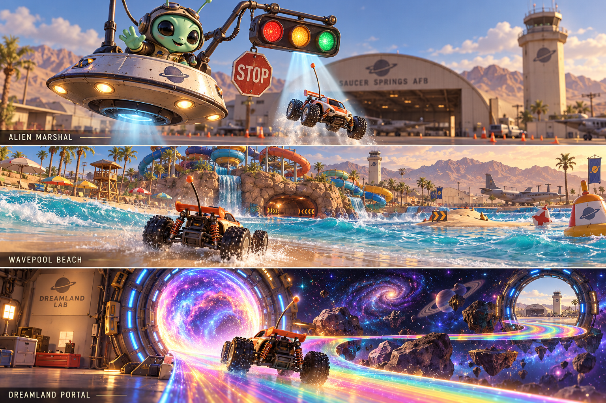

# Saucer Springs AFB — complete game design, v1

## Approved progression update — 23 October 2026

The four cups follow the world, superseding the original MK64 cup order below:

| Cup | Area | Four races |
|---|---|---|
| Home Base | Domestic and civilian life | Liberty Loop, BX Dash, School Run, Wavepool Beach |
| Flightline | Operational air base | Demo Team Circuit, Supply Line, Red Flag Ramp, Boneyard Maze |
| Dreamland | Experiments and secret labs | Cold Start, Ice Patrol, Canopy Run, Containment Circuit |
| Beyond the Portal | Connected alien world | Lunar Paddock, Comet Quarry, Gravity Garden, Night Wave |

The other base events remain explorable activities. The entire base remains driveable; cups organize races rather than replacing geography with menus. MK64 remains the reference for driving, race flow, items and controls. Course correspondences below describe inspirations, not the final cup membership.

The marshal begins as a robot MP. Discovering the alien location (`lab`) permanently changes the marshal to the friendly alien. This reveal does not require every specimen. The existing fifteen-specimen gate controls entry to Dreamland events and the portal separately.

23 October 2026. This is the **build specification**, not a claim that the game already looks or plays like the finished design. The [interactive atlas](index.html) contains the mapped places, courses and arenas. The [request ledger](../../rc-design-request-ledger.md) records the recovered owner direction. The approved [buggy and hangar reference](../../../assets/rc/concepts/buggy-hangar-v1.png) remains the finish target.

Concept art generated with the built-in image tool; this is a visual target, not a gameplay capture. [Generation prompt](concept-prompt.txt).

## The game we are building

**Mario Kart 64 races and battles, Re-Volt toy-car handling, all inside one large driveable Saucer Springs AFB.** The base explains why each course exists. Koopa Troopa Beach becomes the base wavepool. Kalimari Desert becomes the supply railway. Bowser’s Castle becomes the alien containment lab. Lakitu becomes a friendly alien on a small saucer.

The player can ignore the race rings and simply drive from housing, through the school and BX, along the flight line, out to the dirt track and back. An interior is a building in that world. A race is a temporary set of gates, rivals, items and rules placed over it. Finishing a race leaves the car at its actual finish line, ready to keep exploring.

The latest owner direction settles the design reference: **when a race or battle decision is uncertain, start from Mario Kart 64**. The exceptions are deliberate: toy-scale physical handling; connected-world exploration; short child-friendly recovery; our aircraft, characters, setting and art. All 16 courses and all four battle arenas have counterparts below. Existing school, BX, housing, golf and other activities remain additional experiences in the same base.

## World layout and travel

Keep the current approximately **5.8 × 6.3 km** playable frame. The old 30-second compressed hub is superseded. The base should feel large; most local races still take only 40–60 seconds per lap. Cross-base drives take minutes, with distinct districts and optional activities along the way. Do not advertise eight minutes as an exact corner-to-corner promise: the road route, speed and stops determine the trip.

The map uses current game coordinates, +x east and +z south. Solid roads come from the current OSM-derived overview. Dashed atlas links are **desired connectivity**, not surveyed roads or proof that a route is implemented. Existing anchors stay where the game places them. New venues are explicitly proposed sites, to be fitted to footprints and terrain before construction. Nellis supplies the large-scale geography and cultural reference; Saucer Springs remains a fictional playable base. Preserve OpenStreetMap attribution.

| District cluster | Landmarks and purpose | Connections |
|---|---|---|
| Northwest family town | Housing, stables, HQ, hospital, civic green | North road into Main Gate; school/BX town spine |
| West town and recreation | BX, commissary, school, gym/pool, skatepark, roller rink, ice rink, bowling, baseball | A continuous recreation loop and campus paths; two exits from every large venue |
| Central flight line | Main Gate, Red Flag ramp, hangars, demo team, runways | Service roads, taxiways and the town road; long views to orient the player |
| Southwest leisure | Petting Zoo, golf/clubhouse, tropical conservatory, wavepool and boardwalk | South base loop, cart paths and garden paths |
| Southeast desert | Dirt stadium/quarry, supply railway, Boneyard | Runway return, storage loop and eastern perimeter road |
| Northeast test campus | Public cold-weather hangar, locked inner alien lab, Night Wave portal | Eastern service road remains public; only the lab/portal progression gate locks |

Place the new public cold-weather hangar **outside** Dreamland’s locked inner fence so Flower Cup does not depend on completing the entire expedition. The tropical conservatory and recreation ice annex give the snow/jungle/ice references believable physical homes. They are designed additions, not claims about real Nellis facilities.

Every place has an entrance visible from the road, at least one unambiguous exit, a silhouette seen from the preceding junction and a route ribbon through its actual openings. High-speed roads get a meaningful landmark or optional choice every 20–30 seconds of travel; do not fill every gap with identical item boxes. Long runways and desert stretches may intentionally feel open.

### Dreamland portal and Rainbow Road

The owner’s latest direction makes Rainbow Road an **alien portal**, replacing the earlier elevated test-ring proposal. The portal is a visible drive-through object inside Dreamland. It shows the luminous track beyond it, opens only once that small course is prepared, and carries the same car/session into a bounded space pocket. The sky and gravity presentation may change; handling and controls stay familiar. No level picker or page reload intervenes.

The portal is the explicit fantasy exception to ordinary base geography. Its entry is a real base location; the course need not be squeezed into the Nellis footprint. A marked return portal is always available outside the race gates. Completing or quitting places the car on the safe Dreamland apron through the visible exit transition, preserving its world progress and garage choice. Falls use the alien marshal and a course-local safe node, never a stale base coordinate. Portal entry, cancellation, failure-to-load and return each require their own continuity test before implementation is accepted.

### Seamless-world acceptance

1. Start at Main Gate; drive to and through every public venue with one document, no level reload, teleport or recovery command.
2. Starting an event preserves the world. A local grid reset is a visible, explicit race action; it is never a hidden door transition.
3. Finishing or quitting removes event-only objects, restores ordinary traffic and continues at a safe point in the same place.
4. District floor, threshold, outside road and collision share the same height profile. Test slow entry, reverse exit and off-angle entry, not only a fast centre-line approach.
5. Streams load ahead of the car and prepare predictable neighbouring venues. A missing asset cannot remove collision beneath the car. Keep an already usable scene visible; a compact retry is reserved for a genuinely unavailable destination.
6. Map route selection never moves the car. Fast travel is separately labelled and available only after discovery. Arrival has safe heading, loaded collision and no race auto-start.

The 23 October implementation passed a single-document 8.06 km Main Gate → BX → School → Housing journey, entering and reversing out of all three districts. That proves those connections, not every proposed venue.

## Mario Kart 64 correspondence

Reference course names identify the intended driving experience. The working Saucer Springs names identify places/events in our game. The official [Nintendo manual](https://www.nintendo.com/eu/media/downloads/games_8/emanuals/nintendo_8/Manual_Nintendo64_MarioKart64_EN.pdf) supplies the cup/course catalogue, battle rules and item baseline. Detailed Saucer Springs layouts below are design decisions.

<!-- COURSE_MATRIX -->

| Cup | MK64 course | Saucer Springs course / physical home | What carries over |
|---|---|---|---|
| Mushroom | Luigi Raceway | **Gate Guard Raceway** — Main Gate & Airpark | An inviting first oval: wide tarmac, one tunnel and a long clear straight. Learn steering, items and three-lap flow. |
| Mushroom | Moo Moo Farm | **Paddock Dash** — Base Riding Stables | Short, bumpy farm rhythm becomes the family riding stables. Pop-up irrigation heads stand in for mole-like hazards. |
| Mushroom | Koopa Troopa Beach | **Wavepool Beach** — Sunrise Splash Waterpark | The owner’s explicit pairing: an artificial beach around a huge base wavepool, with rock arch and jump-through tunnel. |
| Mushroom | Kalimari Desert | **Supply Line** — Rail & Supply Depot | A desert loop punctuated by a moving freight train at two crossings. |
| Flower | Toad’s Turnpike | **Base Traffic** — Main Gate & Airpark | Race among base buses, pickups and tugs on a broad road loop with a clear oncoming lane. |
| Flower | Frappe Snowland | **Cold Start** — Cold-Weather Test Hangar | Artificial snow inside the environmental test hangar preserves the snowy S-bends and playful obstacles in a desert base. |
| Flower | Choco Mountain | **Quarry Run** — Desert Dirtbike Track | A winding desert quarry extension gives the dirt venue a steep mountain circuit. |
| Flower | Mario Raceway | **Demo Team Circuit** — Demonstration Team Hangar | A tighter showcase circuit: hairpin, S-bend, grass cut and hangar-size tunnel, with a clean demo-team identity. |
| Star | Wario Stadium | **Whoops Stadium** — Desert Dirtbike Track | A longer stadium-style dirt loop built from berms, jumps and a memorable large leap. |
| Star | Sherbet Land | **Ice Patrol** — Recreation Ice Rink | The recreation ice rink provides long low-grip turns, islands and penguin-shaped maintenance bots. |
| Star | Royal Raceway | **Clubhouse Grand Prix** — Sunrise Vista Golf Course | A grand sweeping road course with a large jump and a landmark clubhouse you can explore during free drive. |
| Star | Bowser’s Castle | **Containment Circuit** — Area 51½ · Dreamland | The secret lab supplies imposing architecture and timed mechanical obstacles, with friendly aliens watching through glass. |
| Special | D.K.’s Jungle Parkway | **Canopy Run** — Tropical Survival Garden | A tropical survival conservatory provides the lush creek, dock, bridge jump and winding canopy route. |
| Special | Yoshi Valley | **Boneyard Maze** — Desert Boneyard | Many narrow choices through retired aircraft converge before the finish. Route discovery is the skill. |
| Special | Banshee Boardwalk | **After Hours Boardwalk** — Sunrise Splash Waterpark | The wavepool’s after-hours service boardwalk gives the narrow night route, creaking timber and surprise silhouettes. |
| Special | Rainbow Road | **Night Wave Portal** — Area 51½ · Dreamland | The finale is Rainbow Road through an alien portal: a luminous floating track in strange space, entered by driving through the Dreamland portal and exited through the same visible connection back to the base. |

### Luigi Raceway → Gate Guard Raceway

**Route:** Visitor grid → Broad left sweeper → Gate-guard tunnel → Long straight → Banked return.

**Shortcut:** A modest inside-apron cut rewards a clean line without a jump.

**Hazards and fallback:** Cones on the verge only; no moving hazard in the first race.

**Construction:** Extend the existing gate course into a 400–500 m teaching oval; open-world road passes alongside.

### Moo Moo Farm → Paddock Dash

**Route:** Stable yard → Wide dirt bend → Irrigation humps → Feed shed → Paddock straight.

**Shortcut:** Inside hay-bale line is quicker but bumpier.

**Hazards and fallback:** Visible rising sprinkler heads and shallow ruts; horses stay off the track.

**Construction:** Build stable/paddock kit, animated irrigation heads and a 350–450 m dirt loop.

### Koopa Troopa Beach → Wavepool Beach

**Route:** Beach start → Dry sand bend → Wave wash → Tunnel jump → Sandbar → Beach finish.

**Shortcut:** Difficult tunnel ramp plus a wave-timed sandbar; both rejoin before the next gate.

**Hazards and fallback:** Waves slow and nudge; a dry outside line is always open.

**Construction:** Expand Sunrise Splash with wavepool, sand beach, rock tunnel, wave phase and wet-sand handling.

### Kalimari Desert → Supply Line

**Route:** Depot grid → Desert bend → Crossing one → Rail cutting → Crossing two → Supply shed.

**Shortcut:** The service underpass avoids a train wait but costs distance when the crossing is clear.

**Hazards and fallback:** Early crossing lights; soft train contact and safe rail shoulders.

**Construction:** Add rail depot and train loop on the southeast service roads; 650–800 m course.

### Toad’s Turnpike → Base Traffic

**Route:** Main Gate → Bus loop → BX boulevard → Service-road merge → Gate return.

**Shortcut:** A signed service lane cuts a corner; it is narrower and has a slow-speed dogleg.

**Hazards and fallback:** Traffic telegraphs lane changes and yields when trapping would occur. Kid impacts are brief bumps.

**Construction:** Author a connected 1–1.5 km town circuit, deterministic traffic lanes and visible intersections.

### Frappe Snowland → Cold Start

**Route:** Equipment doors → Snowfield → Snow-dummy slalom → Banked drift → Cooling loop → Exit apron.

**Shortcut:** A raised snow bank cuts the final S; hold too much throttle and the soft drift slows you.

**Hazards and fallback:** Snow dummies, soft banks and signalled vent puffs.

**Construction:** New public cold-test hangar and snow surface; outer campus accessible before Dreamland unlock.

### Choco Mountain → Quarry Run

**Route:** Cutting entrance → Narrow uphill → Rockfall bend → Ridge traverse → Dusty downhill → Track return.

**Shortcut:** A maintenance ledge crosses the inside of the ridge; a miss drops onto the lower main route.

**Hazards and fallback:** Rounded foam test boulders tumble on a visible cycle; no lethal crushing or blind full-width blockage.

**Construction:** Expand northeast of Whoops with authored cliff cuttings, ridgeline and boulder runoffs; 500–650 m.

### Mario Raceway → Demo Team Circuit

**Route:** Demo grid → Hairpin → Hangar pipe tunnel → Grass infield → Technical S → Finish straight.

**Shortcut:** Boost across a rough infield strip; it loses time without enough speed.

**Hazards and fallback:** Static tyre stacks mark the edge; the driving line is the challenge.

**Construction:** Create 450–550 m technical tarmac loop adjacent to demo hangar; share doors with free drive.

### Wario Stadium → Whoops Stadium

**Route:** Paddock grid → Whoop rhythm → Long berm → Tabletop jump → Cross-under → Final double.

**Shortcut:** Inside berm and narrow double reward lifting before the jump; no checkpoint-skipping wall exploit.

**Hazards and fallback:** Bad jumps lose speed and land safely on dirt, never reset a whole lap.

**Construction:** Enlarge Whoops to 700–900 m with a separate novice practice loop; 80–110 s per lap.

### Sherbet Land → Ice Patrol

**Route:** Rubber grid → Ice lake oval → Bot slalom → Ice-island tunnel → Long drift → Grip strip.

**Shortcut:** An ice bridge through the central island requires a controlled entry and exit.

**Hazards and fallback:** Bots cross predictably; blue recesses catch a wheel gently and slope back out.

**Construction:** Build the ice annex alongside, not instead of, the roller rink; 220–300 m loop.

### Royal Raceway → Clubhouse Grand Prix

**Route:** Clubhouse grid → Garden bends → Pond approach → Big bridge jump → Clubhouse avenue → Green-side return.

**Shortcut:** A narrow cart path cuts the garden section; coins invite a clubhouse forecourt detour outside races.

**Hazards and fallback:** Water margins have shallow banks; a missed jump joins the lower road.

**Construction:** Add officers’ club/clubhouse hero exterior and a 650–800 m paved loop beside existing golf.

### Bowser’s Castle → Containment Circuit

**Route:** Bunker doors → Press corridor → Moving catwalk → Courtyard turn → Saucer chamber → Lab finish.

**Shortcut:** A maintenance catwalk crosses the saucer chamber; brake for its narrow landing.

**Hazards and fallback:** Foam-faced test presses, sweeping doors and animated containment beams; all have anticipation cues and bypasses.

**Construction:** Expand Dreamland interior into a 450–600 m route; locked by the existing 15 specimens, with a visible turnaround outside.

### D.K.’s Jungle Parkway → Canopy Run

**Route:** Palm gate → Creek jump → Dock → Jungle bends → Maintenance tunnel → Canopy climb.

**Shortcut:** A raised service walkway skips mud; a missed transfer falls to the slower bank.

**Hazards and fallback:** Foliage never hides gates; workboat is scenery; fruit props give light, clearly cued bumps.

**Construction:** Build conservatory/garden next to wavepool and golf; 550–700 m route with two open road exits.

### Yoshi Valley → Boneyard Maze

**Route:** Storage gate → Three-way split → Wing bridges → Fuselage canyon → Rejoin → Wide aircraft obstacle → Storage loop.

**Shortcut:** One high wing route is fastest; two ground routes are safer. All branches share equivalent gate progress.

**Hazards and fallback:** A slow rotating radar dome sweeps the rejoin area; falls reach the service road.

**Construction:** Add authored multi-path graph and clear shared rejoin gates; keep race position visible in Kid mode.

### Banshee Boardwalk → After Hours Boardwalk

**Route:** Closed-park arch → Lagoon boardwalk → Pump-house tunnel → Forked dock → Maintenance shed → Moonlit return.

**Shortcut:** A narrow maintenance gangway trims the pump-house detour; bright exit arrows prevent dead ends.

**Hazards and fallback:** Friendly inspection drones and moths replace frightening creatures; rail gaps lead to shallow recovery shelves.

**Construction:** Build a 450–600 m permanent boardwalk around the lagoon, playable by day and dressed for night races.

### Rainbow Road → Night Wave Portal

**Route:** Dreamland portal → Rainbow climb → Floating curves → Saucer fly-by → Starlight spiral → Return portal → Lab apron.

**Shortcut:** Optional inside catwalk saves a broad bend but has a narrow dogleg; the main route has guardrails.

**Hazards and fallback:** Slow UFO inspection pods move with clear tells; the alien marshal beams fallen cars back to the last safe course node. A separate exit always returns to the Dreamland apron.

**Construction:** Build a 1.5–2 km portal course with luminous roadway, starfield, visible guardrails, saucer fly-bys and two-way return portal. Prepare the course before the portal opens; preserve the same session, car and saved base state. One-lap expedition finale; three-lap full-cup variant. Accessible after Dreamland discovery.

<!-- END_COURSE_MATRIX -->

### What remains outside the sixteen-course correspondence

Liberty Loop, the BX, School Run, HQ Paperwork Circuit, Commissary Dash, Ramp Rat, Hangar Hop, Runway Drag, Rink Drift, Round the Bases, Paper Route, Grand Tour, Wing Walker and Splash Down retain their own routes. They do not need to impersonate another MK64 circuit. The same venue can support its short local event, its MK64-inspired showcase course, free driving and a battle arena without becoming four disconnected maps.

The Grand Tour is a 6–8 km point-to-point showcase over the actual road network: Main Gate → town → recreation → golf/wavepool → supply depot → Boneyard → flight line. Show its estimated 10–15 minute duration before starting. It is optional, not a prerequisite for the short local races or the lab unlock.

### Four battle arenas

<!-- BATTLE_MATRIX -->

| MK64 arena | Saucer Springs arena | Physical layout and play |
|---|---|---|
| Big Donut | **Fuel Depot Ring** | A broad circular service road around a fenced central storage island; four evenly spaced item bays and no dead-end pockets. See an opponent across the ring, choose which way to chase, cut behind the storage island for cover. Centre is a visible restricted island, not a damaging pit. |
| Block Fort | **BX Pallet Forts** | Four coloured pallet forts in the warehouse yard, three driveable heights, perimeter ramps and narrow connecting bridges. Climb for sightlines and item access; drop to ground to escape. Distinct colours make positions readable above the weather balloons. |
| Double Deck | **HQ Parking Decks** | Three open parking levels connected by ramps on alternating sides, with central openings and broad lower escape lanes. Read opponents’ height from their balloons and ramps; vertical routes offer choices rather than sealed camping pockets. |
| Skyscraper | **Hangar Roof Deck** | A square elevated maintenance deck with a central opening and four exposed side ledges; a permanent external service ramp connects to the base. The compact roof makes positioning matter. Alien marshal recovers falls; Kid recovery preserves balloons, Big Kid loses one. Roof battle remains optional. |

<!-- END_BATTLE_MATRIX -->

Ramp, WIC and BX free-form Furball spaces remain useful additional arenas. Each formal arena needs at least two escape choices from every item spawn, a clear return route after falling and readable opponent elevation. Avoid long sightlines that make one missile decide a match immediately.

## Race flow and difficulty

### Shared-game correspondence

| Mario Kart 64 part | Saucer Springs counterpart | Decision |
|---|---|---|
| Grand Prix and four cups | Four mapped four-event series in the same order | Carry over the series structure, podium and points: 9 / 6 / 3 / 1 for the first four. Always allow Continue, Retry or Leave after a result. |
| Time Trials | Solo event with personal ghost and split times | Fixed route/hazard seed; no rivals, Retreat or random offensive items. One defined three-charge Afterburner allocation. Ghost is non-colliding and can be hidden. |
| Versus | Chosen race with friends and optional AI fill | Same track and item rules; no required progression for a guest’s already-host-unlocked event. |
| Battle | Furball, four mapped arenas plus existing spaces | Three balloons; elimination primary, timed pops secondary. |
| Character and weight choice | Body choice plus jet shell/livery | Body supplies light/balanced/heavy handling identity. Shell and nose art are cosmetic; no need for human drivers inside toy cars. |
| 50 / 100 / 150 cc | Rookie / Club / Ace event pace | Speed/AI pace is separate from handling assists. Rookie is the first-play default; Club and Ace are explicit race settings. Do not increase unstick difficulty with pace. |
| Hop, drift and mini-turbo | Suspension hop, power slide and a short exit boost | Hold drift while steering after the hop; visible tyre sparks charge through two stages. Release gives a brief boost. Kid may auto-initiate the hop; it still requires holding a readable line. |
| Start boost / early-start spin | Green-light launch boost / short wheelspin | A visible timing window; error costs a little launch speed, never freezes the car for several seconds. |
| Item roulette and held defence | One-slot crate roulette, orbiting rounds and rear-held oil/drop | Hold fire to show a defensive item behind/around the car; release launches/drops it. No towed missile trailer. |
| Lap, place, item and course map HUD | Compact race strip and minimap over the base | Keep the same functional information. In free drive, replace lap/place with destination and discovery. |
| Lakitu | Alien marshal on a small saucer | Complete marshal/recovery role defined below. |
| Post-race podium | Small mobile awards platform at the event finish | Three cars, medal/coin effect, clear Again / Drive / Map; skippable immediately. |
| Four-player split screen | Local two/four-player RC racing and Furball | Designed extension below; not present in the current release. |

Local play uses one shared simulation and separate player cameras/input slots: two players split horizontally, three/four use quadrants. Gamepads join with a visible confirm; keyboard belongs to one slot. The host’s unlocks select venues; guests choose available bodies and cosmetics without overwriting the host’s saves. Each viewport gets its own item/lap information and alien cue. A global pause freezes all players; one player opening a local information panel cannot silently freeze the others. The audio graph is shared, with one music/mute owner and distance attenuation from the nearest local listener.

During shared free drive, players remain in the same base and can meet physically. Stream around all player positions with bounded shared asset caching; never evict collision beneath any player. Explicit group travel moves only consenting players. Before shipping local play, measure two/four simultaneous views and separated driving on supported hardware; lower distant detail first. This is a designed feature requiring implementation and performance acceptance, not a claim that synthetic single-gamepad tests prove multiplayer.

**Default circuit: three laps.** Target eight cars for the full race field; the current four-car field is an interim implementation. Small interiors may retain four where eight would physically jam the course. Sprints are one pass. The long Night Wave expedition finale uses one lap; its full Special Cup version uses three. Course details always state the exception before the start.

From Free Drive, enter an event ring and press the normal confirm control. The compact choice is Race / Time Trial / Furball where supported, plus Kid / Big Kid. Alien marshal descends with three start lights; a short staged countdown ends on green. A correctly timed throttle gives a small launch boost; early sustained throttle gives a brief wheelspin, not a long stall. All signals work without sound.

Checkpoints span every valid branch. Skill shortcuts rejoin before the next required checkpoint. A branch must never count a lap simply because its geometry crosses the finish plane. The route line uses anticipation: broad turn cues, a braking colour transition and a distinct landing marker. Do not replace it with scattered arrows that disappear under shelves.

Results show place, time, medal and personal best, with **Again / Drive / Map**. Every finish gets a cheerful response, but first place still means beating rivals. No artificial instant win; no rivals permanently parked two gates behind. A missed corner should cost a place and a clean shortcut should earn it.

| Mode | Handling and recovery | Competition |
|---|---|---|
| Kid | Speed-sensitive steering, traction help, air levelling, one-second auto-right, quick alien recovery; no added time penalty | Close racing both ways. Retain current no-target assistance for race items as the initial family setting; opponents still race, pass and win. This differs deliberately from the MK64 default. |
| Big Kid | Steering/traction assistance off; recovery still available | Rivals use the same items and opportunities as the player; stronger lines and authored shortcuts. |
| Furball, either difficulty | Handling follows Kid/Big Kid | Rivals target the player. Three balloons each, one-second minimum fire interval, clear warnings and two seconds of post-pop Chaff. Kid aim is less accurate, not harmless. |

Tuning targets are tests, not promises of a particular child’s win rate: a clean ordinary lap competes for a podium; repeated missed corners can lose; a skilled line beats the safe line; neither mode completes before the player starts. Seeded AI comparisons measure overtakes and finish spread. The owner’s child playtest is the final check on frustration and fun.

### Furball

Use the familiar three-balloon elimination match as the primary rule. Weather balloons float on 3–4.5 m tethers so cars remain findable behind buildings. A hit pops one balloon with a large readable break animation, brief wobble and temporary Chaff; no repeated stunlock. Last car remaining wins. A separate three-minute match awards most pops, ties resolved by balloons remaining, then shared win.

At zero balloons, offer immediate rematch or watch. In a multi-car match, an optional one-use **decoy drone cart** is the Mini Bomb Kart counterpart: it can make one harmless surprise pop, cannot collect items or win, and then retires. No ghost farming of lifetime kills. Rival AI seeks crates when empty, hunts when armed, uses cover and flees briefly after a pop.

Lifetime pops update nose art automatically: shark mouth at 1, lightning bolt at 3, checker tail at 6, gold stars at 10. Additional unlocks are friendly mascots, mission tallies and fictional squadron tails. Keep a garage preview; no grind is required to enter a race.

## Alien marshal: our Lakitu

A friendly small alien rides a compact saucer: warm mint skin, large expressive dark eyes, rounded hands, a cream/orange safety vest and an open cockpit. Its face, hands and signs remain legible from behind the car. The saucer banks gently and carries a visible tractor beam for recovery. The robot MP performs these jobs initially; the alien takes over only after discovery of the alien location, with that discovery saved between visits. No spoken instruction is essential.

| Job | Visual action | Timing / rule |
|---|---|---|
| Start marshal | Descends beside the grid with three lamps, then rises clear | Each lamp lights in sequence; green and a flag wave release the grid. Never blocks the next turn. |
| Lap / final lap | Briefly shows a large `2/3` or final-lap board | One presentation at a lap boundary; it replaces, rather than stacks with, another low-priority board. |
| Wrong way | Big curved arrow and pointing arm | Show after roughly one second moving against course direction; suppress while reversing to recover a corner. Clear immediately when corrected. |
| Stuck / fall recovery | Projects a soft tractor beam around the chassis, lifts, carries to safe road, lowers and waves | Aim for 2–3 seconds total. Pick a tested safe node behind the last valid gate; preserve lap, items and heading. Kid gets no extra penalty. |
| Retreat | Lowers a floating 3-D STOP sign ahead of the player; lamps count down | Three-second warning; stationary means below 0.2 m/s for one second. Everyone observes the same rule. |
| Flag timeout | Lifts a non-stopping car just above the track; STOP board remains visible | Put the car down when the flag interval ends, at most two seconds after compliant cars resume. No mystery loss of controls. |
| Finish | Chequered board and cheerful salute beside the line | Race result appears; Alien marshal rises away so the car can continue driving. |

Retreat occurs at most once in a race, never during a jump, a blind interior turn, a countdown or the final approach. A short audible bugle is supplementary. The sign, flag movement and countdown must teach the rule while muted. A clear green/GO cue ends it. Free Drive can observe the base ceremony without forcing the player to participate. No flag timeout in Time Trial; keep records deterministic.

One alien-marshal instance owns the intervention. Priority is recovery → mandatory start/stop → finish → wrong way → lap board. Do not stack multiple drones or conflicting signs. Pausing freezes the animation and its timer. Cancelling a race clears pending boards. Recovery cannot start while a deliberate fast travel or grid reset owns the car.

## Items: MK64 role → Saucer Springs implementation

One visible item slot, roulette feedback on collection, clear held-item silhouette and one ordinary fire control. Crates reappear after three seconds. Item distribution depends on position in races and is symmetrical in battle. Explain complex items through their icon and a short optional tooltip, not another modal tutorial.

| MK64 role | Our item | Defined behaviour |
|---|---|---|
| Mushroom | Afterburner | About 60% extra push for 1.4 s; visible exhaust puff. No loss of steering. |
| Triple Mushroom | Triple Afterburner | Three discrete charges, each visible in the slot. Cannot stack their acceleration. |
| Super Mushroom | Hot Start | Repeated short boosts during a six-second window; rare, trailing positions only. |
| Banana / Banana Bunch | Hydraulic Leak / three-drop pack | A small oil puddle briefly reduces grip. Strong visual sheen; three-drop version displays remaining drops. |
| Green Shell | Zuni | Straight toy rocket with up to two predictable wall bounces; expires after four seconds. |
| Red Shell | Fox Two | Seeks the nearest valid car ahead with a visual lock cue; defeated by Chaff, Flare or solid cover. |
| Triple shells | Three-pack Zuni / Fox Two | Three small visible toy rounds orbit the RC shell; each can block one hit or be launched. **No trailer.** Winchester means empty, not a separate pickup. |
| Spiny Shell | Pitbull | Finds the leader in race mode; warns the target before arrival. A small effect radius prevents a whole field being trapped. Not in elimination Furball. |
| Star | Chaff burst | Temporary invulnerability with a sparkling foil halo. Standard Chaff blocks one hit for up to five seconds; rare Super Chaff gives a short speed boost as the closer Star counterpart. |
| Boo | Optical Camo | Brief translucent shimmer and one stolen held item from a valid rival; the car stays faintly visible and collidable. No stealing from an empty slot. |
| Lightning | Power Dip | A brief cartoon electrical hiccup slows other cars and shows static icons. No shrinking that changes collision; no effect during alien recovery or post-hit Chaff. Rare race-only catch-up item. |
| Fake Item Box | Decoy Crate | Looks close to a normal crate but has a visible upside-down mark; contact causes a brief wobble. The distinction works without colour. |

Keep the existing water balloon as **Splash**, a short arcing throw with one-spin maximum. **Fox One** is the owner’s extra skill weapon: steering sweeps a visible radar beam and the toy missile follows it; breaking sight loses tracking. **Flare** drops a bright decoy behind the car, diverting one Fox Two for 1.5 seconds. **Buddy Lase** tags one visible rival for three seconds, improving allies’ aim in optional team battle; it does no damage itself. **JDAM** is a toy foam parcel lobbed at a visible ground reticle, with a one-second landing marker and small wobble radius. **Pudding** leaves a short-lived sticky patch with no spin. These additions are fully defined options; introduce them after the standard item set is readable and balanced.

Furball item set: Splash, Zuni, Fox Two, Hydraulic Leak, Chaff, Flare, Afterburner and Decoy Crate. No leader-only Pitbull, field-wide Power Dip or unlimited boost. Three-packs are rare. All hits are cartoon wobbles or balloon pops; cars never explode into wreckage.

The missile trailer/Jammer mechanic is **rejected** by the owner’s later playtest. Existing trailer code is legacy implementation to remove; a parked MJ-1 jammer remains an appropriate ground-support prop.

## Vehicles, garage and progression

All cars share the RC language: chassis, exposed shocks, knobby tyres, antenna and a snap-on shell. Jet bodies remain recognisable F-16, F-15, A-10, F-22 and Su-27 toys. Paint tribes include Viper Punks, Mudhen Mafia, Prop Gang, Arctic, Aggressor and Night Wave. No manufacturer marks or real unit insignia.

| Body | Handling identity | Access |
|---|---|---|
| Buggy | Balanced acceleration, suspension and off-road grip | Start vehicle; approved orange/ivory sculpted art |
| Monster truck | Large tyres and softer suspension; better over bumps, slower tight turns | Available in garage; mastery is optional |
| Rally hatch | Low, precise, fast on smooth tarmac; less forgiving on whoops | Available in garage |
| Pickup | Stable long wheelbase and predictable jumps; moderate turn rate | Available in garage |
| Golf cart | Slow and comic, generous steering, low-pressure exploration | Discover Sunrise Vista |

Top-speed and acceleration differences stay small enough that any body can complete every required course. A cosmetic jet shell never changes the collision footprint or secretly boosts performance. Garage shows one large rotating car, body/shell/paint controls in aligned rows and nose-art milestones on demand. It remembers the choice and returns to the same parked position in the world.

Keep the **15 existing specimen IDs** and Dreamland unlock condition. The new HQ, commissary and MK64 counterpart venues add optional challenge coins, not retroactive locks on a player’s saved progress. Every district has five designed coin approaches and return routes; skill coins remain optional. Race records and medals are per event, mode and difficulty so assisted records do not silently replace unassisted ones.

Cup play groups the mapped circuits in the original four-course order. Entering a cup is an explicit short series, with results and a clear Continue / Leave choice between races. The base remains the world beneath the series; local movement to the next grid is a clearly chosen quick transfer. Single races remain available independently after discovery. Dreamland/Special Cup locked entries show the exact specimen condition rather than an unexplained disabled button.

## Art, models and sound

The approved hero image has sculpted surfaces, believable material thickness, tyre detail, suspension and strong ground contact. Current blocky/procedural art is a working scaffold. A catalogue entry or a passing frame gate does not make it finished art.

| Asset family | Required inventory and treatment |
|---|---|
| RC cars | Five bodies, five jet shells, shared wheel/steering/suspension pivots, paints and automatic nose art. Hero buggy ~25k triangles, other bodies 12–20k starting budgets. |
| Ramp aircraft | F-16, F-15C/E, F-22, F-35A, A-10, B-52, KC-135, E-3, C-17, EA-18G, Typhoon, Rafale, Gripen, Tornado, Su-27 and MQ-9. Distinct silhouettes, gear and underside detail. 8–15k near models plus simplified far rows. |
| Museum/captured hardware | F-105, F-4, F-100, F-111, F-117; MiG-21/23/29, Su-27; SA-2, SA-6, ZSU-23-4, Flat Face and Fan Song. Radar pivots are authored, not random whole-object rotation. |
| Ground vehicles | MJ-1, tow tug, R-11, P-23, Security Forces pickup, school/shuttle buses, Janet-style 737, golf cart, civilian pickup/sedan, supply locomotive/wagons, resurfacer bots, small workboat. Moving lanes and parked versions share models. |
| Building kit | Stucco/roof variants plus hero tower, hangars, demo bay, BX, commissary, school, HQ/parking decks, gym, pool, hospital, chapel, recreation buildings, bunker, gate booth, water tower, clubhouse, stables, supply depot and environmental hangars. |
| Activity kits | Skate modules; rink/ice; bowling lanes/pins; baseball; golf; dirt berms/ramps; quarry; wavepool beach/rocks/flumes/boardwalk; Boneyard ramps; snow and tropical conservatory; portal Night Wave track. |
| Characters and props | Alien marshal/saucer/tractor beam/boards; friendly aliens/tubes; crew chiefs; distant horses; PT belt, PCS pods, yard sign; furniture, chairs, copier, carts, food fixtures, plants, fences, lamps, bins, pallets, tools and AGE carts. |
| Surface finish | Asphalt, concrete, stucco, tile, gravel, gym/rink wood, ice, snow, sand, grass, mud and metal. Original or licensed PBR sets, restrained wear/decals and baked landmark ambient occlusion. No checkerboard z-fighting. |

Use real reference photos first for aircraft and base architecture, then simplify deliberately. Keep warm desert daylight, cool shaded interiors with readable floors, and a night cycle with visible road edges. Each district gets a recognisable colour/material pair. Secret science is playful, not frightening. The base skyline, mountains, runways and tower should orient the player without opening the map.

Editable Blender sources are required. Export visible geometry, explicit collision, surfaces, gates, racing lines, alternate lines, item positions, coins, specimens and camera hints together. Starting district budgets remain ≤250k visible triangles, ≤40k collision triangles, ≤24 materials and ≤12 MB; split large venues into neighbouring chunks. These are budgets to measure, not excuses to flatten the hero art.

Motor sound varies continuously with load/speed and fades when idle; avoid a short obvious repeating sample. Tyres distinguish dirt, wood, ice and asphalt. Boost, lock, pop and recovery each have a short recognisable sound paired with a visible cue. Music is optional and understated. Mute is always one reachable control and persists. Silent QA uses the real audio graph with destination gain clamped.

## Interface and navigation

One compact desktop play row: Pause · Mute · Map · Garage · Kid/Big Kid · Recover. Racing adds one compact status strip: place, lap, item and time; Furball replaces lap with balloon icons. No unexplained brevity-code buttons. Tumbleweed, RTB and Knock it off can live in tooltips or callouts. The Alien marshal carries temporary instruction so the screen does not accumulate banners.

Map opens over the paused drive, shows the car and roads, and selects a destination with **Route / Travel** as distinct actions. Place names and symbols remain consistent between map, signs and event rings. On phones, essential driving controls stay thumb-reachable; secondary choices use the existing menu. Escape always closes the current panel before pausing the game. Opening or closing a menu cannot reset an event.

The main Guns Only picker is three plain cards: F-22, Cobra, RC. RC opens at the base, not an isolated district selector. Keep older deep links working; treat them as compatibility links. Within RC, changing a destination sets a route or chooses explicit travel, and must never quietly load a replacement level.

All bounded map/garage/menu views must fit an ordinary laptop, phone portrait, phone landscape and enlarged text. Readability is checked from actual viewport screenshots; measurement alone is insufficient. Preload likely next routes/models with bounded concurrency and reuse prepared assets, including during delayed networking.

## Analytics and completion criteria

Keep existing explicit telemetry consent and anonymous bounded sessions. Useful aggregates: sessions/day; drive versus race/battle choice; event start/finish/quit; retry rate; completion/place distribution by difficulty; recovery frequency by venue; frame-time percentiles; menu-to-drive conversion; and mute usage. Log coarse event/location IDs, never raw driving trails or identifying device data. Separate automated QA with telemetry off.

An event is ready when its full main line, all shortcuts and every fallback are driven with the actual car, AI completes with valid gates, items obey the mode rules, the alien marshal behaves on mute, and the player can arrive and leave from the base. An art asset is ready when it matches its silhouette/reference, has correct scale/materials/pivots/collision, stays inside measured budgets and is inspected in real gameplay lighting. A venue is ready only when both are true.

### Build sequence, with exit criteria

1. **World contract and readable core:** preserve verified connected entrances; remove stale isolated-menu behavior; correct remaining place names; improve the hero buggy, camera, ribbon and first oval. Exit: a newcomer can drive Main Gate → Housing → BX → School and choose a race unaided.
2. **MK64 common rules:** complete alien marshal role set, three-lap flow, eight-car target where space permits, standard item roles, no-instant-win tuning and three-balloon arenas. Remove rejected trailer. Exit: repeatable fair race and battle with sound muted, including falls and rematch.
3. **Mushroom set:** Gate Guard Raceway, stables, **wavepool beach**, supply railway. Finish one course’s scenery, routes and hazards before declaring the cup built. Exit: four distinct complete courses that also connect to free drive.
4. **Town and Flower set:** HQ/commissary detail; base traffic; cold-test hangar; quarry; demo circuit. Exit: all public entrances and vehicle crossings work with no required secret unlock.
5. **Recreation and Star set:** dirt stadium, ice annex, clubhouse, containment lab; finish roller rink, pool, bowling, baseball, golf and skatepark. Exit: each has a distinct driving feel and safe exits.
6. **Special set and world finish:** tropical conservatory, Boneyard branches, night boardwalk, portal Night Wave, remaining aircraft/props and source-based horizon. Exit: expedition and cup complete, persistent progress survives reload, all routes remain available for exploration.
7. **Release acceptance:** automated unit/geometry/route checks; actual GPU headless visual/performance runs; real viewport screenshots; slow/offline prepared-navigation checks; full public-package hash verification and live route smoke. Human child playtest, physical controller feel and audible mix are recorded separately, not inferred from silent automation.

No token-budget percentage is a delivery estimate. The design is complete enough to assign bounded construction tasks; timings and exact placements are initial targets that must survive a driven blockout. The sections below are the individual venue briefs, including the additional destinations beyond the sixteen MK64 counterparts.

<!-- PLACE_BRIEFS -->

## 01. Main Gate & Airpark

**Site:** (-607, -29) · Existing anchor. **Current state:** Playable scaffold.

First view of the whole base: RC-scale tyres beside full-size aircraft, mountains and the tower. A clear choice between town, flight line and home streets.

**Arrival and exit:** Wide open visitor lane links both directions of the perimeter road. Event ring sits in a lay-by, never across the drive-through lane.

**Drive through:** Welcome monument → Defenders booth → Gate-guard aircraft → Visitor car park → Town road.

| Activity | Shape / target | Signature |
|---|---|---|
| Gate Guard | Circuit · 300–400 m · 40–55 s / lap | Slalom round jet pylons; tow-rope-sized lane markings make the toy scale obvious. |

**Skill line:** A low plinth ramp passes under the F-4 tail; a dogleg forces braking before the drop back onto the car park.

**Recovery and fallback:** Barrier arms stay raised on the public driving path. Falling off a plinth returns to the paved loop.

**Art:** Sandstone welcome monument; SAUCER SPRINGS AFB; F-105, F-4, F-100, F-111, F-117 static displays; Alien marshal booth, PT belt, flag and direction signs.

**Discovery:** First specimen sits visibly beside the visitor lane; five airpark coins introduce optional exploration.

**Done when:** From fresh start, a child can drive toward any public district without entering a race or selecting a level. Both gate lanes pass the real car.

## 02. Family Housing · Liberty Loop

**Site:** (-1285, -1132) · Existing anchor. **Current state:** Integrated district; needs art pass.

A familiar neighbourhood becomes a giant toy obstacle course. Safe roads are the easy line; gardens reward throttle control.

**Arrival and exit:** Two street openings join the north base road. The current south entrance remains flush with the district floor.

**Drive through:** PT-belt start → Cul-de-sac → Sprinkler lawns → Open garage ramp → Backyard barbecue → Playground → Street exit.

| Activity | Shape / target | Signature |
|---|---|---|
| Liberty Loop | Circuit · 406 m · 45–60 s / lap | Boost pad on the straight; garden obstacles never block the road. |
| Paper Route | Checkpoint run · 1.2 km target · 2–3 min | Mailbox flags flip when passed; finish back at the neighbourhood entrance. |

**Skill line:** Garden Wall Run: box ramp → 0.8 m wall top → braking dogleg → 0.8 m gap. About 8% quicker when clean; misses land in a yard with a broad road opening.

**Recovery and fallback:** Sprinklers nudge, never pin. Trampoline has sloped access and an open landing apron. Every fenced yard has a car-sized exit.

**Art:** Tan/peach/sage stucco and terracotta roofs; Xeriscape, bikes, basketball hoop, trampoline, barbecue; PCS pods/boxes, mailboxes, Yard of the Month, 15 MPH and quiet-hours signs.

**Discovery:** Specimen under a barbecue side table; five coins at the garage, trampoline, wall, moving pod and playground.

**Done when:** Complete road lap and every yard exit; a full-throttle shortcut miss rejoins the slow route. No doorstep, kerb or district seam traps the buggy.

## 03. HQ Offices · Paperwork Circuit

**Site:** (-700, -250) · Proposed site. **Current state:** Missing district — restored to scope.

A small office building becomes a maze at wheel height: desk legs, carpet islands, a huge copier and rolling chairs.

**Arrival and exit:** Front accessible ramp from the civic road; rear mailroom loading ramp exits onto the same road network. Both doors stay open.

**Drive through:** Reception mat → Desk-leg slalom → Rolling-chair bay → Copier room → Mailroom → Conference table → Front lobby.

| Activity | Shape / target | Signature |
|---|---|---|
| Paperwork Circuit | Circuit · 280–340 m · 45–60 s / lap | Carpet slows; polished corridor lets you slide. Chairs move across a visible, timed crossing. |
| Mandatory Fun Run | Sprint · 500–650 m · 75–100 s | HQ rear door → civic green → BX forecourt; a pizza-table finish. |

**Skill line:** Mail-cart ramp climbs a low sorting shelf, brakes around a parcel, hops to the adjacent shelf and drops by the conference room. Main route stays at least 3 m wide.

**Recovery and fallback:** Chairs yield if the car is in their path. Paper stacks are light props; power cables are flattened into collision. Every under-desk pocket has two exits.

**Art:** Low-pile blue carpet, cream walls, venetian-blind light; Desks, caster chairs, copier, mail carts, intrays, paper boxes; Fictional squadron noticeboard; one understated meeting joke.

**Discovery:** Specimen visible in a transparent outgoing-mail tray; five coins use the copier base, desk tunnel, chair bay, shelf and rear courtyard.

**Done when:** Drive in from town, complete a lap, drive out the loading ramp in the same session. Camera never stays behind a desk panel or chair back.

## 04. Hospital & Civic Green

**Site:** (-412, -507) · Reference anchor; footprint to fit. **Current state:** Background landmark; through-route to detail.

A recognisable town landmark and a calm route between housing and Main Gate. It adds life without becoming another mandatory race.

**Arrival and exit:** Public forecourt joins the north road; pedestrian ramps cross the green. Ambulance bay stays outside the racing line.

**Drive through:** Civic green → Canopy → Forecourt → Shuttle stop → North road.

| Activity | Shape / target | Signature |
|---|---|---|
| Civic connector | Free drive · 200–350 m · 30–60 s | A shaded alternative to the main road, with chapel and water-tower sightlines. |

**Skill line:** Optional planter-edge coin route has sloped access and rejoins the forecourt; no rooftop route.

**Recovery and fallback:** Parked ambulances remain static; benches and planters never form sealed pockets.

**Art:** Hospital canopy and restrained medical symbol; Chapel, water tower, shade structures, shuttle bus; Town landscaping connects to the surrounding housing palette.

**Discovery:** Coins on the public route; no extra mandatory specimen added to the existing save requirements.

**Done when:** Forecourt connects at both ends and cannot accidentally start an event. Quiet visual respite between busy venues.

## 05. Base Exchange

**Site:** (-546, 791) · Existing anchor. **Current state:** Integrated district; needs richer finish.

The big retail circuit: amber concourse, contrasting departments, giant products, food-court table tunnels and an obvious return to daylight.

**Arrival and exit:** Automatic front doors from the car park; stockroom service door is a second physical exit. The racing ribbon remains visible throughout Free Drive.

**Drive through:** Entrance mural → Amber concourse → Electronics islands → Toy corner → Clothing runway → Food-court tables → Checkout 3 → Front doors.

| Activity | Shape / target | Signature |
|---|---|---|
| The BX | Circuit · 317 m · 40–55 s / lap | Department colours and overhead shapes identify the next turn. |
| Parking Lot Scramble | Furball · 100 × 80 m arena · 3 min | Parked cars and trolley corrals create cover with two exits each. |

**Skill line:** Stockroom cuts the clothing loop via a box ramp and pallet deck. Flight Suit Runway is a narrower elevated alternative with a braking dogleg. Neither bypasses a checkpoint.

**Recovery and fallback:** Trolleys and cans scatter away. Tables give at least 0.55 m clearance; shelf ends are chamfered. Reverse out through either door.

**Art:** Reference-led Nellis BX ceiling grid and troffers; Black fixtures with orange bands; amber concrete and wood-look departments; Original signage, toy jets, unbranded café and food counters; no store logos.

**Discovery:** Specimen in the stockroom; five coins off the main line, each with an obvious way back.

**Done when:** The route is readable with sound muted. No checkerboard overlap or floor seam. The front door remains visible from the lobby at toy camera height.

## 06. Commissary & Shoppette

**Site:** (-690, 960) · Proposed campus extension. **Current state:** Not a complete interior yet.

Grocery shelves provide a different retail rhythm from the BX: long freezer straights, tight endcap turns and a playful can-stack shortcut.

**Arrival and exit:** Shares the BX campus service road, with front supermarket doors and a rear delivery ramp. No scene transition.

**Drive through:** Trolley porch → Produce islands → Freezer straight → Can-stack endcap → Checkout belt ramp → Loading bay → Front aisle.

| Activity | Shape / target | Signature |
|---|---|---|
| Commissary Dash | Circuit · 300–360 m · 45–60 s / lap | Knock over a stack of cans to expose a short route; freezer doors reflect the car. |

**Skill line:** Flattened cartons climb a low checkout counter, then a narrow belt crosses to the bagging shelf. A braking turn avoids the till; a miss drops onto the main aisle.

**Recovery and fallback:** Cans use capped lightweight effects; collision cannot bury the car. Rear dock has a permanent sloping return path.

**Art:** Glossy cream tile, freezer wall, produce crates; Cans, cartons, shopping baskets and checkout counters; Shoppette and Class 6 remain exterior base-life dressing; no drinking gameplay.

**Discovery:** Optional grocery coins and a challenge coin reward; no new mandatory specimen gate.

**Done when:** Distinct silhouette and surfaces from the BX; both exits work; toppled props reset only when out of view or on event restart.

## 07. Saucer Springs Elementary

**Site:** (-1228, 718) · Existing anchor. **Current state:** Integrated district; needs unified naming/art.

A child recognises the gym, lunch tables and playground instantly. Each changes the driving surface and the shape of the line.

**Arrival and exit:** Front walk from the school road; playground gate returns via the bus loop. Entrances are continuous with the outside terrain.

**Drive through:** Flagpole walk → Locker hall → Science pocket → Library → Gym drift → Cafeteria tunnel → Playground slide → Front walk.

| Activity | Shape / target | Signature |
|---|---|---|
| School Run | Circuit · 322 m · 45–60 s / lap | A broad gym slide leads into precise cafeteria steering; the playground slide is the big jump. |

**Skill line:** Library diagonal rewards a tight turn; Planter Run climbs beside the flagpole, brakes and jumps back onto the front walk.

**Recovery and fallback:** Slide has a wide landing lane. Gym walls have rounded lower edges. No racing below a surface the chase camera cannot see through.

**Art:** Warm brick/stucco, bright lockers, maple gym floor; Cafeteria tables, parachute, monkey bars, sandbox, library shelving; Toy-scale science display with a cheerful alien specimen.

**Discovery:** Science-pocket specimen; five coins distributed across classroom, gym, lunch and playground.

**Done when:** Ribbon stays readable through all rooms. Drive through the front door and leave via the playground without a reload or teleport.

## 08. Gym & Deep End Pool

**Site:** (-1201, 1224) · Reference campus; placement needs clearance. **Current state:** Venue expansion to build.

A broad polished gym opens onto an empty pool used as a gentle stunt bowl. This is the practice space for learning slides and ramps.

**Arrival and exit:** Two recreation-campus paths enter the gym and pool apron. A wide sloping pool ramp is always available.

**Drive through:** Basketball court → Equipment mat → Pool deck → Shallow bowl → Deep end → Exit ramp.

| Activity | Shape / target | Signature |
|---|---|---|
| Deep End | Stunt session · 60 × 35 m · Untimed | Link bowl turns and small jumps; bank points by returning to the deck. |

**Skill line:** A shallow-to-deep transfer crosses a low divider; a safer roll-through line remains beside it.

**Recovery and fallback:** No drain suction, drowning or vertical-walled trap. The exit ramp is visible from the deepest point.

**Art:** Court markings and stacked mats; Empty painted pool, ladder, diving-board silhouette; Warm evening light and broad visible exits.

**Discovery:** Lip coins teach controlled approaches; no required high jump to progress.

**Done when:** Every landing can roll to the exit without recovery. Auto-right works on both the bowl wall and the flat bottom.

## 09. Red Flag Flight Line

**Site:** (618, 71) · Existing anchor. **Current state:** Playable scaffold; hero rows to refine.

The main spectacle: a tiny RC car threads under real-sized allied and aggressor jets while ground crews and tugs make the ramp feel alive.

**Arrival and exit:** Three wide taxi/service-road approaches. Public RC lanes remain open around aircraft nose wheels and beyond the event area.

**Drive through:** Crew-chief start → Fighter row → Underwing slalom → AGE lane → Bomber shadow → Hot pit → Tower-side return.

| Activity | Shape / target | Signature |
|---|---|---|
| Ramp Rat | Circuit · 550–650 m · 60–85 s / lap | Use aircraft gear and wings as readable gates. |
| Hot Pit | Pickup race · 450–550 m · 60–80 s | Collect three coloured service tokens in any order, then return. |
| Ramp Furball | Arena · 180 × 140 m · 3 min | Aircraft shadows and tugs break sightlines; weather balloons reveal opponents. |
| FOD Walk | Collecting · 200 × 150 m · Untimed | Sweep up bright harmless debris; finish with a clean-ramp stamp. |

**Skill line:** A low equipment ramp crosses the back of a parked tug, then drops beneath a wing. Wing surfaces are only driveable where explicitly authored.

**Recovery and fallback:** Crossing tugs signal and yield; no jet blast or lethal machinery. Keep wheel gaps wider than the buggy plus steering margin.

**Art:** Recognisable F-16/F-15/F-22/F-35/A-10 silhouettes first; Allied jets, B-52, tankers and transports in coherent parking rows; MJ-1, R-11, tow tugs, crew chiefs, FOD bins, tower and restrained apron paint.

**Discovery:** Specimen near a crew-chief ladder; aircraft identification coins are optional discovery rewards.

**Done when:** Underwing route, traffic crossings and camera clearance pass at toy scale. Distant rows use consistent low-detail silhouettes rather than generic triangles.

## 10. Runways 03 / 21

**Site:** (24, 1842) · Existing anchor. **Current state:** Playable drag scaffold.

A huge straight where a toy feels tiny. Two long diagonals establish the geography from almost anywhere on the base.

**Arrival and exit:** Taxiway links at both ends and mid-field. Runway access never depends on starting a drag race.

**Drive through:** Threshold bars → 400 m drag grid → Centreline boost pads → Finish runoff → Taxiway return.

| Activity | Shape / target | Signature |
|---|---|---|
| Runway Drag | Sprint · 400 m · 33–45 s | Afterburner only; launch timing and boost placement decide a close finish. |

**Skill line:** No hidden shortcut in the timed drag. Optional parallel taxiway provides a free-drive return trip.

**Recovery and fallback:** Generous braking runoff; parked and ambient aircraft cannot collide with the player during the event.

**Art:** Two recognisable parallel runways on source axes; Threshold paint, edge lights, signs and windsock; Night-wave departures with occasional friendly UFO lights.

**Discovery:** Specimen at the return taxiway, never in an active event finish lane.

**Done when:** A slow launch can lose. Night lighting preserves road readability without excessive glare or a dark car silhouette.

## 11. Hangar Row & Garage

**Site:** (380, 400) · Existing anchor. **Current state:** Playable scaffold; approved art target applies.

The approved orange-buggy hangar becomes a real place in the base: maintenance bays, tool chests, parked jets and the garage display.

**Arrival and exit:** Large open front and rear hangar doors join the service road. Garage interaction is in a side bay outside the racing line.

**Drive through:** Tool-chest grid → Open hangar → Gear-leg tunnel → Hose ramp → Second hangar → Outdoor figure-eight crossover → Service road.

| Activity | Shape / target | Signature |
|---|---|---|
| Hangar Hop | Sprint · 500–600 m · 60–85 s | Race through two open hangars and cross beneath a service ramp. |
| Hangar Eight | Circuit · 450–550 m · 55–75 s / lap | An original figure-eight archetype, with physically separated over/under paths. |

**Skill line:** A maintenance platform rises beside a jet, turns sharply past a toolbox, hops to a low wing-work stand and rejoins outside.

**Recovery and fallback:** Hoses are ramps, not snagging cylinders. Fall zones below the elevated line return to the slower road.

**Art:** Approved sculpted amber/ivory buggy, graphite chassis, exposed coil-overs; Used concrete, tyre marks, yellow lines, tools and warm practical lights; Original aircraft with clear landing gear and high/low detail versions.

**Discovery:** Specimen behind a transparent tool locker; garage displays owned paints, bodies and nose-art milestones.

**Done when:** Match approved reference in material richness and contact shadows. Doors, floor, collision and ambient lighting remain continuous with the world.

## 12. Demonstration Team Hangar

**Site:** (820, 400) · Proposed site. **Current state:** Landmark and activity to develop.

A neat contrast to the busy Red Flag ramp: immaculate red-white-blue demonstration jets and a playful ground formation exercise.

**Arrival and exit:** Service-road loop links Hangar Row to the central ramp; a broad viewing apron doubles as the activity area.

**Drive through:** Display line → Leader start → Shallow slalom → Formation turn → Hangar arch → Viewing apron.

| Activity | Shape / target | Signature |
|---|---|---|
| Formation Follow | Follow-the-leader · 400–500 m · 90 s | Stay inside a generous moving ground ribbon behind a demo RC car; misses reduce stars, never restart. |

**Skill line:** Optional precision lane tightens the formation for a higher medal; it is not the main route.

**Recovery and fallback:** The leader slows when the player falls far behind. Jets remain static; no real aerial formation task is required.

**Art:** Generic red-white-blue demo livery without official logos; Open hangar, floor polish, neat crew equipment; Visible flag/tower landmarks orient the return drive.

**Discovery:** A team-style cosmetic coin rewards one completed follow, regardless of score.

**Done when:** The moving ribbon works on mute and during tight turns; finish returns to free drive exactly where the activity ends.

## 13. Petting Zoo

**Site:** (-1361, 2074) · Existing source-backed anchor. **Current state:** Hardware scaffold; activity to build.

Captured hardware becomes a friendly museum playground. Swivelling radars invite hide-and-seek between enormous wheels and launch rails.

**Arrival and exit:** An open museum loop connects to the southwest base road in two places. Keep the source-backed site; discard the old unverified east-side placement.

**Drive through:** MiG display row → Radar clearing → Launcher shadows → Armour lane → Museum exit.

| Activity | Shape / target | Signature |
|---|---|---|
| SAM Dodge | Hide-and-seek · 120 × 100 m · 90 s | Collect three flags while avoiding visible radar sweep cones. Detection gives a playful spotlight and a short score pause, not a damaging missile. |

**Skill line:** Display plinth ramp crosses behind the SA-6, then drops into a screened lane. A wide path remains around every display.

**Recovery and fallback:** Radar cones have visual countdowns and broad safe zones. Gun barrels and missiles are museum props, never live weapons.

**Art:** MiG-21, MiG-23, MiG-29, Su-27; SA-2, SA-6, ZSU-23-4, Flat Face and Fan Song; Weathered museum labels and swivelling radar dishes.

**Discovery:** Specimen behind the radar information board; optional hardware discovery stamps.

**Done when:** Radar line-of-sight agrees with visible cover. Every vehicle silhouette is distinct and recognisable from a low viewpoint.

## 14. Sunrise Vista Golf Course

**Site:** (-330, 2776) · Existing anchor. **Current state:** Car Golf and race scaffold.

Open green fairways interrupt the desert palette. The car becomes the putter; cart paths become a rally route.

**Arrival and exit:** Clubhouse road and two cart-path connections join the south base loop.

**Drive through:** Clubhouse → First green → Sand trap → Pond bridge → Long fairway → Flag green → Cart return.

| Activity | Shape / target | Signature |
|---|---|---|
| Car Golf | Three-hole round · 3 × 40–90 m holes · 3–5 min | Nudge a large toy ball into each hole; count strokes, always allow retry. |
| Fairway Rally | Circuit · 650–750 m · 75–100 s / lap | Fast paths versus slower grass and sand; a bridge shortcut crosses the pond. |

**Skill line:** A narrow cart bridge saves the pond detour. Falling lands on a shallow bank with a driveable ramp, not in deep water.

**Recovery and fallback:** Reset ball returns it to the last lie with one stroke; car recovery stays forgiving. Water has sloped edges and no drowning.

**Art:** Greens, flags, raked sand, pale cart paths; Clubhouse, golf carts, sparse shade trees; One golf-before-runway visual joke in a dated foundation plaque.

**Discovery:** Discovering the course unlocks the golf-cart body. Specimen beside the clubhouse.

**Done when:** All three holes are physically reachable; ball and hole agree visually. No ball can leave the recoverable course boundary.

## 15. WIC PlayPlace Skatepark

**Site:** (-1130, 1230) · Existing anchor. **Current state:** Stunt/race scaffold; modules to refine.

The best place to play without an objective: flowing bowls, quarter-pipes and transfers at RC scale.

**Arrival and exit:** Open campus paths from the gym, rink and baseball grounds. Two low roll-in ramps enter the park.

**Drive through:** Beginner roll-in → Shallow bowl → Funbox → Quarter-pipe → Half-pipe → Rail bypass → Campus exit.

| Activity | Shape / target | Signature |
|---|---|---|
| PlayPlace | Circuit · 250–350 m · 35–50 s / lap | Choose a safe rolling line or chained transfers. |
| WIC Furball | Arena · 90 × 70 m · 3 min | Bowls provide cover; balloons remain visible above the lips. |
| Free Session | Stunts · Whole park · Untimed | Coins lead through increasingly precise transfers, without a combo-loss penalty. |

**Skill line:** Quarter-pipe transfer over the funbox; brake for a narrow ledge before the last bowl. No mandatory rail grinding system.

**Recovery and fallback:** All bowls have visible roll-outs. Misses land on lower concrete paths with no sealed pits.

**Art:** Painted concrete, scuffed coping, restrained original graphics; Bowl, half-pipe, quarter-pipe, rails, funbox and stairs; Desert shade sails and park benches.

**Discovery:** Specimen in the beginner bowl; five difficult coins on lips and ledges, all optional.

**Done when:** Test each module from both directions and upside-down. Camera follows the landing surface rather than the launch angle.

## 16. Roller Rink

**Site:** (-940, 1260) · Existing recreation-campus anchor. **Current state:** Floor/event scaffold; full venue to build.

Warm varnished wood under a mirror ball: long readable slides and a colourful night venue.

**Arrival and exit:** Double doors from the recreation plaza, rear service door to the same campus path. Open throughout the day; lights change with the cycle.

**Drive through:** Rental counter → Entry carpet → Wood oval → Mirror-ball straight → Snack island → Wide return → Plaza doors.

| Activity | Shape / target | Signature |
|---|---|---|
| Rink Drift | Circuit · 150–220 m · 25–40 s / lap | Hold a controlled slide around the oval; carpet zones let beginners regain grip. |

**Skill line:** A raised rental-shoe bench gives a short straight, reached by a low ramp with a tight exit. It is slower if approached flat-out.

**Recovery and fallback:** Soft rink rail, broad inside apron and two exits. No strobing lights or required rhythm timing.

**Art:** Polished wood with restrained reflections; Mirror ball, coloured pools of light, rental skates and snack counter; Strong entrance colour visible from every part of the oval.

**Discovery:** Use the existing rec specimen for the campus; rink coins are separate optional discoveries.

**Done when:** Readable at day and night, sound off. A beginner can slow and leave without completing a lap.

## 17. Strike Recreation · Bowling

**Site:** (-1020, 1260) · Existing anchor. **Current state:** Pin mini-game scaffold; full interior to build.

The car is the bowling ball. Full-size pins and ball-return tunnels make the scale comic and immediately understandable.

**Arrival and exit:** Shared recreation plaza with the rink; open side corridor returns to the plaza without crossing active lanes.

**Drive through:** Shoe desk → Approach mat → Lane → Pin deck → Side return corridor → Plaza.

| Activity | Shape / target | Signature |
|---|---|---|
| Strike! | Five-frame game · 20–25 m lanes · 3–4 min | Two runs per frame; show pins remaining as icons. Highest total wins, solo always finishes. |
| Lane Drag | Sprint · 60–90 m linked lanes · 15–25 s | Cross-over ramps join three lanes, with a broad braking apron. |

**Skill line:** Side-lane ramp crosses the ball-return cover, braking around its end before rejoining the approach.

**Recovery and fallback:** Gutters are shallow and ramp out. Pins cannot pile around the car. Reset pins only after the car leaves the pin deck.

**Art:** Lane maple, dark gutters, large white pins with red bands; Ball return, seating, shoe counter and original wall mural; Shared rec-centre exterior with a clearly different entrance from the rink.

**Discovery:** Existing rec specimen at the shared forecourt; bowling coins sit in the safe return corridor.

**Done when:** All ten pins score exactly once; reset never moves the player. Finish leaves the car on the return path.

## 18. Baseball Diamond

**Site:** (-1327, 1490) · Existing anchor. **Current state:** Sprint scaffold; set dressing to finish.

A compact sprint with four obvious turns. The dugouts and bleachers offer an optional toy-sized exploration route.

**Arrival and exit:** Two open field gates connect to the recreation loop. Infield remains driveable outside events.

**Drive through:** Home plate → First base → Second base → Third base → Home slide → Dugout exit.

| Activity | Shape / target | Signature |
|---|---|---|
| Round the Bases | Sprint · 110 m target · 17–25 s | Four turns and a long slide into home; gates use oversized base shapes. |

**Skill line:** A bleacher access ramp crosses a low seat row; tight dogleg rejoins behind third base. A longer dirt path is always available.

**Recovery and fallback:** No wire gaps or dugout steps that trap the car. Outfield fence guides back to an open gate.

**Art:** Dirt infield, patchy grass, chalk lines; Dugouts, benches, bleachers, scoreboard; No real team branding.

**Discovery:** Specimen by the dugout; optional coins beneath the bleachers.

**Done when:** All bases register in order; cutting directly to home cannot finish. Outfield exploration returns naturally to the road.

## 19. Desert Dirtbike Track

**Site:** (1800, 1450) · Existing authored anchor. **Current state:** Whoops scaffold; terrain rhythm to refine.

Whoops, berms and tabletops make suspension visible. The main line flows; the fast line demands lifting off before the biggest jump.

**Arrival and exit:** Open desert service road connects the track to the runway return and Boneyard.

**Drive through:** Paddock → Small whoops → Left berm → Tabletop → Mud strip → Right berm → Paddock exit.

| Activity | Shape / target | Signature |
|---|---|---|
| Whoops | Circuit · 400–500 m · 50–70 s / lap | Rhythmic bumps reward measured throttle; one large tabletop gives the hero jump. |

**Skill line:** A tighter inside berm leads to a narrow double; a missed landing falls into the broad main-track runoff.

**Recovery and fallback:** Tabletops have no deep voids; mud slows without bogging. Perimeter slopes return to the service road.

**Art:** Warm dirt, gravel shoulders, tyre ruts and sparse scrub; Banners, cones, small paddock shelter; Dust effects bounded and clear enough to see the next landing.

**Discovery:** Specimen at the paddock; five coins step from easy berm to optional double.

**Done when:** Landings are stable in every body type. A novice holding throttle can finish the main line without repeated recovery.

## 20. Desert Boneyard

**Site:** (2350, 1600) · Existing authored anchor. **Current state:** Wing route scaffold; aircraft art to refine.

Rows of retired airframes form a giant playground. The elevated route hops across wings while the road beneath remains a complete race.

**Arrival and exit:** Service loop connects Dirtbike Track to the eastern perimeter road; two wide openings through the storage fence.

**Drive through:** Storage gate → F-4 rows → Kicker ramp → Wing-to-wing line → B-52 shadow → C-130 corridor → Storage exit.

| Activity | Shape / target | Signature |
|---|---|---|
| Wing Walker | Circuit · 550–650 m · 65–90 s / lap | A safe road loop and a harder elevated wing route share the same gates. |

**Skill line:** Ramps reach low maintenance platforms beside the wings; use braking doglegs before gaps. Elevated route saves roughly 8–12% when driven cleanly.

**Recovery and fallback:** Falling lands on the desert road. Wings are not razor-thin collision; fuselage gaps cannot wedge the chassis.

**Art:** B-52, F-4 and C-130 retired rows; Fabric covers, missing panels, muted sun-faded paint; Original warning signs, storage racks and tyre stacks.

**Discovery:** Specimen in a shaded ground-level storage bay; wing coins are optional skill rewards.

**Done when:** Every elevated segment has a tested main-road landing fallback; all aircraft retain distinct silhouettes in dusty light.

## 21. Sunrise Splash Waterpark

**Site:** (-545, 3388) · Existing authored anchor. **Current state:** Slide/splash scaffold; full park to develop.

The base wavepool is Koopa Troopa Beach: a broad sand loop, moving water across the line, a sandbar shortcut and a difficult ramp into a rock tunnel. Slides and the lazy river extend the same driveable park.

**Arrival and exit:** Two paths connect to the golf/cart-road network. Entrance plaza is the dry navigation anchor.

**Drive through:** Wavepool beach start → Dry sand sweep → Wave wash → Rock-arch ramp → Tunnel or outside beach → Sandbar → Lazy-river bridge → Beach finish.

| Activity | Shape / target | Signature |
|---|---|---|
| Wavepool Beach | Circuit · 500–650 m · 60–85 s / lap | Koopa Troopa Beach counterpart: broad beach bends, wave timing, a sandbar and the difficult tunnel jump. |
| Splash Down | Circuit · 350–450 m · 50–70 s / lap | Slower shallow water versus the quicker but narrower slide route. |

**Skill line:** Timed sandbar cuts the outer beach as a wave retreats. A separate narrow ramp launches into a rock tunnel; miss it and land on the slower beach with no dead end.

**Recovery and fallback:** A permanent dry outside lane always connects the lap. Waves slow and gently displace the car; the deep-looking basin has a hidden shallow collision shelf and alien recovery if needed. No drowning.

**Art:** Turquoise water, coral/yellow flumes, pale concrete; Shade umbrellas, splash jets, lazy-river edging; Sun-faded original park graphics; Large wavepool, sandy beach, artificial rock arch and tunnel; Visible wave-generator wall concealed behind resort rockwork.

**Discovery:** Specimen at the splash-pad edge; coins in the river bend and on slide approaches.

**Done when:** Wave timing and wet-sand grip agree visually. Both shortcuts work without bypassing gates; misses return to the beach. Drive from golf into the park, race, then drive out without reloading.

## 22. Area 51½ · Dreamland

**Site:** (2500, -1200) · Existing authored anchor. **Current state:** Unlock/finale scaffold; lab adventure to build.

The destination hinted at across the base: a cheerful secret lab, friendly aliens and a saucer. Finding specimens opens the gate, then the finale uses everything learned.

**Arrival and exit:** Eastern service road ends at a visible inner fence. Locked gate has a specimen display and a safe turnaround. Unlocked doors remain physically open.

**Drive through:** Janet apron → Bunker door → Observation lab → Containment floor → Tram platform → Saucer chamber → Night courtyard → Road exit.

| Activity | Shape / target | Signature |
|---|---|---|
| Dreamland Night | Circuit · 450–550 m · 60–85 s / lap | Gentle moving light bridges, lab furniture and a glowing saucer reveal; finish celebrates the whole expedition. |

**Skill line:** A low maintenance catwalk crosses beside the saucer, then a small jump bypasses a long lab curve. Misses land on the main floor.

**Recovery and fallback:** Friendly aliens wave; no horror, confinement or violent escape. Moving platforms pause for the car. A ramp leads from every lowered test area.

**Art:** Hazard-striped science with warm welcoming light; Friendly aliens in tubes, saucer under a tarp, observation windows; White Janet-style 737 and shuttle; original lab/tram shapes.

**Discovery:** Keep the existing 15-specimen unlock and save IDs. Additional venues add optional coins, not surprise new locks. Finale awards Night Wave paint; free exploration continues.

**Done when:** Collect the existing specimens, drive through the opened gate, finish, drive back out and reload with progress intact. The ending never strands the player in a separate scene.

## 23. Base Riding Stables

**Site:** (-1780, -1400) · Proposed site. **Current state:** New MK64 counterpart.

A family recreation paddock gives Moo Moo Farm its base-world home: a short undulating dirt loop with animals safely behind fences.

**Arrival and exit:** Housing service lane passes the stable yard and returns to the northern loop.

**Drive through:** Stable gate → Hay bales → Paddock bend → Drainage humps → Feed shed → Yard return.

| Activity | Shape / target | Signature |
|---|---|---|
| Paddock Dash | Circuit · 350–450 m · 40–55 s / lap | Wide dirt turns, bumps and visible sprinkler heads rising from the inside verge. |

**Skill line:** Jump a shallow drainage channel beside stacked hay; overshoot lands on the outer loop.

**Recovery and fallback:** Horses stay beyond the fence; animated maintenance bots and irrigation heads provide the track hazards. No collision with animals.

**Art:** Timber shelters, hay bales, paddock rails, feed bins; Cartoon horses as background life; warm desert dirt.

**Discovery:** Optional coins along the feed-shed route; no new specimen requirement.

**Done when:** Fast, simple main loop; every pop-up has a visual tell and enough space to steer round it.

## 24. Rail & Supply Depot

**Site:** (1950, 2180) · Proposed site. **Current state:** New MK64 counterpart.

A base logistics railway makes Kalimari Desert work naturally: desert bends, a slow supply train and two timed level crossings.

**Arrival and exit:** A service-road loop connects the southern runway return to Boneyard; the train tracks never cut off all access.

**Drive through:** Supply shed → Desert sweep → Crossing one → Rail cutting → Crossing two → Loading yard.

| Activity | Shape / target | Signature |
|---|---|---|
| Supply Line | Circuit · 650–800 m · 75–100 s / lap | Read the train and decide whether to brake or take the slower underpass. |

**Skill line:** A maintenance underpass saves a wait when the train is crossing, but adds distance when the line is clear.

**Recovery and fallback:** Crossing lights and gates warn early. Train contact nudges to a safe shoulder; no crushing. Rail grooves cannot catch wheels.

**Art:** Small original freight locomotive and supply wagons; Rail depot, loading docks, crossing lights and desert cuttings.

**Discovery:** Optional depot coins; a coin on the underpass teaches the safe alternate route.

**Done when:** Train phase is reproducible for time trial; no spawn or recovery on rails. Both crossings are avoidable by road.

## 25. Cold-Weather Test Hangar

**Site:** (2040, -690) · Proposed site. **Current state:** New MK64 counterpart; public outer campus.

A giant environmental test hangar contains the base’s artificial snow course. It is visible before Dreamland’s secret gate unlocks.

**Arrival and exit:** Two open equipment doors join the eastern service road. The public test campus is outside the locked alien lab.

**Drive through:** Climate-lock apron → Snowfield → Service slalom → Snow berm → Cooling tower loop → Equipment exit.

| Activity | Shape / target | Signature |
|---|---|---|
| Cold Start | Circuit · 500–650 m · 65–85 s / lap | Snow grip, wide drifts and cheery snowman-shaped test dummies echo Frappe Snowland. |

**Skill line:** A banked snowdrift cuts an S bend; a careful lift prevents sliding into the slow snowbank.

**Recovery and fallback:** Snowbanks slow and guide rather than swallow the car. Vent puffs have visible timing and never obscure an entire turn.

**Art:** Huge insulated hangar, refrigeration pipes and artificial snow; Friendly alien snow sculptures, blue-white light, warm orange exits.

**Discovery:** Optional cold-test coins. Secret progress is not required to try this course.

**Done when:** All exits remain visible from the course. Snow grip is distinct from both dirt and rink ice; no white-on-white racing ribbon.

## 26. Recreation Ice Rink

**Site:** (-1070, 1580) · Proposed campus annex. **Current state:** New MK64 counterpart.

An indoor ice rink provides Sherbet Land’s long slides and obstacle weaving while keeping the original roller rink as a separate warm-wood venue.

**Arrival and exit:** Recreation path connects the lobby, rink-side accessible ramp and rear service opening.

**Drive through:** Rubber entry mat → Ice oval → Ice-island slalom → Resurfacer crossing → Practice corner → Grip strip.

| Activity | Shape / target | Signature |
|---|---|---|
| Ice Patrol | Circuit · 220–300 m · 35–50 s / lap | Long drifts, rounded ice sculptures and slow resurfacer bots create a readable low-grip course. |

**Skill line:** A smooth ice bridge crosses the centre island; a narrow exit requires a deliberate steering unwind.

**Recovery and fallback:** Rubber recovery strips surround the rink. Movable bots yield and bump gently. Ice gaps are shallow blue rubber recesses with ramps.

**Art:** Indoor rink, boards, cooling pipes and rented skates; Penguin-shaped maintenance robots and rounded ice islands.

**Discovery:** Optional rink coins; no additional mandatory alien specimen.

**Done when:** A child can stop on the rubber border and drive out. The low-grip line is broad enough for both assisted and unassisted cars.

## 27. Tropical Survival Garden

**Site:** (-760, 3060) · Proposed site. **Current state:** New MK64 counterpart.

A humid survival-training conservatory adjoining the waterpark provides DK’s lush route: palms, creek banks, a dock and a bridge jump.

**Arrival and exit:** Two garden gates connect the golf cart path to the waterpark plaza. Service boardwalk continues around the exterior at night.

**Drive through:** Palm gate → Creek bridge → Muddy bank → Dock straight → Service tunnel → Canopy climb → Garden gate.

| Activity | Shape / target | Signature |
|---|---|---|
| Canopy Run | Circuit · 550–700 m · 70–90 s / lap | A fast dock jump leads into a winding jungle section; the base’s river-cleaning boat crosses in the background. |

**Skill line:** A narrow maintenance walkway trims the muddy bank; misjudging the jump drops onto a slower creek-side return lane.

**Recovery and fallback:** The creek is shallow. Foliage fades around the camera. Any thrown tropical fruit is a soft score-neutral bump with an obvious warning.

**Art:** Original tropical conservatory, palms, broad leaves and mist; Wood boardwalks, rope rails, training signs and small workboat.

**Discovery:** Optional canopy coins; both ground and elevated approaches remain accessible.

**Done when:** The route reads through foliage at low camera height. No canopy geometry hides the next gate or recovery location.

<!-- END_PLACE_BRIEFS -->
